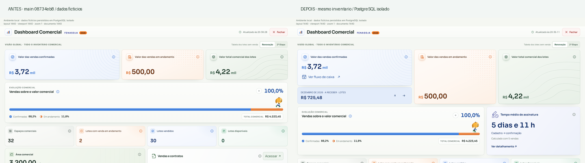

# Fluxo comercial e tempo de assinatura

Implementação sobre `08734eb8ce0f087ddc220af1c919c4c141a15b6c`. A migração `20261021223000_commercial_sales_analytics.sql` foi aplicada **somente ao PostgreSQL isolado**. O schema ativo foi inspecionado em leitura; nenhum pagamento ou venda de teste foi criado no ambiente ativo.

O resumo compartilha uma geração com a revisão do mapa. As parcelas persistidas alimentam as duas bases (principal e cobrança); a elegibilidade vem dos itens assinados e suas vendas vigentes. O rateio analítico conserva os centavos de cada parcela e componente; taxas de pedidos parcialmente assinados permanecem excluídas. Divergências e valores sem cronograma aparecem na cobertura. PAID/PENDING é a fonte disponível de baixa: não há inferência de recebimento parcial nem integração duplicada com o Financeiro.

A conclusão da assinatura é registrada na mesma transação da confirmação, uma vez por ciclo original. O backfill exige histórico simples e comprovável. Revisões não fabricam outro evento; ciclos posteriores permanecem fora da média original. As novas RPCs revalidam `map.manage_sales` e não retornam documentos ou dados pessoais nos agregados.

## Verificação

- `npm run typecheck` e `npm run build`: passaram.
- Testes relevantes de Dashboard, navegação, resumo, revisão e novos contratos: passaram.
- Suíte completa: 3.810 passaram, 91 falharam; os mesmos 91 testes já falham no commit base. O teste adicional da transição da nota também passou após essa execução completa.
- PostgreSQL 18.4 isolado: centavos, 20 itens sem multiplicação, confirmação parcial, taxas, datas, permissões/RLS, outra organização, retry, concorrência, rollback, baixa/estorno de estado e invariantes passaram. As funções reais de autorização e confirmação foram usadas com adaptadores locais de sessão/organização; isso não representa uma sessão Supabase autenticada em produção.
- Carga sintética de 139 pedidos × 17 parcelas: plano e tempo em [database-report.json](database-report.json). A projeção foi otimizada de aproximadamente 942 ms para 88 ms no mesmo ambiente local; não é benchmark de produção.
- Chrome Leo: capturas em 1440, 1280, 390 e 430 px, com dados fictícios lidos do PostgreSQL. Navegação, bases, mês, retorno e detalhes conferidos. Sem teste em aparelho físico ou teclado virtual real.

## Reproduzir em ambiente isolado

Requer PostgreSQL local em `127.0.0.1:55438`, usuário `postgres`, senha de teste `local-financial-tests`. O script recria exclusivamente o banco descartável `commercial_analytics_test`; não aceita URL remota.

```sh
node scripts/commercial-analytics/database-qa.mjs
node scripts/commercial-analytics/prepare-review.mjs
node scripts/commercial-analytics/review-server.mjs
# Em outro terminal:
npx vite --config scripts/commercial-analytics/review.vite.config.ts
```

Abrir `http://127.0.0.1:8088/scripts/commercial-analytics/review.html`; `?baseline` renderiza o componente do commit base com o mesmo inventário fictício. O adaptador HTTP é restrito a loopback e RPCs de leitura. O metadado de escala e a instrumentação da página de revisão são exclusivos desse harness, sem alterações no viewport da aplicação.

Para produção, aplicar a migração pelo runner transacional vigente e validar a releitura autenticada. A guarda interrompe a aplicação se o contrato de `confirm_sale_order_items` tiver mudado desde a inspeção; nesse caso, reconciliar a definição antes de executar.


