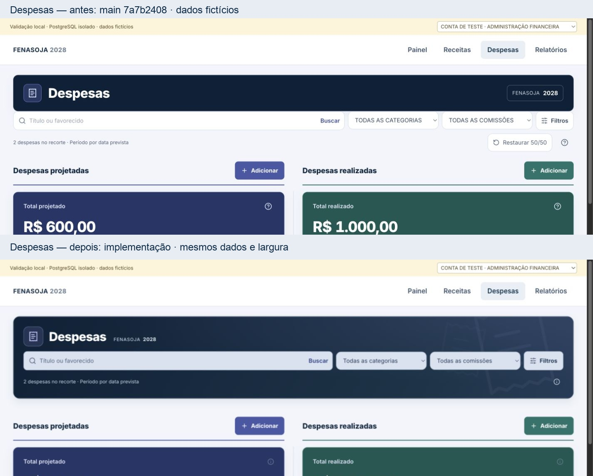
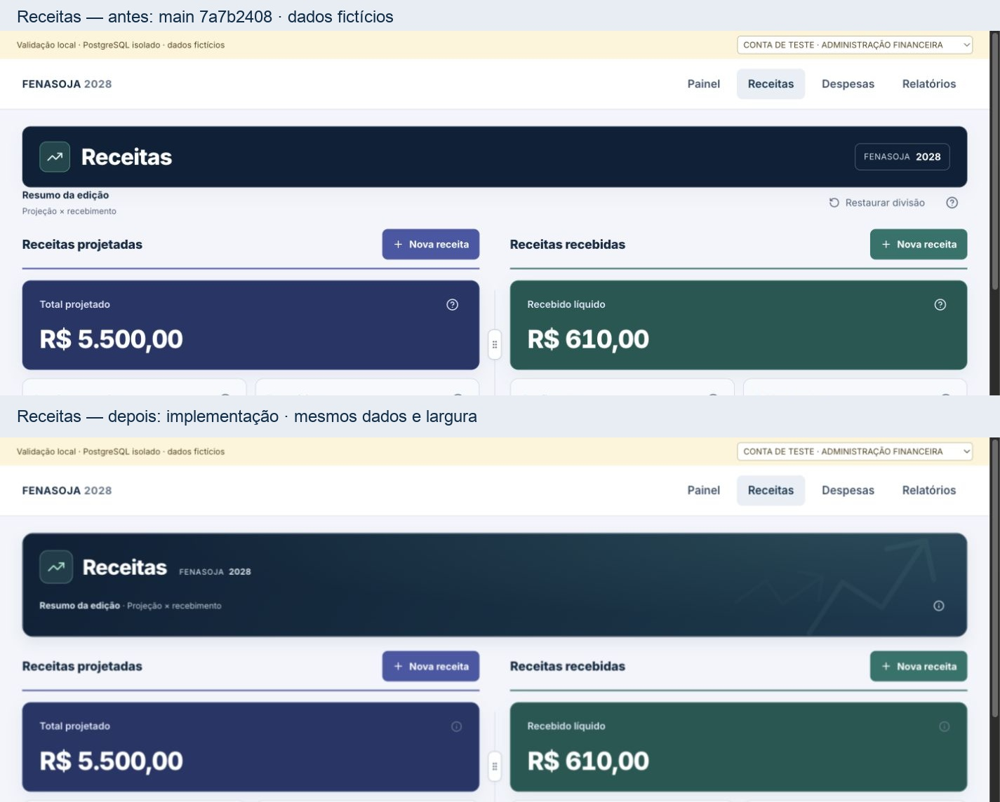

# Conferência visual — Financeiro 2028

Resultado: composição verificada no navegador local, sobre os componentes reais e dados fictícios persistidos em PostgreSQL. A referência anterior foi renderizada a partir de `main` em `7a7b2408`, no mesmo host de revisão e sobre os mesmos dados. Os anexos do usuário orientaram a hierarquia e as correções; o resultado é uma evolução deliberada dessas telas.

## Antes/depois

Os comparativos usam recortes iguais do topo, sem deformar os screenshots. A viewport CSS foi medida; as dimensões dos bitmaps nativos estão registradas separadamente em [visual-checks.json](evidence/visual-checks.json).

| Viewport CSS medida | Despesas anterior / final | Receitas anterior / final |
|---|---|---|
| 1440 × 900 | [antes](evidence/expenses-before-1440.jpg) · [depois](evidence/expenses-1440.jpg) | [antes](evidence/revenues-before-1440.jpg) · [depois](evidence/revenues-1440.jpg) |
| 1280 × 900 | [antes](evidence/expenses-before-1280.jpg) · [depois](evidence/expenses-1280.jpg) | [antes](evidence/revenues-before-1280.jpg) · [depois](evidence/revenues-1280.jpg) |
| 390 × 844 | [antes](evidence/expenses-before-390.jpg) · [depois](evidence/expenses-390.jpg) | [antes](evidence/revenues-before-390.jpg) · [depois](evidence/revenues-390.jpg) |
| 430 × 844 | [antes](evidence/expenses-before-430.jpg) · [depois](evidence/expenses-430.jpg) | [antes](evidence/revenues-before-430.jpg) · [depois](evidence/revenues-430.jpg) |

## Verificações realizadas

- Busca, categoria, comissão, Filtros e contexto de Despesas integram a mesma árvore/card. A busca por Enter chegou a um registro e a limpeza recuperou dois, no conjunto fictício.
- O card de Despesas mede 200 px de altura no desktop. Os controles usam a mesma superfície azul acinzentada, sem os quatro retângulos brancos da captura inicial.
- O contexto de Receitas fica subordinado ao título. A busca dos registros continua explicitamente local à lista carregada; os indicadores e o ranking usam agregados completos do servidor.
- Nenhum botão/texto de restauração aparece nas duas telas. O divisor continua ajustável por teclado; testes de preferência e de filtros foram preservados.
- Não foi observado overflow horizontal nas quatro viewports. Em mobile, categoria e comissão ficam no popover de Filtros, sem controles duplicados.
- [Filtros mobile](evidence/expense-filters-390.jpg), [cadastro mobile](evidence/expense-composer-390.jpg) e [cronograma](evidence/revenue-plan-1440.jpg) documentam as superfícies reais.
- Controles do formulário mediram 44 px de altura e fonte de 16 px em mobile. Na área reduzida de 390 × 430, o modal ficou entre y=8 e y=422; o rodapé permaneceu visível entre y=329 e y=421, com rolagem interna e sem overflow horizontal.
- A ajuda foi verificada no navegador por clique e Escape e nos testes por hover, foco, teclado e eventos DOM de toque. Não submete o formulário. O navegador integrado não oferece despacho nativo de toque para este teste.
- `prefers-reduced-motion: reduce` resultou em `animation-name: none` nos paths dos ícones. A ampliação visual de 200% foi emulada; também foi conferida a reorganização em 720 × 450. Isso não é um teste de aparelho físico ou de leitor de tela.
- Contraste calculado dos controles coloridos: texto `#203a59` sobre `#d8e2f2`, 8,88:1; placeholder `#4c617e`, 4,85:1. Foco do campo tem contorno escuro interno e contorno claro externo contra o card azul. Estes valores não constituem uma declaração geral de conformidade de acessibilidade.
- O fluxo gravou duas receitas em lote e uma despesa, reutilizou os quatro tipos de referência e releu os mesmos registros/parcelas após reload e em nova aba. O recebimento parcial de teste e seu estorno atualizaram os saldos. A exportação baixada contém seis fatos e 16 linhas separadas de parcelas.

## Limites explícitos

Sem teste em celular físico, teclado virtual real, leitor de tela ou login interativo das quatro contas no aplicativo publicado. A redução de viewport simula a área disponível; não simula todos os comportamentos de um teclado real. O host de revisão tem contexto de identidade de teste; as leituras e gravações financeiras passam por PostgreSQL real, papel `authenticated`, RPCs e RLS.

O schema já foi aplicado ao banco conectado. A interface desta PR ainda depende de merge/publicação; as capturas não representam o aplicativo publicado em produção.
