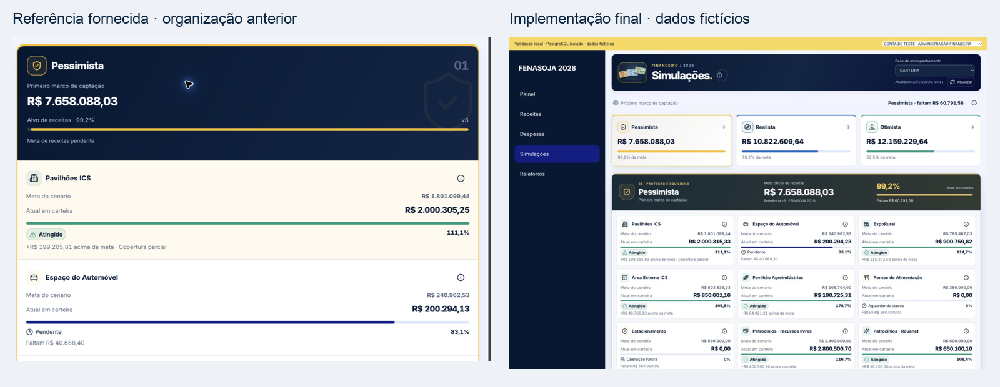

# Revisão visual — Product Design

Comparação da referência fornecida com os componentes reais no harness isolado. As alterações de organização e identidade seguem as orientações posteriores do proprietário: um cenário em foco, grade compacta de categorias, informações no i, mosaico sem tabela e comparador por categoria. Os screenshots contêm somente **dados fictícios**; não representam vendas ou saldos da FENASOJA.

## Resultado

- Hero compacto, aproximadamente 112 px no desktop e 134 px em 390 px. A referência intermediária enviada tinha aproximadamente o dobro da altura. O cenário em foco tem masthead de 112 px no desktop, com identidade, meta e progresso próximos.
- Nove categorias em três colunas nas larguras de 1440 e 1280 px, duas em recortes intermediários e uma em celulares. Ícones centralizados; valores completos e comparação em centavos. Resumo da base abaixo do cenário. Orçamento/reserva lado a lado no desktop, capacidade abaixo.
- Participação em mosaico de aproximadamente 338 px de altura no desktop: percentuais, identidade por fonte e valores com contraste reforçado. A área dos blocos não representa escala monetária; os percentuais explícitos representam a participação.
- Comparador com categoria selecionável, atual e meta lado a lado e diferença em destaque. Sem tabela nessa superfície. As composições autorizadas e o histórico continuam disponíveis em detalhes acessíveis.
- Subtotal e total com superfícies claras e grafismos distintos. Aviso geral de cobertura removido conforme solicitado; limitações permanecem nas categorias afetadas e nos detalhes de fonte. Alertas de falha real preservam última fotografia e data.
- Notas ilustradas em SVG: US$ 10 laranja, US$ 20 azul, US$ 100 verde; retratos em gravura, molduras, selos, textura e fundo institucional. Entrada com atrasos de 0, 320 e 640 ms, destaque breve e flutuação. Apenas o emblema mantém movimento sob `prefers-reduced-motion`, por pedido explícito do proprietário. Ele pausa fora da tela/aba oculta e dispõe de controle de pausa no i. As demais animações respeitam a preferência do sistema. Os indicadores financeiros continuam em BRL.
- Modais e popovers recebem superfície branca opaca, sem depender de tokens herdados pelo portal. Contraste do modal conferido após a animação: fundo `rgb(255,255,255)` e opacidade `1`. Botão fechar e foco visíveis.

## Evidências e verificações

| Ensaio | Resultado / evidência |
|---|---|
| 1440 × 1000 | Grade de 3 colunas, sem overflow global: [desktop](evidence/screenshots/1440-desktop-synthetic.png) |
| 1280 × 800 | Grade de 3 colunas, sem overflow global: [notebook](evidence/screenshots/1280-notebook-synthetic.png) |
| 390 × 844 | Uma coluna ativa e comparação compacta dos três cenários: [mobile](evidence/screenshots/390-mobile-synthetic.png) |
| 430 × 932 | Orçamento, reserva, capacidade e divergência de referência: [mobile](evidence/screenshots/430-mobile-synthetic.png) |
| Altura de 600 px | Popover rolável, contido na janela (topo ~144, base ~581): [altura reduzida](evidence/screenshots/1280-short-height-synthetic.png) |
| Reflow equivalente a 200% | Janela de 1280 representada por 640 CSS px, sem overflow: [reflow](evidence/screenshots/200-percent-reflow-synthetic.png) |
| Composição por fonte | Modal opaco em desktop e mobile: [desktop](evidence/screenshots/1440-composition-synthetic.png), [mobile](evidence/screenshots/430-composition-synthetic.png) |
| Carteira, Confirmado, Caixa | As três bases abrem; seleção manual permanece após mudança de base e atualização: [caixa](evidence/screenshots/1280-cash-synthetic.png) |
| Falha de rede | Request bloqueado pelo navegador; valores e cenário preservados, aviso em português: [desatualizado](evidence/screenshots/1280-stale-synthetic.png) |
| Acesso | Admin fora do roster negado; leitor autorizado abre: [negado](evidence/screenshots/1280-access-denied-synthetic.png) |
| Teclado | Enter abre i, pausa funciona, Escape fecha e retorna foco ao acionador; composição fecha por Escape |
| Reduced motion | Entrada do emblema conserva sequência 0/0,32/0,64 s; transições do restante da interface eliminadas/reduzidas |
| Vazio e operação futura | Alimentação sem registros e estacionamento futuro mantêm metas, sem falsa conquista ou ETA |
| Orçamento excedido | Estado próprio de estouro, diferente de receita atingida; percentual próximo de 100 usa precisão adicional |

Os ensaios foram feitos no navegador integrado e em viewports emulados. Não houve teste em aparelho físico nem zoom nativo do navegador; o ensaio de 200% acima verifica o reflow equivalente. O IAB não oferece despacho de `Input.dispatchTouchEvent`; foram verificados alvos e cliques em viewports móveis, além dos contratos de teclado. Rede, dimensões e preferência de movimento usadas nos ensaios foram restauradas. Não houve login interativo na aplicação de produção; a validação conectada de autorização/contratos está documentada separadamente.
