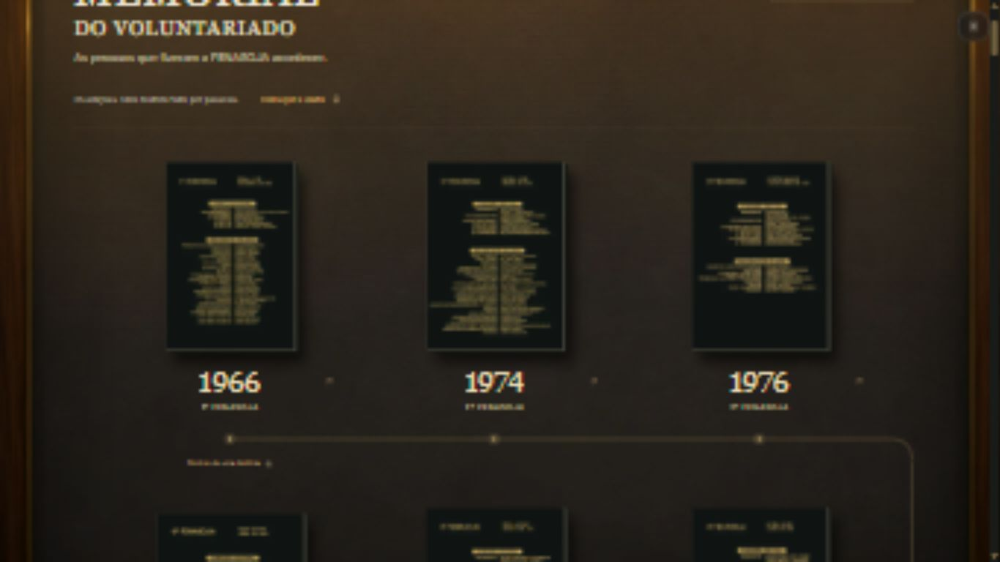
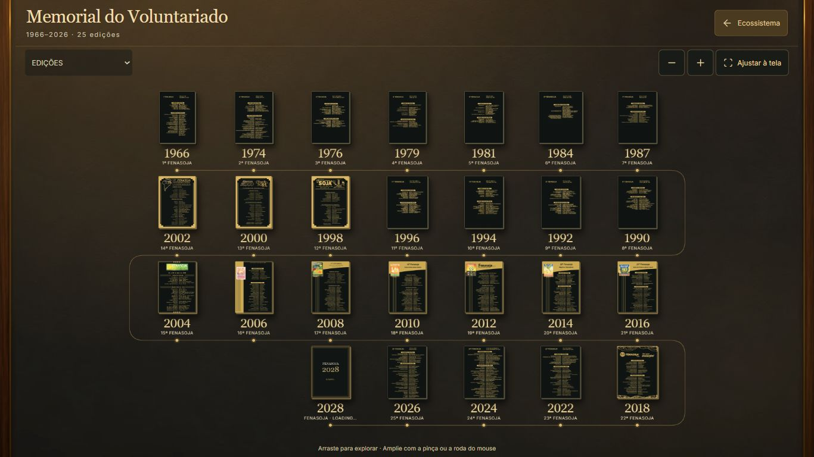
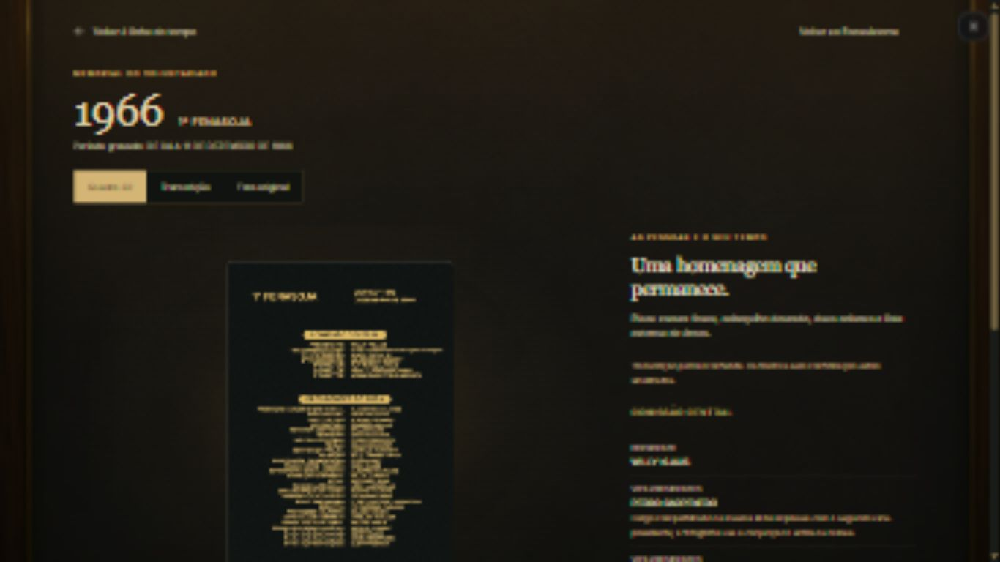
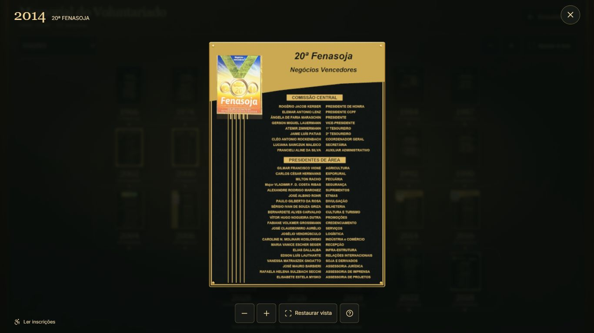
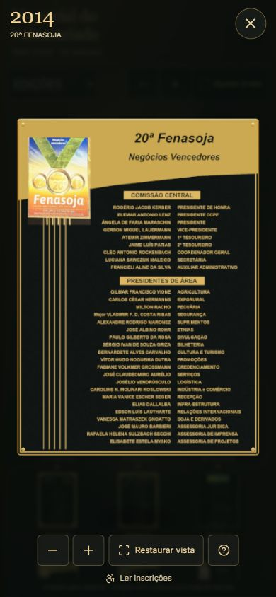
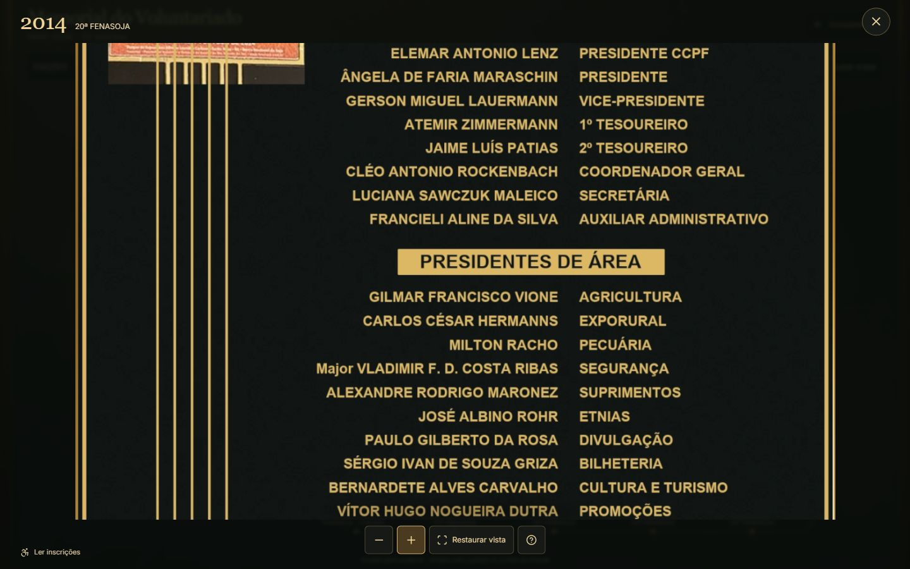

# Memorial do Voluntariado — inspeção direta

Implementação e revisão de 7 de novembro de 2026, sobre `origin/main` no commit `70a4e58b4dd0c07828032d6305e3f8c062d9677a`. Branch: `codex/memorial-inspecao-direta`.

A entrada continua em `/?ecossistema=memorial`, incluindo os parâmetros existentes `edicao` e `documento`. A exposição fica montada enquanto o quadro é inspecionado. Não houve publicação em produção.

## Jornada revisada com Product Design

1. **Entrar pelo ícone ou URL.** O cabeçalho passou a ocupar aproximadamente 78 px no desktop e 92 px no mobile. As placas aparecem imediatamente. A introdução alta, chamada de início e rodapé extenso saíram da exposição.
2. **Reconhecer e escolher uma edição.** O desktop enquadra as 25 edições e o epílogo em sete colunas e quatro faixas. O percurso mantém a ordem serpenteante. No mobile, duas ou três colunas deixam várias peças visíveis; arraste, pinça, roda, comandos e seletor permitem chegar a todas.
3. **Inspecionar diretamente.** Um clique abre a peça frontal sobre um véu escuro, com ano, edição, um X e comandos fora do palco. Foram removidas as três abas e a ficha lateral. O documento de 2020 permanece acessível dentro da edição de 2022.
4. **Ler e retornar.** A inspeção admite giro, zoom e deslocamento ampliado. “Ler inscrições” oferece conteúdo estruturado, inclusive as incertezas do acervo. X, Escape e histórico retornam à galeria com foco no card; a galeria mantém sua transformação.

**Avaliação:** os obstáculos de entrada, excesso de etapas, conflito entre fechamentos e percurso vazio foram corrigidos nas capturas e interações observadas. A vista geral privilegia anos e escolha; a leitura dos nomes ocorre na inspeção ou na leitura estruturada. As capturas não certificam acessibilidade nem comportamento físico de toque.

| Antes, produção | Depois, implementação local |
| --- | --- |
|  |  |
|  |  |

[Registro curto de interação](interaction.html): reprodução de quatro capturas da escolha, inspeção, manipulação e retorno. É uma sequência de imagens, não um vídeo contínuo nem medição de fluidez. Os estados comparados estão em [interaction.json](evidence/interaction.json).

## Acabamento e fidelidade com Creative Production

Foram aplicados os critérios de preservação da fonte e de conteúdo exato do fluxo Creative Production. O painel interativo desse plugin não estava disponível por chamada direta nesta sessão; o refinamento foi implementado no renderizador existente e revisado nas capturas.

- Reutilização das artes, marcas, cores e ambiente de grafite, madeira e latão do acervo.
- Luz quente, bisel com quatro segmentos, bordas metálicas, sombra discreta e repouso frontal estável. A face usa material sem variação de iluminação para manter contraste nas letras.
- Entrada breve a partir da posição do card, interrompida na manipulação; respeito a movimento reduzido. Não há animação contínua consumindo quadros em repouso.
- Remoção determinística de notas editoriais das faces de 1966, 1974, 1979, 1984, 1998, 2004 e 2018. Lacunas não foram completadas com nomes inventados. As transcrições, incertezas, originais e proveniência permanecem associados ao acervo. O manifesto registra a revisão de exposição e os novos hashes.

## Causas corrigidas

**Overflow realimentado pelo SVG:** a lista anterior tinha 4.636 px de altura de layout, mas 11.257 px de `scrollHeight`; o SVG herdava esses 11.257 px. A galeria chegava a 11.652 px. Agora a geometria vem de células em coordenadas do conteúdo, com largura, altura e `viewBox` explícitos. A medida da viewport usa `clientWidth/clientHeight`, sem consultar o overflow do desenho. Em 1366 × 768, layout, `scrollHeight` e SVG medem os mesmos 776 px de conteúdo, antes da escala visual.

**Perda de contexto de navegação:** a inspeção não substitui a galeria. Sua pose é independente da transformação do conjunto; a camada posterior fica inerte. A troca de resolução também não altera a pose. O X externo fica reservado à organização; dentro do memorial há retorno ao Ecossistema ou fechamento do quadro conforme a camada.

**Gestos incompletos:** o controlador compartilhado acompanha múltiplos ponteiros, recalcula centro/distância a cada entrada ou saída e suprime cliques após arraste. `pointercancel`, perda de captura, desfoque, visibilidade e resize encerram referências pendentes. Os listeners de roda e `touch-action` ficam restritos às superfícies; são removidos no descarte.

**Nitidez limitada:** a inspeção apresenta primeiro a miniatura de 420 px e promove a textura conforme projeção, DPR, zoom, origem e limite da GPU. O orçamento da face RGBA com mipmaps é de até 16 MiB em capacidade reduzida ou 32 MiB no perfil normal; a promoção pode manter a face anterior e a nova simultaneamente por um instante. Há descarte de texturas, bitmaps, materiais, geometria, ambiente, listeners e tarefas pendentes. Só a peça ativa usa WebGL.

Na observação de 2014, a textura passou de 732 × 1024 para 1463 × 2048 sem alterar a pose; a estimativa da face final com mipmaps foi 15.979.862 bytes. [Medição](evidence/texture-promotion.json). Não é uma medição da memória total da GPU.

**Falha de WebGL:** a mesma composição mantém imagem de alta resolução, zoom e deslocamento 2D, indicação curta e tentativa de retorno ao 3D. O descarte evita forçar perda de contexto em um canvas ainda conectado que React possa reutilizar.

## Matriz de navegador

Validação em navegador Chromium integrado ao Codex, no Windows. Dimensões abaixo são as medidas CSS efetivamente lidas no DOM, não apenas o tamanho solicitado ao emulador. As capturas finais têm as dimensões correspondentes; [manifesto](evidence/capture-dimensions.json).

| Viewport CSS | Colunas | Peças inteiras visíveis inicialmente | Cabeçalho | Altura do conteúdo = SVG = scrollHeight |
| --- | ---: | ---: | ---: | ---: |
| 1366 × 768 | 7 | 26 | 78 px | 776 px |
| 1440 × 900 | 7 | 26 | 78 px | 776 px |
| 1920 × 1080 | 7 | 26 | 78 px | 776 px |
| 360 × 800 | 2 | 6 | 92 px | 2414 px |
| 390 × 844 | 3 | 15 | 92 px | 1686 px |
| 430 × 932 | 3 | 15 | 92 px | 1686 px |
| 844 × 390, paisagem | 5 | 5 | 68 px | 1140 px |

“26” inclui as 25 edições e o epílogo. O conteúdo mobile ultrapassa a altura da superfície, com deslocamento limitado ao seu tamanho real. O teste em 360 px adotou duas colunas porque a largura útil interna é menor que 350 px.

- [Métricas completas](evidence/viewport-metrics.json) e [repetição de resizes](evidence/resize-stability.json): alturas retornaram a 1686/776 px sem crescimento acumulado.
- [Todas as identidades](evidence/edition-identities.json): 25 quadros abertos no fluxo real, com título e identificador do renderizador correspondentes; 2012 = 19ª e 2014 = 20ª edição.
- Entrada pelo ícone, link direto, recarga, documento de 2020 vinculado a 2022, 2028, X, Escape, voltar/avançar e restauração de foco/transformação verificados.
- Arraste e roda reais pelo navegador; alternativas por teclado para giro, pan, zoom e restauração. [Contenção do foco](evidence/keyboard-focus.json): Shift+Tab no X alcança “Ler inscrições”; Tab no último comando retorna ao X.
- [Transições 1→2→1 e interrupções](evidence/gesture-transitions.json), [gestos da galeria](evidence/gallery-gestures.json): Pointer Events sintéticos no harness isolado, com captura substituída para permitir eventos artificiais. Esses ensaios não equivalem a multitoque físico.
- Perda de contexto e ausência de WebGL verificadas separadamente, mantendo interação 2D. [Perda de contexto](evidence/fallback-context-loss.jpg), [WebGL indisponível](evidence/fallback-no-webgl.jpg).

## Checks

- `npm test -- --maxWorkers=2 src/features/memorial src/features/alvorada/ecosystemNavigation.test.ts`: **46/46**, seis arquivos.
- ESLint dos arquivos TypeScript/TSX alterados: **sem erros ou avisos**.
- `npm run typecheck`: **passou**.
- `NODE_OPTIONS=--max-old-space-size=8192 npm run build`: **passou**, em 1 min 17 s na execução final. Permanecem avisos de tamanho de chunks e Browserslist desatualizado.
- `npm test -- --maxWorkers=2`: execução geral durante o desenvolvimento, complementada pelos 46 testes focados finais: **4281 passaram, 94 falharam**, em 507 arquivos (452 passaram, 55 falharam). A suíte geral não está verde.
- Comparação dos 55 arquivos com snapshot de `origin/main`: **92 falhas idênticas**, pelos mesmos nomes de teste, em 53 arquivos. Os dois restantes eram timeouts de 5 s. Reexecução isolada desses dois arquivos na implementação: **15/15 passaram**. [Comparação rastreável](evidence/baseline-comparison.json).

As falhas reproduzidas pertencem a contratos e jornadas preexistentes do Mapa Comercial, Agenda, portal e marca Alvorada. Não foram corrigidas ampliando o escopo desta PR. Logs completos locais permanecem em `artifacts/memorial-*.log`; a evidência resumida e os nomes dos arquivos estão versionados.

## Arquivos e responsabilidades

| Arquivo/grupo | Alteração |
| --- | --- |
| `src/features/memorial/MemorialExperience.tsx`, `PieceDetail.tsx` | Galeria persistente, inspeção direta, foco, leitura estruturada e comando documental |
| `Timeline.tsx`, `timelinePath.ts`, `surfaceMath.ts` | Distribuição responsiva, serpentina, coordenadas estáveis, limites e zoom ancorado |
| `SurfaceControls.ts` | Pointer Events, pinça, roda, cancelamento e limpeza |
| `MemorialViewer.tsx`, `inspectionMath.ts`, `scene/PlateRenderer.ts` | Pose, enquadramento, materiais, texturas progressivas e fallback 2D |
| `memorial.css` | Viewport, hierarquia compacta, camadas, áreas seguras e estados acessíveis |
| `src/features/alvorada/FenasojaEcosystemExperience.tsx` | Hierarquia de fechamento e contenção de foco |
| `assets.json`, sete faces e suas miniaturas | Revisão determinística de notas editoriais, hashes e proveniência |
| `scripts/memorial/reconstruct-faces.py`, `qa.tsx`, `qa.vite.config.ts` | Reprodução das faces e ensaios isolados de falha/gestos |
| Testes do memorial, este relatório e `evidence/` | Regressão de jornada, limites, gestos, recursos e evidências |

`catalog.ts`, `catalog.json`, transcrições e `ecosystemNavigation.ts` mantêm os contratos existentes. Seus testes foram executados.

## Limites observados

- Não houve acesso a iPhone/Android físico nem Safari. Multitoque foi sintético; áreas seguras e orientação foram verificadas por layout/emulação. É necessário ensaio físico para afirmar compatibilidade nesses aparelhos.
- Teclado, semântica, foco e leitura estruturada foram verificados; não houve sessão com leitor de tela nem certificação de acessibilidade.
- Não há promessa de 60 FPS, benchmark de GPU ou rede móvel real. O desenho usa renderização sob demanda; os checks gerais concorreram com parte da sessão de navegador.
- A qualidade da inscrição continua limitada pela arte de origem. A promoção de textura evita a redução anterior, mas não inventa detalhe ou nomes ausentes.
- A consulta do organograma retornou erro de rede na sessão local. Seu ícone de Memorial continuou disponível e a entrada foi testada. Não foi validada a saúde do serviço do organograma.
- O ambiente local apresentou troca de contexto durante hot reload; o descarte foi corrigido e as 25 peças foram reabertas com estado 3D pronto após a correção.

## Reprodução

`npm run dev -- --host 127.0.0.1 --port 8080`, depois abrir `http://127.0.0.1:8080/?ecossistema=memorial`. O registro fica em `/docs/memorial/upgrade/interaction.html`.

Harness isolado: `npx vite --config scripts/memorial/qa.vite.config.ts`, depois `/scripts/memorial/qa.html?ecossistema=memorial&edicao=fenasoja-2014`. As ações “Testar transições de toque” e “Simular perda de contexto” pertencem apenas a esse harness. `&webgl=off&motion=reduce` exercita a ausência de WebGL com movimento reduzido.
