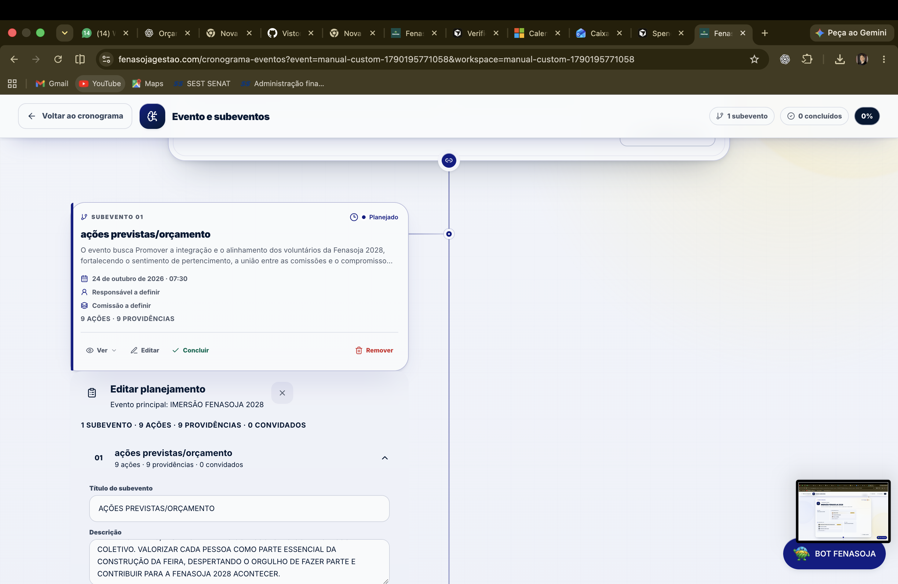
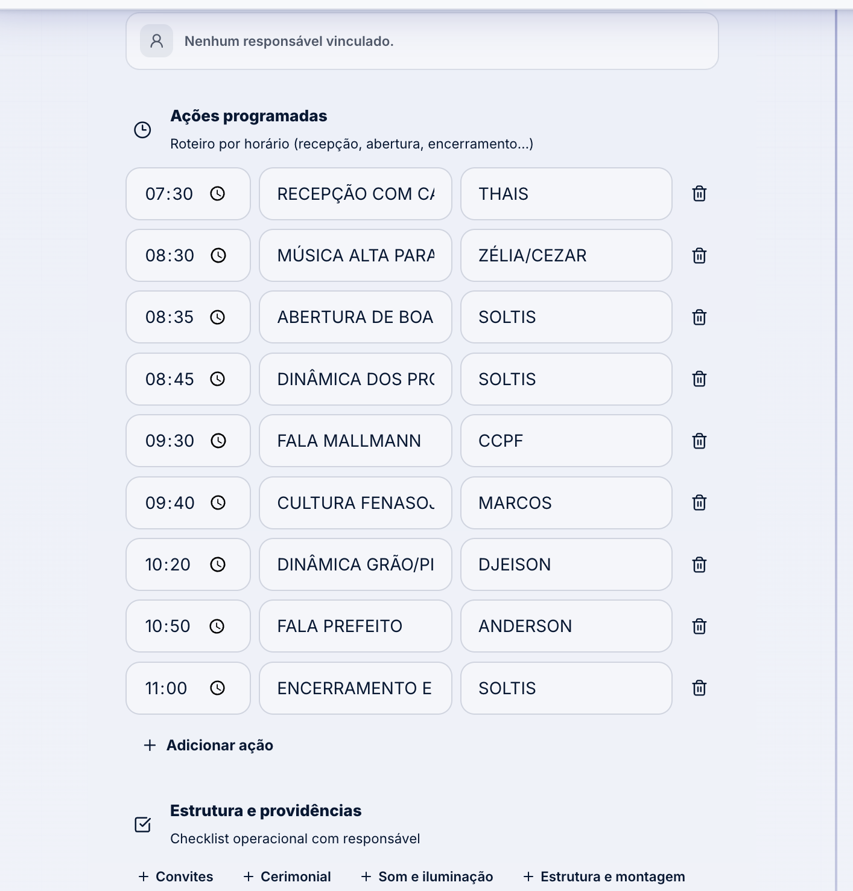
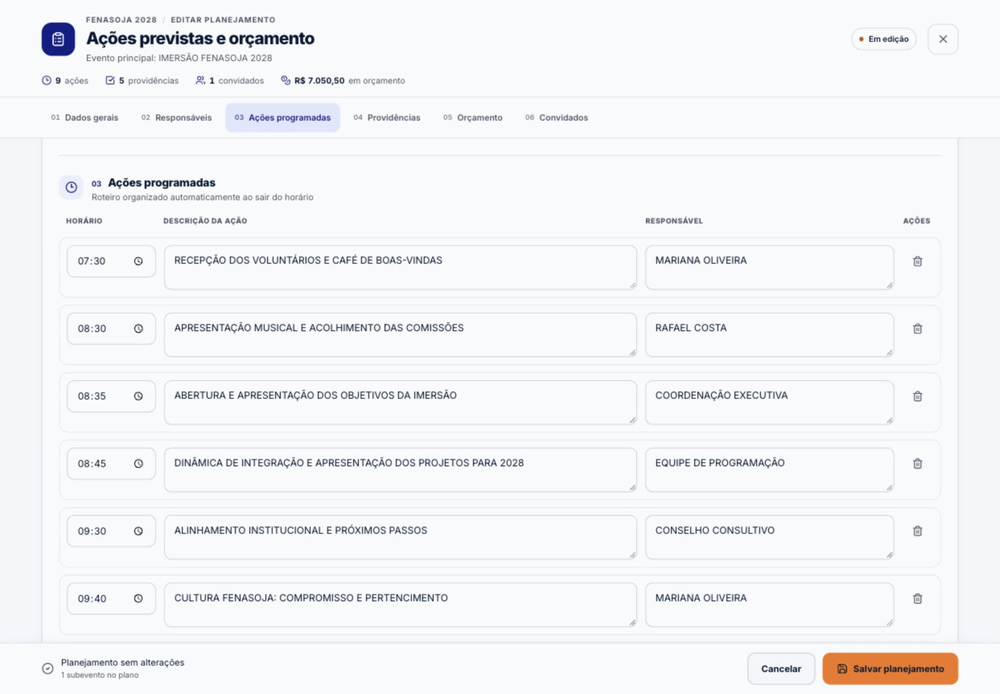
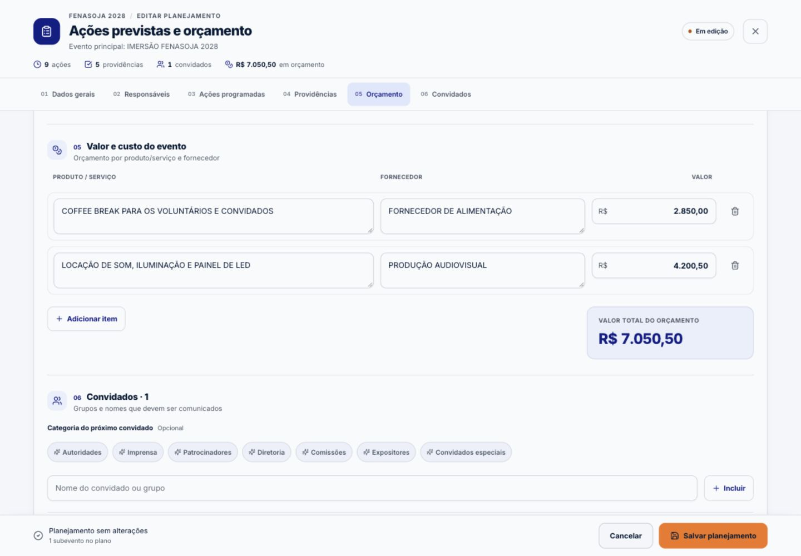
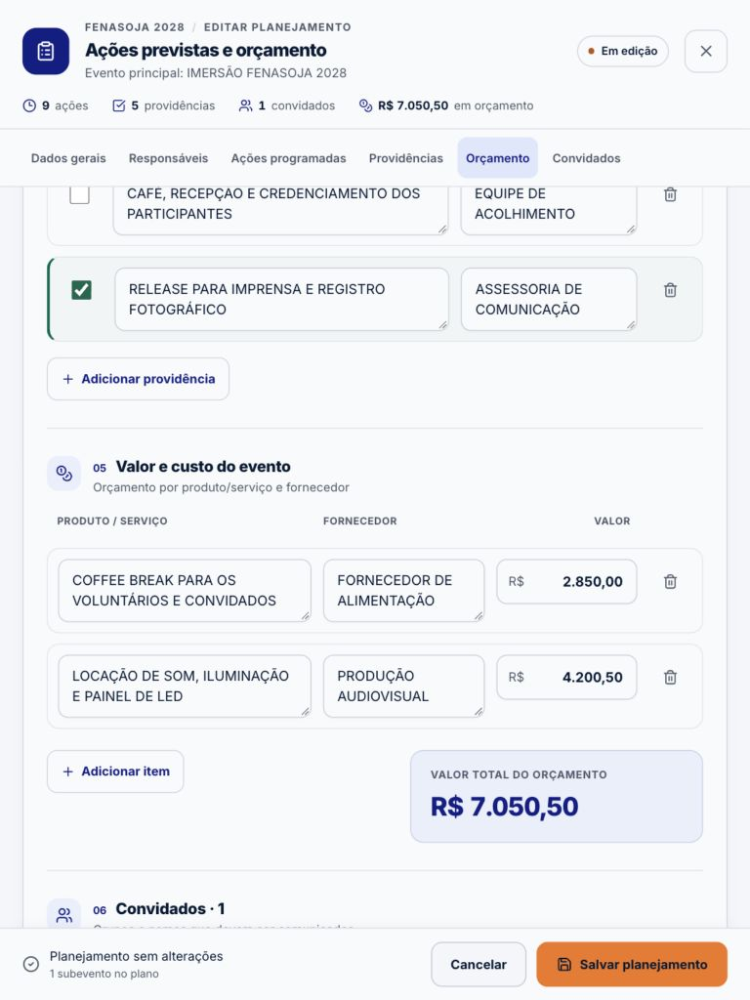
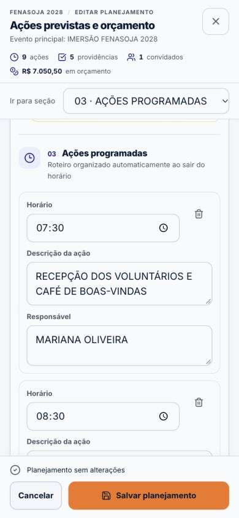
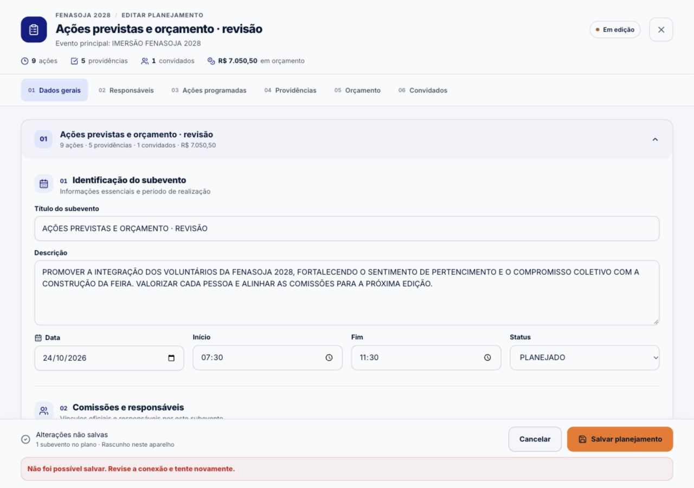
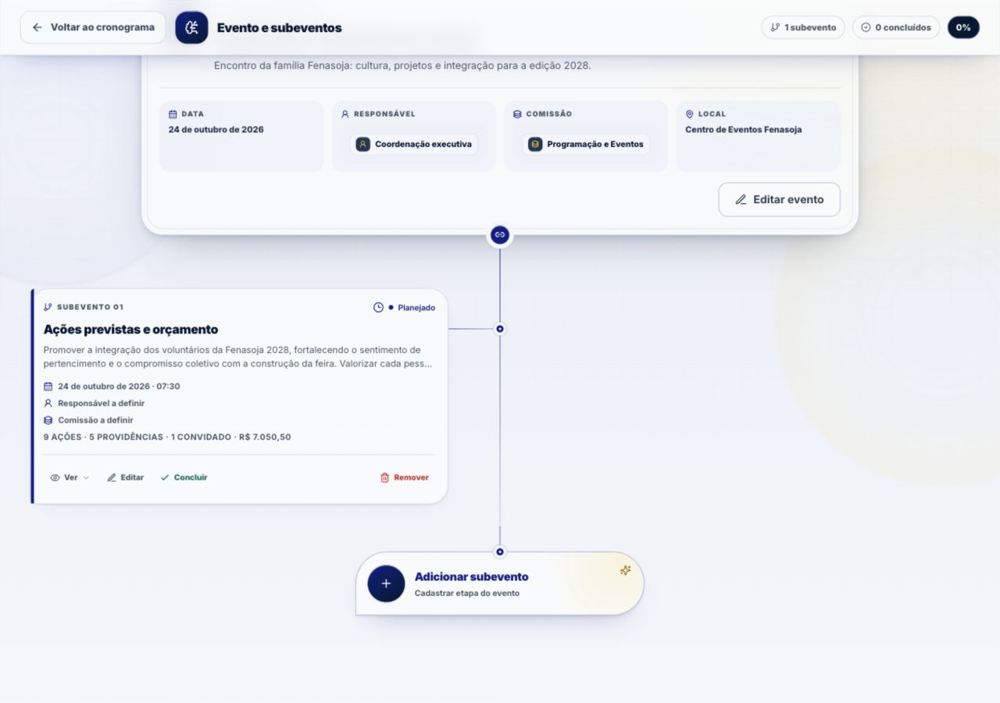

# Editor de planejamento de subeventos — Fenasoja 2028

Implementação em 20/10/2026. Referência original: `3cd79ab9`.

## Diagnóstico e decisões

As capturas fornecidas mostram o construtor ocupando apenas o ramo esquerdo da árvore. O problema não era uma largura isolada de input: `EventRelationshipWorkspace` montava `SubeventPlanBuilder` dentro de `.cronograma-branch-content`, que divide a área com a linha central e o ramo oposto. A descrição das ações, os responsáveis e as providências disputavam essa largura. O botão de salvar ficava depois de todas as listas.

1. **Abrir edição — corrigido.** Uma sessão de edição guarda o subevento selecionado fora da lista filtrada. O construtor usa um portal com Dialog Radix em tela inteira. A árvore permanece montada e conserva seu contexto.
2. **Preencher — corrigido.** Seis seções numeradas separam identificação, relações, ações, providências, orçamento e convidados. Índice por botões no desktop e seletor no celular; navegação interna por `scrollTo`, sem hashes ou histórico.
3. **Operar listas — corrigido.** Grids proporcionais no desktop, campos de texto com quebra de linha, responsáveis legíveis, remoção separada e checklist com sinalização de conclusão. No celular, cada linha vira um card com labels visíveis.
4. **Conferir orçamento/convidados — corrigido.** Valores alinhados à direita, total destacado, sugestões de categoria separadas de convidados efetivamente incluídos. Categorias existentes preservadas.
5. **Salvar/retornar — preservado e validado.** O callback existente é aguardado. Sucesso fecha o editor; erro mantém campos e rascunho, apresenta mensagem e permite nova tentativa. O foco retorna ao botão de origem com `preventScroll`.
6. **Sair com alterações — reforçado.** Confirmação oferece continuar editando, manter rascunho ou descartar. O descarte da faixa de rascunho também exige confirmação.

### Arquitetura

- Contrato público do construtor mantido: `connectedTo`, `defaultDate`, `initialSubevents`, `mode`, `draftKey`, `onSubmit` e `onCancel`.
- Mesma superfície para criação e edição; criação múltipla continua disponível. O fallback `SubeventComposer` permanece para consumidores sem `onSaveSubeventPlan`.
- Cabeçalho, navegação e rodapé são regiões fixas da composição flex. Somente `.cronograma-plan-editor-scroll` rola. Conteúdo central de até 1.400 px, com gutters proporcionais e safe area no rodapé.
- Uma sessão captura os valores iniciais, impedindo que um refetch da árvore remonte o editor. Campos de subeventos são montados na primeira expansão e permanecem montados ao alternar; itens ainda não visitados não montam todo o formulário.
- Chaves visuais em `WeakMap` sobrevivem aos patches imutáveis e à exclusão de linhas anteriores, sem inserir campos novos nos dados persistidos. Ações continuam usando IDs/`clientKey` existentes. Ordenação usa o mesmo `sortActionsByTime` no blur e no envio; restauração de foco após a movimentação usa um único frame cancelável, sem scroll.
- Submissões repetidas são bloqueadas sincronicamente. Campos ficam desabilitados enquanto o callback está pendente. Cálculos do resumo usam `useMemo`; nenhuma dependência nova foi adicionada.
- Tokens OKLCH existentes (`primary`, `action`, `surface-*`, `border`, `success` etc.), componentes Input/Textarea/Button e seletores oficiais reutilizados. CSS restrito ao portal; árvore e rundown não receberam mudanças visuais.
- Radix gerencia foco, bloqueio do fundo, Escape e diálogos relacionais sobrepostos. Título/descrição do diálogo, regiões nomeadas, labels, erro anunciado, foco de validação e estado de salvamento acessível. Motion respeita `prefers-reduced-motion`.

### Componentes inspecionados e preservados

| Componente | Papel confirmado |
| --- | --- |
| `CronogramaEventosPage.tsx` | Callback transacional atual, adaptação do payload e lazy loading do workspace; sem alterações |
| `SubeventComposer.tsx` | Formulário simples usado como fallback; sem alterações |
| `SubeventPlanRundown.tsx` | Leitura de ações/checklist/orçamento/convidados; sem alterações |
| `CronogramaSubeventForm.tsx` | Editor de subeventos dentro de EventForm; sem alterações |
| `RelationalMultiSelect.tsx` | Pesquisa, múltipla seleção, registro oficial, destaque principal, loading e erros já existentes; reutilizado sem alterar identidade ou comportamento global |
| `cronograma-workspace.css` / `cronograma-plan-builder.css` | Layout da árvore e estilos existentes; sem alterações |
| `planBuilderUtils.ts` | Ordenação e lógica monetária; sem alterações |

## Arquivos da entrega

- `src/components/cronograma-eventos/workspace/EventRelationshipWorkspace.tsx`: sessão de edição fora dos ramos e fechamento após sucesso.
- `src/components/cronograma-eventos/workspace/SubeventPlanBuilder.tsx`: superfície modal, hierarquia dos formulários, responsividade, chaves/foco e proteção de edição.
- `src/styles/cronograma-plan-editor.css`: estilos encapsulados do editor.
- `src/test/cronogramaPlanEditor.test.tsx`: oito testes de integração cobrindo as operações e os casos de falha.
- `scripts/subevent-planning/`: prévia local isolada e configuração reproduzível da comparação com o baseline.
- `docs/qa/subevent-planning/`: relatório, comparação automatizada e capturas.

## Validação técnica

| Verificação | Resultado |
| --- | --- |
| `npm run typecheck` | Passou |
| `npm run build` | Passou; avisos de chunks grandes já existentes |
| `npm test -- src/test/cronogramaPlanEditor.test.tsx src/test/cronogramaRelationshipWorkspace.test.tsx src/test/cronogramaPlanBuilderUtils.test.ts` | 17/17 passaram |
| `npm test` (suíte completa) | 3.777 passaram; 91 falharam, em 52 arquivos |
| Baseline dos dois componentes originais | 3.769 passaram; as mesmas 91 falhas nos mesmos 52 arquivos |
| Comparação por arquivo + nome completo do teste | Zero falhas novas e zero falhas resolvidas |
| `git diff --check` | Passou |

A suíte completa foi executada após a reconstrução e comparada ao código original. O ajuste final de foco/expansão foi novamente validado pelos 17 testes específicos, typecheck e build. As falhas anteriores abrangem contratos/cartografia do mapa, mocks de autenticação/seletores da Agenda e registro de bots. A lista resumida está em [test-comparison.json](test-comparison.json). Não foram alteradas áreas externas ao escopo para tentar tornar a suíte inteira verde.

Os comandos usaram o npm CLI com o Node do runtime local, pois `npm` não estava no PATH inicial. Não houve alteração de `package.json` ou lockfile.

### Cenários cobertos pelos testes

- Portal fora da árvore, isolamento modal, navegação interna, URL preservada e devolução de foco.
- Valores carregados e campos mantidos durante atualização de fundo.
- Validação de título e foco no campo inválido.
- Ações: edição, ordenação no blur e no envio, exclusão sem trocar nós e texto preservado.
- Providências: descrição, responsável e conclusão mantidos.
- Orçamento: fornecedores, remoção e parsing monetário atual, sem alteração do cálculo.
- Convidados: categoria existente, inclusão e exclusão.
- Comissões e pessoas oficiais em diálogos sobrepostos, com vínculo principal preservado.
- Salvamento pendente, bloqueio de duplicação, falha com dados preservados e nova tentativa bem-sucedida.
- Escape, continuar, manter, reabrir/restaurar e descartar rascunho com confirmação.
- Criação múltipla com expansão sem remontar campos já visitados.
- Regressão existente da árvore: leitura, criação simples/fila, conclusão e remoção.

### Verificação visual/interativa

Navegador integrado, componentes reais, dados demonstrativos e callback local sem acesso autenticado à base.

| Viewport | Resultado observado |
| --- | --- |
| 1280 × 720 e 1280 × 900 | Editor ocupa viewport; cabeçalho/rodapé estáveis e uma área de rolagem |
| 1440 × 1000 | Ações distribuídas horizontalmente, relações em duas colunas e orçamento proporcional |
| 768 × 1024 | Grids ajustados, texto das linhas quebra sem exigir scroll horizontal |
| 390 × 844 | Navegação compacta, cards operacionais, labels e rodapé acessível |
| 320 × 760 | Sem overflow horizontal no documento ou área de trabalho; botões disponíveis |

No navegador, também foram confirmados erro de salvamento com o editor aberto, confirmação de saída, restauração do título digitado, salvamento com retorno à árvore e foco no botão Editar. A edição de horário por teclado moveu uma ação do final para o início mantendo o foco na descrição da mesma ação. Medidas DOM confirmaram cabeçalho em `top=0`, rodapé no limite inferior da viewport e ausência de overflow horizontal.

Limites: não foi feita gravação no banco de produção, nem certificação com leitores de tela ou teclado virtual de aparelhos físicos. Persistência real continua sob o callback original; os testes validam seu payload e a reação à resolução/rejeição. Não há alegação de conformidade integral de acessibilidade nem benchmark de volume extremo.

## Evidências de antes/depois

As imagens “antes” são as capturas de produção fornecidas pelo usuário. As imagens “depois” foram capturadas da implementação com dados demonstrativos. Conteúdo e dimensões diferem; a comparação avalia organização e uso do espaço, sem pretensão de equivalência pixel a pixel.

### Antes: editor subordinado ao ramo





### Depois: ações no workspace dedicado



### Orçamento no desktop e tablet





### Mobile



### Falha e retorno após sucesso





## Escopo preservado

A entrega não altera rotas da aplicação, URLs do cronograma, APIs, endpoints, migrations, tabelas, schemas, permissões, regras de persistência nem estruturas de dados. `budgetTotal`, `parseCurrencyDigits`, adaptação do payload e callback de gravação permanecem os existentes. O HTML da prévia é uma ferramenta local em `scripts/`, fora da entrada de build e do roteador da aplicação.

Uma modificação paralela em `supabase/functions/mcp/index.ts` foi preservada no diretório de trabalho e excluída desta entrega.

## Reproduzir a prévia e a comparação

```bash
npm install
npx vite --config scripts/subevent-planning/preview.vite.config.ts
# Abrir /scripts/subevent-planning/preview.html no servidor local (porta 5273).
# O checkbox da prévia permite simular falha sem acessar APIs.

npm test -- --config scripts/subevent-planning/baseline.vitest.config.ts
```

A configuração de baseline lê os dois componentes em `3cd79ab9` em memória pelo Vite. Ela não substitui arquivos de trabalho, não muda o branch e não executa alterações no banco.
