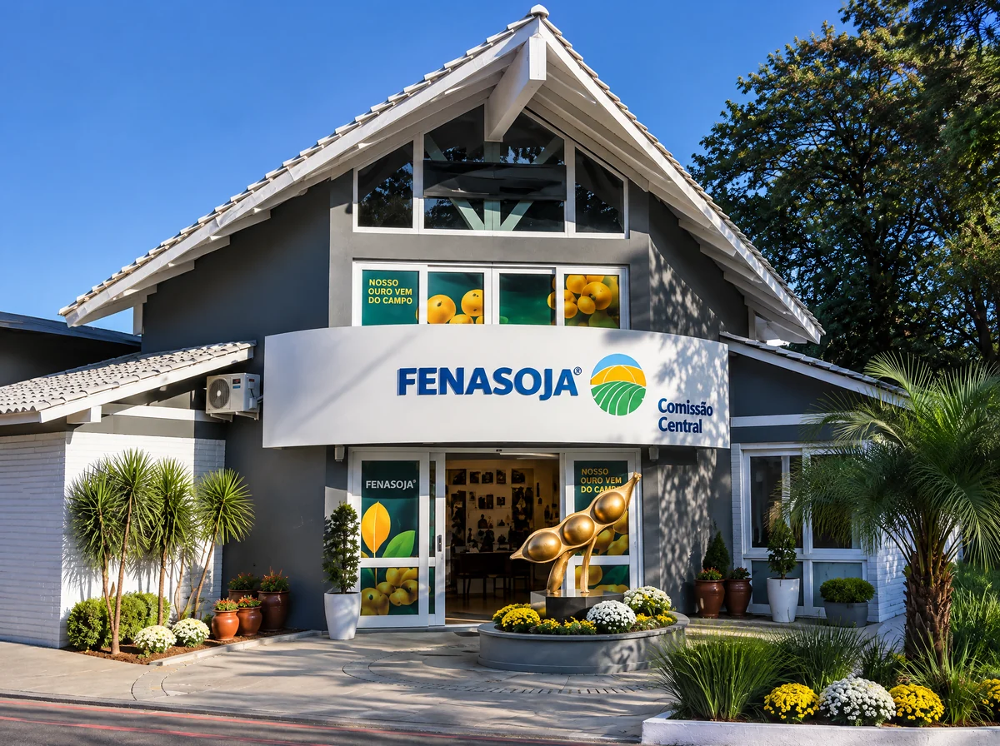
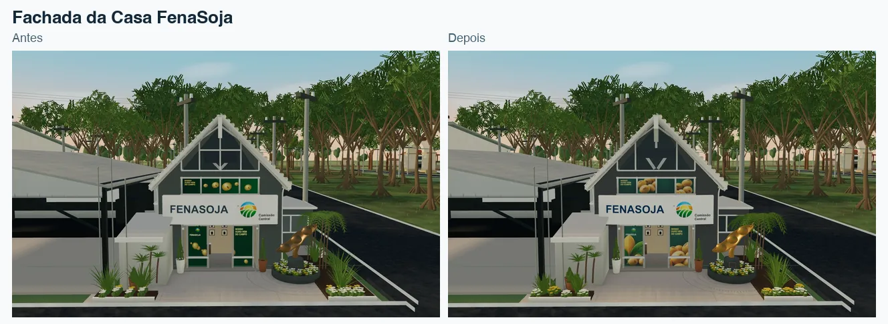
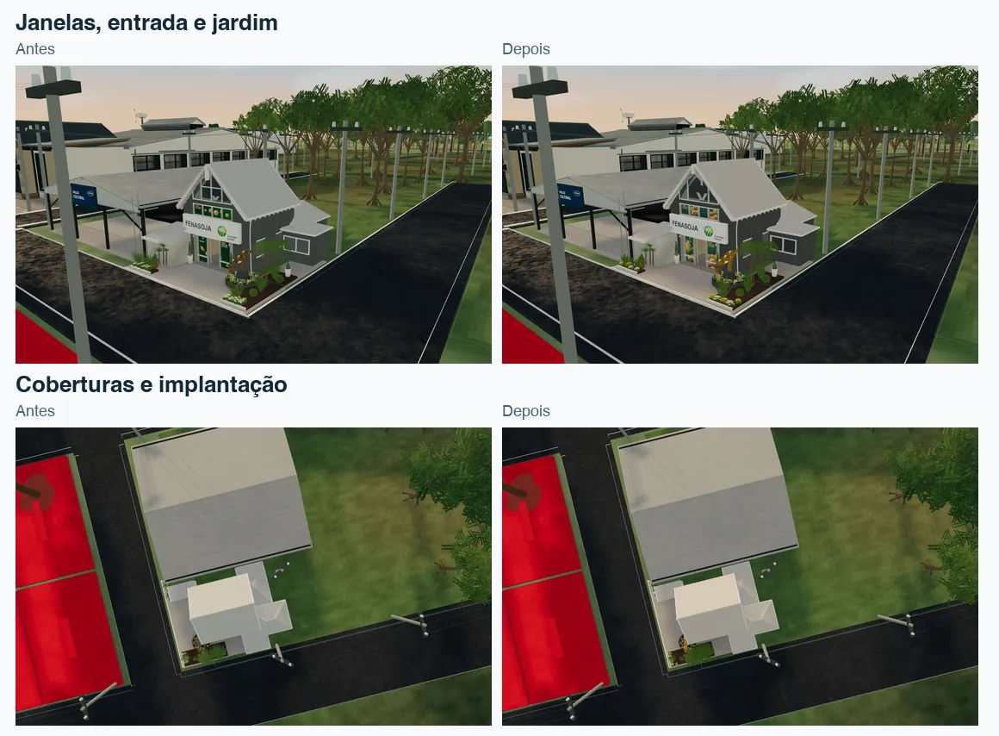
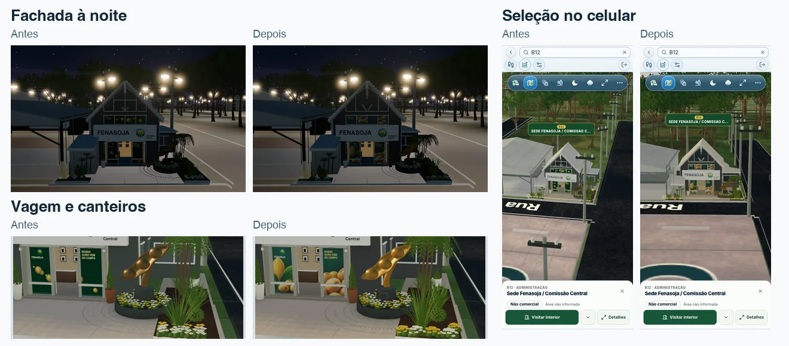

# Casa FenaSoja B12 no Mapa Comercial

A sede mantém a implantação da planta oficial e a fachada voltada à Rua Brasília. A foto da casa orientou a empena, os caixilhos, a placa curva, a entrada, a escultura de três grãos e os canteiros. A vista aérea de 19/03/2026 serviu para conferir o entorno. [Registro cartográfico](../../fenasoja-complex-reconstruction.md) · [Google Earth](https://earth.google.com/web/@-27.84368784,-54.47848789,324.52330494a,90.87332933d,35y,334.89152733h,0t,0r/data=CgRCAggBOgMKATBCAggASg0I____________ARAA)

## Higgsfield e integração

As três gerações foram feitas com GPT Image 2.6 no nível de resolução 2K e na qualidade média, a configuração máxima desse modelo dentro da franquia gratuita. A geração de fachada é a referência visual. As pranchas de materiais e grafismos forneceram cinco WebPs usados no 3D.

| Arquivo | Aplicação | Dimensões |
| --- | --- | --- |
| `stucco.webp` | Grão do reboco grafite | 256 × 256 |
| `ceramic.webp` | Variação mineral da telha clara | 512 × 512 |
| `concrete.webp` | Agregado fino do passeio | 256 × 256 |
| `campaign-windows.webp` | Fundo e grãos da faixa superior | 1.024 × 256 |
| `campaign-entry.webp` | Arte das duas folhas laterais da entrada | 1.024 × 1.024 |

As superfícies foram recortadas e normalizadas para conservar o detalhe das pranchas sob a iluminação do mapa. A marca oficial e os dizeres da fotografia são compostos no mapa por cima da arte. Os cinco arquivos somam 208 kB. O carregamento reaproveita as texturas já alocadas e o material procedural cobre falhas de leitura.

## Capturas do Mapa Comercial

## Validação

- **100/100 cenários** no Chromium 157 (Chrome), com cinco tamanhos de tela, cinco ângulos e quatro estados (dia, noite, chuva e qualidade reduzida). O roteiro conferiu a resposta HTTP, a imagem decodificada, o conteúdo no material, a textura residente na GPU e a presença de uma amostra visível de cada superfície. As cinco texturas passaram em todos os perfis, com um Canvas estável e sem erros de renderização. [Resultados individuais](matrix-100-webp.json)
- A rota `/mapa-comercial` passou em desktop e celular emulado. A busca enquadrou a B12, o clique ou toque direto selecionou a sede, a visita abriu e voltou ao mapa e o palco B13 continuou selecionável.
- A geometria no maior detalhamento caiu de 170.069 para 162.447 triângulos com os mesmos 36 lotes de desenho. Os testes de geometria verificam a posição do vidro em relação à arte, a abertura da entrada e a espessura da placa curva.
- A suíte Vitest passou em 4.511 de 4.598 testes. As mesmas 87 falhas também ocorreram na base `5ac9fca2`. As duas novas verificações passaram.

Na câmera frontal fixa, a mediana por quadro permaneceu em 16,7 ms e a cena desenhou 7.622 triângulos a menos nos dois perfis. A amostra usou Chrome 157 em Apple M5, DPR 1 e aproximadamente 2,3 s com a câmera estabilizada em cada perfil.

## Reprodução

Com o Vite de desenvolvimento ativo e Chrome disponível, execute `node scripts/fenasoja-complex/texture-matrix.cjs`. `QA_URL`, `PLAYWRIGHT_MODULE` e `QA_OUTPUT` permitem indicar a URL, o módulo Playwright e o diretório do relatório.
