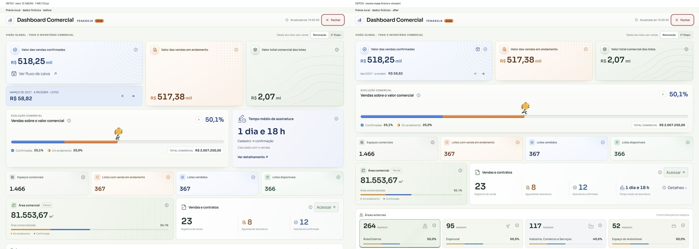

# Dashboard Comercial compacta — 23/10/2026

Implementação sobre `main` em `151d829d5610acbc355a581d6cca79e7e9401d87`.
Referência histórica: `08734eb8ce0f087ddc220af1c919c4c141a15b6c`.

A prévia mensal agora pertence ao rodapé do card confirmado. O acesso ao fluxo fica no cabeçalho, com tooltip e nome acessível; o progresso ocupa a largura integral. A média de assinatura fica somente em Vendas e contratos, com metodologia/amostra no `OverviewInfo` e referência direta ao botão de detalhes para recuperar o foco. Área comercial ocupa um terço da largura e Vendas e contratos dois terços; as quatro métricas compartilham a mesma faixa no desktop, sem um rodapé extra. Os dois cards medem 173,40px de altura em 1440/1280px.

Não há alteração em RPCs, backend, cálculos, fontes comerciais, status, permissões ou migrações. A única animação substituída foi a transferência medida por coordenadas: o par mês/valor usa uma transição local de opacidade de 180 ms, desativada com movimento reduzido. O ciclo de dez segundos, pausa, foco, visibilidade e observação da área visível continuam ativos.

## Comparação controlada

Todas as capturas entregues usam dados fictícios: inventário de referência + `withDashboardValue` e a resposta do PostgreSQL isolado já versionada em `docs/commercial-analytics/database-report.json`. Nenhuma consulta foi enviada à produção. Os valores são diferentes dos prints do usuário, mas idênticos entre antes/depois/histórico. Meses podem variar porque o carrossel continua ativo. A média tem amostra própria de 4 vendas; o contador de assinaturas confirmadas da fixture é 12.

Capturas no navegador integrado, tema claro, viewport com altura de 1000 CSS px e densidade 1. A faixa de identificação da fixture ocupa os mesmos 24,5px nas três versões. Fontes Manrope/Sora existentes, sem redução da fonte financeira.

| Viewport | Altura da faixa financeira antes → depois | Cards confirmadas / andamento / inventário antes | Cards depois | Início dos KPIs antes → depois | Espaço recuperado até KPIs |
| --- | --- | --- | --- | --- | --- |
| 1440 | 269,02 → 164px | 178,02 / 269,02 / 269,02px | 164 / 164 / 164px | 678,02 → 533,75px | 144,27px |
| 1280 | 265,23 → 164px | 174,23 / 265,23 / 265,23px | 164 / 164 / 164px | 671,73 → 533,75px | 137,98px |
| 390 | 501,34 → 416,34px | 158,34 / 118 / 118px | 164,34 / 118 / 118px | 1169,43 → 841,43px | 328px |
| 430 | 501,34 → 416,34px | 158,34 / 118 / 118px | 164,34 / 118 / 118px | 1154,34 → 826,34px | 328px |

O histórico renderizou os três cards em **148px** nas duas larguras desktop. O resultado usa 16px adicionais para preservar a prévia interna. A distribuição 1,4:1:1 permanece: larguras de 563,29/402,35/402,36px em 1440 e 497,41/355,30/355,29px em 1280.

O progresso passou de 920 para **1392px** em 1440 e de 813,33 para **1232px** em 1280, exatamente entre as margens da faixa financeira. Sua altura passou de 239,5/237px para **200,25px**, igual à referência histórica. Títulos e valores dos três cards ficam nas mesmas coordenadas verticais (165,375px e 200,5px em 1440). As medidas brutas estão em [measurements.json](./measurements.json).



Após o ajuste solicitado na conversa, Área comercial ficou com **460,66px** e Vendas e contratos com **921,34px** em 1440; em 1280, **407,33px** e **814,67px**. Ambos medem **173,40px** de altura. A versão intermediária com média no rodapé aumentava Vendas e contratos em 55px; essa composição foi substituída pelas quatro métricas na mesma linha. Em telas menores os cards são empilhados e crescem naturalmente.

## Verificações

- `typecheck`: passou.
- `build`: passou (avisos existentes de chunks grandes/Browserslist).
- Testes pertinentes reexecutados após o refinamento horizontal: **48 passaram em 6 arquivos** (analytics, overview, resumo, navegação, contrato financeiro e progresso).
- Suíte completa: **3834 passaram, 90 falharam, em 454 arquivos**. Uma cópia limpa da `main` reproduziu exatamente os mesmos 90 nomes de falha, em 51 arquivos; nenhuma falha nova. Lista em [checks.json](./checks.json).
- Navegador: 1440/1280/390/430px; títulos/valores sem sobreposição, sem rolagem horizontal no contêiner global. Alvo do fluxo de 34×34px no desktop e 44×44px no mobile.
- Teclado: tooltip com Tab, foco visível, Enter abre fluxo/detalhes, Escape fecha informações. O retorno do fluxo preserva base com taxas, ano 2027 e outubro; o retorno de assinatura preserva scrollTop **923,5px** e foco no controle compacto.
- Prévia alternou meses mantendo **164px**; próximo mês, pausa da prévia e pausa do Sojinha funcionaram. Com `prefers-reduced-motion: reduce`, animação da prévia = `none`.
- Estados ready/loading/error/stale/restricted/sem histórico e acesso somente a contratos revisados. Falhas não viram média zero. Em sessão só de contratos não há botão de fluxo nem de detalhes de assinatura.
- Popover ampliado: reflow equivalente a 200% em superfície de 1440px, emulado com 720 CSS px e DPR 2, sem corte nem overflow. [Captura](./after-200pct-info.png). Não foi usado comando de zoom nativo do navegador. Acionamento por toque físico não disponível no navegador integrado; tamanho de alvo e semântica do botão foram conferidos, clique e teclado foram exercitados.
- Console final sem erros após abrir uma nova aba. Durante a edição houve avisos de HMR do harness, corrigidos com descarte da raiz React no dispose.

[Resultados das interações](./interaction-checks.json) · [Revisão Product Design](../../../design-qa.md)

## Arquivos de produção alterados

- `CommercialDashboard.tsx`: composição, ação de fluxo no cabeçalho, preview no footer, progresso sem coluna lateral e refs de retorno.
- `CommercialSalesAnalyticsCards.tsx`: preview local e `SignatureLatencyInline`, consumindo o provider existente.
- `CommercialDashboardSalesSummary.tsx`: única apresentação compacta da média como quarta métrica junto aos contadores (faixa inferior apenas em telas estreitas).
- `commercial-dashboard-overview.css`: densidade, alinhamento, alvos e estilos locais.

Testes ajustados: `commercialSalesAnalytics.test.tsx` e `commercialDashboardSalesSummary.test.tsx`. Nenhum teste espelha valores de CSS.

## Reproduzir

```sh
node scripts/dashboard/prepare-compact-qa.mjs
node node_modules/vite/bin/vite.js --config scripts/dashboard/compact-qa.vite.config.ts
```

Abrir `/scripts/dashboard/compact-qa.html` na porta 8088. Parâmetros `?phase=before` e `?phase=historical` selecionam fontes extraídas dos refs acima (arquivos gerados ignorados). `?state=loading|error|restricted|empty|stale` cobre estados; `?access=contracts` cobre acesso só a contratos. O alias do cliente existe apenas nesse servidor isolado; o build de produção não importa o harness.
