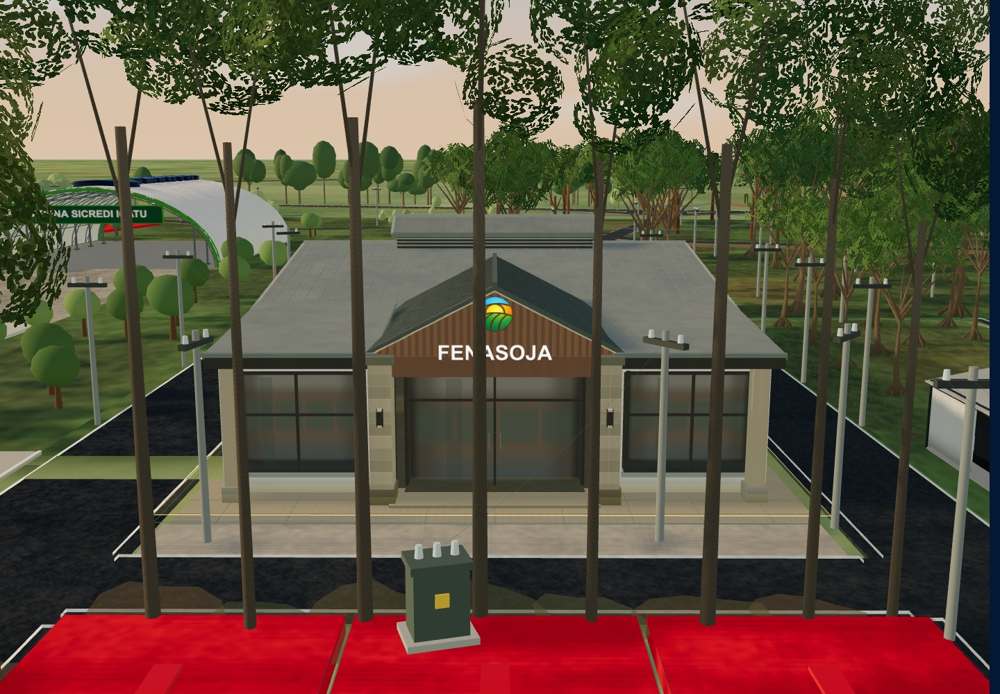
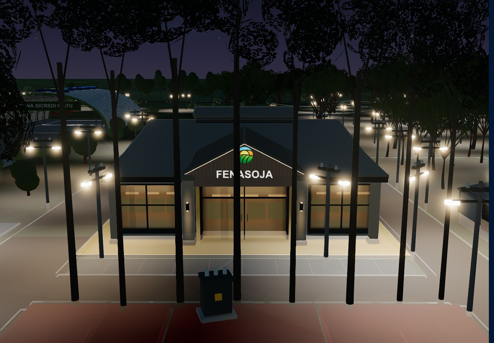

# Centro de Eventos C1, passeio frontal e portões — 17/11/2026

Implementação sobre a main `1bc532c93e9abc397b34fe6965877a6857882de8`, na branch `codex/centro-eventos-arquitetura`. A fachada ocupa melhor o envelope existente; a antiga faixa verde até a Rua Brasília tornou-se pavimento. A entrada, os materiais e a iluminação foram refeitos, as oito árvores frontais tiveram sua apresentação refinada, e A7/A8/A9/A11 receberam grades físicas conectadas ao cercamento externo.

[Galeria completa antes/depois, dia/noite, desktop/móvel e portões](capturas.md).





## Referências e grau de interpretação

Foram inspecionados os anexos iniciais **1, 2, 3 e 4**, as imagens posteriores do modelo e as quatro capturas dos portões. **Os anexos iniciais 5, 6 e 7 (fotos de solo da lateral) e 8 (vista aérea) não estavam anexados/acessíveis.** Não foram tratados como se tivessem sido vistos.

- As capturas documentam a implantação do modelo, a proporção inadequada da entrada/passeio e os portais genéricos existentes.
- A imagem premium orientou madeira, pedra, esquadrias e luz quente. Esses acabamentos são interpretação criativa, não documentação da fachada real.
- Janelas horizontais, acesso envidraçado, faixas superiores, beiral e climatização da lateral seguem a descrição escrita do usuário. Quantidade, ritmo e proporções são uma proposta arquitetônica dentro do envelope existente.
- O [Google Earth indicado pelo usuário](https://earth.google.com/web/@-27.84434498,-54.48053238,317.53919463a,751.48702591d,35y,63.14282823h,1.5471121t,359.99999918r/data=CgRCAggBOgMKATBCAggASg0I____________ARAA) foi aberto e inspecionado no navegador, incluindo os acessos, campos, vias e reservatórios próximos ao A9. A imagem exibida estava datada de 19/03/2026. Ela sustenta relações espaciais; não permite confirmar ferragens ou dimensões exatas dos portões.
- As correções posteriores do usuário definem a solução final da frente: **estrutura + calçada, sem gramado frontal**, e melhor visibilidade entre as árvores.

## Arquitetura e implantação

O C1 conserva centro, orientação para Q-E-12, footprint, identificador, aliases e enquadramento. A troca dos eixos de `eventCenterModelBounds` ocorre antes do yaw existente. O volume de seleção permanece cadastral; duplo clique continua focando o exterior. Não há interior navegável.

A composição tem salão, cobertura metálica com espessura, cumeeiras, bordas, juntas, lanternim menor, frontão da entrada, pilares com juntas de pedra, caixilhos, portas recuadas, marquises apoiadas, rufos, descidas pluviais e climatização lateral. Os vãos são aberturas reais entre peças de parede, com vidro transparente diante de um fundo procedural simples. A marca usa o mesmo símbolo oficial e o letreiro FENASOJA.

A entrada avançou dentro do C1, deixando **0,60 unidade da cena** de passeio interno. O pavimento adjacente preenche somente a faixa existente de aproximadamente **0,735 unidade** até a borda da Rua Brasília, sem cobrir o asfalto. Esses valores não são metros nem alteram a área cadastral. A função recusa o encontro se a rua não estiver presente, se o alinhamento mudar significativamente ou se houver interferência comercial. Canteiros e bancos frontais da primeira exploração foram retirados.

As árvores `tree-e-01`–`tree-e-08` mantêm IDs e posições. Apenas suas instâncias recebem troncos mais finos, cor de casca mais neutra, bifurcações mais altas e copas compactas. Nenhuma árvore foi apagada e as demais permanecem com sua apresentação anterior. Árvores e postes reais ainda podem encobrir parcialmente a entrada em algumas direções; não são ocultados conforme a câmera.

A iluminação do C1 usa emissivos e manchas suaves compartilhadas em lotes de geometria, **sem novas luzes dinâmicas**. A transição usa o estado noturno existente, invalida enquanto converge e termina com emissão zero de dia. A âncora de Gastronomia deriva da cobertura efetivamente modelada, com folga técnica de 0,025 unidade.

## Portões e cercamento

A7, A8, A9 e A11 usam pilares, bases pequenas, tampas, folhas de grade abertas, travessas, barras, dobradiças, puxadores, ferrolhos e placa discreta. Os pontos cadastrais não mudaram. A8/A11 derivam seus vãos das vias presentes; A9 respeita o acesso recuperado da revisão 2028 e mantém a rua paralela independente. A7 se conecta à cerca existente da Campeira.

O cercamento acompanha as bordas externas visadas nas capturas, com retornos aos pilares e aberturas nas bocas das ruas. Não cerca cada lote nem pretende documentar todo o perímetro topográfico do parque. Os contratos verificam as revisões 2026 e 2028, inclusive penetração indevida em lotes/vias além da estreita junta de borda. Folhas abertas permanecem paralelas à circulação. A arquitetura não recebe raycast; um proxy conserva a seleção do portão e abrange as folhas.

## Arquivos principais

| Arquivos | Responsabilidade |
|---|---|
| `utils/eventCenter.ts`, `utils/eventCenterArchitecture.ts` | Envelope, paleta, dimensões, partes, LOD e âncora compartilhada |
| `canvas/FenasojaEventCenter.tsx`, `EventCenterGeometry.ts`, `EventCenterIdentityPanel.tsx` | Montagem por material, recursos próprios, vidro, luz e marca oficial |
| `canvas/StrategicLandmarks.tsx`, `gastronomyMarkerAnchor.ts` | Integração no C1 existente e no marcador comercial |
| `utils/eventCenterForecourt.ts`, `canvas/EventCenterForecourt.tsx` | Encontro pavimentado seguro com a Rua Brasília |
| `utils/eventCenterForecourtTrees.ts`, `canvas/CommercialTreeLayer.tsx` | Refinamento restrito às oito árvores frontais |
| `utils/visitorGateArchitecture.ts`, `canvas/VisitorGateGrilles.tsx`, `CommercialMapCanvas.tsx` | Grades, conexões, vãos e proxies dos quatro portões |
| `src/test/commercialMapEventCenter*.test.ts`, `commercialMapVisitorGateGrilles.test.ts` | Contratos geométricos, funcionais e de recursos |
| `scripts/event-center/` | Capturas reproduzíveis, medições e QA de interação na cena completa |

Os caminhos `utils/` e `canvas/` da tabela são relativos a `src/features/commercial-map/` e `src/features/commercial-map/components/`, respectivamente. Nenhuma entidade persistida, venda, preço, status, permissão, migration, rota de produto ou cadastro foi alterado. Casa Fenasoja, palco e coberturas vizinhas mantêm seus modelos e posições; nenhuma ligação física foi criada entre C1 e o palco.

## Medições reais

Ambiente: Mac com Apple M5, 16 GiB RAM, Chrome 157.0.8103.79, ANGLE/Metal. Viewports de 1440×1000 e 390×844, DPR 1. A segunda é **emulação de viewport/toque no desktop**, não medição em telefone físico.

Antes de editar foram registrados os relatórios [desktop inicial](metrics/initial-before-desktop.json) e [móvel inicial](metrics/initial-before-mobile.json). Para a comparação final, o mesmo commit foi reproduzido por `baseline.vite.config.ts`, que lê os cinco módulos originais via `git show` sem trocar o checkout. A cena é a rota diagnóstica completa já existente, com fixture versionada, mesmas câmeras, seleção, clima seco e estados de iluminação. Os lotes vermelhos são os dados da fixture, não mudanças de status comercial.

**Draw calls e triângulos abaixo são submissões reais do passe principal WebGL**, renderizado com as sombras já calculadas, sem recalcular mapas de sombra ou contar passes de pós-processamento. Isso evita confundir o último fullscreen pass do compositor com o custo do mapa. O C1 é medido no mesmo renderer, isolando temporariamente seus meshes; o valor “depois” inclui os dois desenhos do encontro com a rua. O custo da cena completa inclui grades, árvores e todo o contexto visível. A mediana/P95 de intervalo de quadros vem de uma janela de 2,2 s no pipeline normal completo; não é um timer de GPU.

As constantes de orçamento são limites de teste, não os números medidos. LOD distante conserva aberturas, frontão, marca e lanternim. O aumento de geometria paga silhueta, vãos e construção; detalhes repetidos do C1 são agrupados por material, e grades usam instâncias. O refinamento das árvores reutiliza os mesmos lotes GPU.

| C1 + encontro frontal · desktop | Draw calls antes → depois | Triângulos antes → depois |
|---|---:|---:|
| Foco · dia | 11 → 13 | 1.592 → 7.624 |
| Foco · noite | 11 → 14 | 1.592 → 7.638 |
| Distante · dia | 7 → 13 | 460 → 4.180 |
| Distante · noite | 7 → 14 | 460 → 4.194 |

| Mapa completo · câmera/estado | Draw calls antes → depois | Triângulos antes → depois | P95 ms antes → depois |
|---|---:|---:|---:|
| desktop · day-front | 146 → 151 | 572.197 → 592.585 | 17.0 → 17.9 |
| desktop · day-side | 260 → 265 | 656.676 → 676.856 | 16.8 → 17.5 |
| desktop · day-distant | 565 → 570 | 772.778 → 792.728 | 16.8 → 17.0 |
| desktop · night-front | 153 → 159 | 598.435 → 618.837 | 16.8 → 17.9 |
| desktop · night-side | 267 → 273 | 682.914 → 703.108 | 16.8 → 18.4 |
| desktop · night-distant | 573 → 579 | 799.022 → 818.986 | 16.8 → 17.5 |
| mobile · day-front | 119 → 121 | 515.061 → 521.093 | 17.8 → 17.9 |
| mobile · day-side | 167 → 170 | 551.259 → 571.439 | 18.1 → 18.1 |
| mobile · day-distant | 413 → 416 | 670.828 → 689.449 | 17.6 → 18.0 |
| mobile · night-front | 126 → 129 | 541.299 → 547.345 | 17.8 → 17.8 |
| mobile · night-side | 174 → 178 | 577.497 → 597.691 | 17.4 → 17.6 |
| mobile · night-distant | 427 → 431 | 702.128 → 720.763 | 16.8 → 17.9 |

A mediana foi **16,7 ms** em todos esses pares. O P95 variou até **18,1 ms na base e 18,4 ms depois**; houve aumento em algumas vistas, portanto não se afirma custo idêntico. Os intervalos estão próximos do limite de apresentação de 60 Hz e não demonstram capacidade de uma GPU móvel. Não houve erro WebGL ou perda perceptível de navegação nessa execução.

| Abertura e memória · frontal diurna | Antes | Depois |
|---|---:|---:|
| desktop · abertura até readiness | 4208 ms | 4326 ms |
| desktop · geometrias residentes | 641 | 639 |
| desktop · texturas residentes | 148 | 144 |
| desktop · programas | 275 | 276 |
| desktop · heap JS observado | 202.8 MiB | 217.1 MiB |
| mobile · abertura até readiness | 4617 ms | 4644 ms |
| mobile · geometrias residentes | 626 | 624 |
| mobile · texturas residentes | 148 | 144 |
| mobile · programas | 274 | 276 |
| mobile · heap JS observado | 178.8 MiB | 180.7 MiB |

Abertura: uma execução por cenário, navegador novo e servidor Vite aquecido; não é SLA de produção. Memória: contagens do renderer e snapshot de heap sujeito a GC, não VRAM em bytes nem teste prolongado de vazamento. Os quatro relatórios em [metrics](metrics/) contêm câmeras, contexto, hardware, estados e medições completas. A sonda de quadro dos portões, na mesma vista geral, registrou 272 → 270 chamadas e 566.488 → 581.298 triângulos ([antes](gates/before.json), [depois](gates/after.json)); essa sonda inclui passes do pipeline e não deve ser somada à tabela de passes principais.

## Verificação funcional e testes

- **Typecheck:** aprovado (`tsc --noEmit -p tsconfig.app.json`).
- **Build:** aprovado (`vite build`); permanece o aviso existente de chunks grandes.
- **Suíte completa:** execução comparativa com 4.411 aprovados / 88 falhos; base imediata: 4.396 aprovados / as mesmas 88 falhas. A última repetição registrou 4.405 aprovados / 94 falhos: cinco timeouts adicionais e uma falha de espera da UI. Os cinco arquivos envolvidos foram repetidos com dois workers: **34/34 aprovados**, sem mudanças no código nem aumento de timeout. Nenhuma falha adicional persistiu; a suíte global continua sem aprovação pelas falhas da base. [Comparação e nomes completos](test-comparison.json).
- **Contratos da alteração:** 22 testes aprovados em quatro arquivos. Cobrem footprint após yaw, altura, aberturas em todos os LODs, orçamento compilado, âncora contra raycast real da cobertura, descarte de buffers próprios, calçada fora do asfalto/lotes, inventário das árvores, vãos e cercas nas duas revisões.
- **Lint dirigido:** sem erros; um aviso de Fast Refresh pelo export do compilador puro de geometria no módulo dos portões. O lint global não foi usado como aprovação, conforme dívida histórica do repositório.
- **Desktop e viewport móvel:** busca por C1/nome/alias, seleção, desseleção, CameraRig, duplo clique sem interior, filtro Gastronomia, marcador visível, detalhes sem raycast e modo noturno aprovados. A seleção móvel também foi executada por `touchscreen.tap`.
- **Noite → dia:** emissão 0,85 → 0; manchas invisíveis de dia e uniform de janela zerado.
- **Perda de contexto:** `WEBGL_lose_context` + restauração aprovados nos dois viewports, health `ready`, um evento de perda, C1 e Gastronomia presentes novamente.
- **Portões:** clique e duplo clique nos quatro acessos aprovados nas fixtures 2026 e 2028; não abrem interior.

Relatórios de interação: [desktop](interactions/desktop-interactions.json), [móvel](interactions/mobile-interactions.json), [portões 2026](gates/after.json), [portões 2028](gates-2028/after.json). O marcador de Gastronomia mantém a interação existente através da estrutura C1; não foi criado um comportamento de clique independente no medalhão decorativo.

## Reprodução

Use Node e as dependências instaladas do projeto. O ambiente desta execução não expunha o comando `npm`; foram executados diretamente os binários Node correspondentes aos scripts do `package.json`.

```sh
npm install
npm run dev -- --host 127.0.0.1
# Em terminais separados, para a base e para o ponto comercial sintético de QA:
node node_modules/vite/bin/vite.js --config scripts/event-center/baseline.vite.config.ts
node node_modules/vite/bin/vite.js --config scripts/event-center/qa.vite.config.ts

# PLAYWRIGHT_MODULE pode apontar para o pacote Playwright já instalado no ambiente.
QA_URL=http://127.0.0.1:8082 node scripts/event-center/capture.cjs before
node scripts/event-center/capture.cjs after
QA_URL=http://127.0.0.1:8082 node scripts/event-center/capture.cjs before --mobile
node scripts/event-center/capture.cjs after --mobile
node scripts/event-center/interactions.cjs
node scripts/event-center/interactions.cjs --mobile
QA_URL=http://127.0.0.1:8082 node scripts/event-center/gates.cjs before
node scripts/event-center/gates.cjs after
QA_QUERY='?exporural2028' node scripts/event-center/gates.cjs after
```

`QA_OUTPUT` direciona as evidências para fora da árvore observada pelo Vite. O config de Gastronomia adiciona somente uma fixture sintética na rota diagnóstica existente e aborta requisições ao Supabase no teste; não é usado pelo build do aplicativo.

## Limites conhecidos

Não houve inspeção autenticada de vendas reais, escrita no banco, SQL remoto, deploy ou merge. Os fluxos de leitura foram exercitados com as fixtures e com os testes do repositório. Não foi feita medição em telefone físico de baixo desempenho, Safari/iOS, rede móvel ou teste de longa duração. A geometria é uma interpretação arquitetônica em tempo real, não um levantamento as-built nem equivalência garantida a um render offline fotorrealista. Fotos laterais/aérea ausentes e levantamento real ainda seriam necessários para confirmar águas de cobertura, ferragens, níveis, acessibilidade e medidas exatas.
