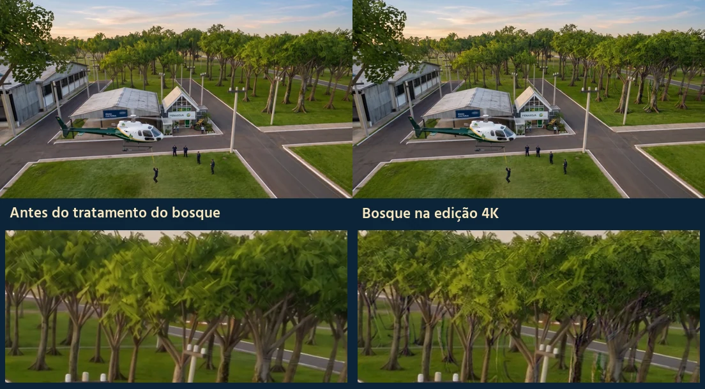

# Amanhecer no Parque de Exposições

No Mapa Comercial, selecione a Casa FenaSoja e abra **Assistir ao filme**. A opção também aparece dentro da sede no Modo Visita. O filme tem som estéreo. A reprodução e a cópia para download contêm apenas imagem e som. A câmera do visitante conserva a posição ao fechar o filme.

## O parque no filme

A tomada inicial e o contraplano do embarque usam a cena tridimensional do Mapa Comercial. A Casa ocupa a esquina da B12 com o Palco Cultural Lactalis imediatamente ao lado. O parque permanece visível durante a subida. A Arena Sicredi/Icatu tem uma cobertura branca arqueada. Atrás aparecem o terreno aberto, as vias e a faixa de árvores observados na vista aérea de 19/03/2026. O Google Earth foi consultado em 20/11/2026. A reconstrução usa o modelo do projeto e quadros autorais. [Vista consultada no Google Earth](https://earth.google.com/web/@-27.84434498,-54.48053238,317.53919463a,1050d,35y,0h,0t,0r)

No plano da fachada, a composição foi restrita às árvores que ficam atrás da Casa e do palco. O contorno da cobertura, o letreiro da Casa, o asfalto e os postes orientam a comparação. A revisão dá volume ao colo dos troncos, individualiza as bifurcações e deixa ver a luz nas clareiras. Os lotes aparecem em verde na representação cinematográfica. Nos dois percursos do mapa, 51 árvores receberam madeira e bifurcações variadas nas posições cadastradas. O plano fotográfico usa uma placa de vegetação registrada e máscaras de oclusão para preservar a aeronave, o cabo e os passageiros.

O desenho das vias e dos prédios vem do mapa cadastrado. A montagem usa texturas fotográficas no asfalto, na grama e na casca, com luz fria de preenchimento e reflexos de amanhecer nas superfícies. O recorte da panorâmica de céu exclui o terreno fotografado. [Antes e depois da esquina B12 na mesma câmera](esquina-b12.webp) · [Grama](https://polyhaven.com/a/grass_ground) · [Casca](https://polyhaven.com/a/bark_brown_02) · [Asfalto](https://polyhaven.com/a/asphalt_04) · [Céu fotografado por Greg Zaal](https://polyhaven.com/a/spruit_sunrise)



## Pessoas, som e encerramento

O filme encena um embarque fictício. Cléo Antonio Rockenbach, Zélia Savoldi e Roque Vanderlei Lugoch sobem primeiro. O presidente Fabiano Soltis e o vice-presidente Djeison Drey embarcam em seguida. Os retratos do projeto orientaram as interpretações. A foto fornecida por Leonardo Strochein orientou o plano do piloto. O emblema na aeronave é o da FenaSoja. [Comissão Central anunciada pela FenaSoja](https://fenasoja.com.br/portal-oficial/geral/definidas-data-e-comissao-central-da-fenasoja-2028/)

A nova tomada acompanha a aproximação até o contato dos patins com a grama e mantém a aeronave visível durante o assentamento. No embarque, uma pessoa sobe enquanto quatro aguardam em frente à sede. Na cabine, a direção do olhar e as expressões de Fabiano e Djeison acompanham o movimento da aeronave. As áreas que mantiveram correspondência com o retrato original recuperam detalhes da fotografia de 2.752 pixels.

O rotor ganha presença na aproximação, permanece audível durante o embarque e perde volume à medida que a aeronave se afasta. A mixagem utiliza duas gravações reais com licença CC0 e uma ambiência de parque criada para o filme. [Créditos e fontes de áudio](../../../scripts/filme-fenasoja-2028/CREDITOS-AUDIO.txt)

No céu azul, o emblema aparece através da névoa. As letras de **FENASOJA** têm faces e chanfros azuis. O ano **2028** recebe reflexos dourados. Os contornos do letreiro vêm dos arquivos tipográficos da experiência Alvorada. [Atribuições tipográficas](../../../public/alvorada/ATTRIBUTION.md)

Nos seis segundos finais, quatro campos em uma faixa azul-marinho com filetes dourados mostram os dias, as horas, os minutos e os segundos. A faixa fica abaixo da escrita tridimensional e mantém o emblema livre. O player usa o relógio oficial, continua atualizando os valores depois do último quadro e acompanha o avanço e o retrocesso. A abertura configurada é **29 de abril de 2028 às 10h, horário de Brasília**. No MP4 independente, a contagem segue a referência de exportação de **20/11/2026 às 04h59min36s** em Brasília. [Configuração oficial](../../../src/config/fenasoja-2028.ts) · [Quadro do encerramento](encerramento-4k.webp)

## Montagem e reprodução

O botão **Baixar em 4K** salva a animação completa em MP4 UHD, 3840 × 2160 a 24 fps, com vídeo HEVC e som AAC estéreo a 48 kHz. O mapa reproduz uma cópia H.264 de 1280 × 720 sob demanda. As duas versões têm 50 segundos e 1.200 quadros. O download só começa quando solicitado. Ambas possuem exclusivamente uma faixa de vídeo e uma de áudio.

As câmeras do mapa, os materiais das superfícies, o letreiro tridimensional e a contagem foram renderizados na resolução final. O material fotográfico do Higgsfield inclui tomadas animadas com origem em 720p e é reamostrado para a montagem em Ultra HD. A [lista de planos](../../../scripts/filme-fenasoja-2028/montagem.json) identifica os enquadramentos e a duração de cada corte.

A montagem utiliza as tomadas fontes já preparadas, FFmpeg com libx264 e libx265, Node com as dependências do projeto e Python com NumPy, SciPy, Pillow e OpenCV. Os valores da contagem vêm da mesma implementação TypeScript do portal. Os exemplos a seguir usam a pasta de trabalho que contém os arquivos referenciados na lista de planos.

```sh
node scripts/filme-fenasoja-2028/parque/render.cjs --4k --out ./tomadas
python3 scripts/filme-fenasoja-2028/montar.py ./tomadas --clock-reference '2026-11-20T04:59:36-03:00'
```

## Verificação da entrega

A decodificação integral verifica os 1.200 quadros, as dimensões, o áudio estéreo e a ausência de faixas de legenda. Os metadados incluem o tamanho, a soma SHA-256 e os seis valores do contador impressos na cópia 4K. [Metadados do download](master.json) · [Sequência do filme](sequencia.webp) · [Referências de produção](producao.json)

No Chrome de desktop e no perfil móvel de 390 px, a abertura do mapa é verificada antes de solicitar o filme. O ensaio também verifica o relógio na pausa, a tela cheia, o retorno à B12, a ausência de trilhas de texto e a integridade da cópia obtida pelo botão **Baixar em 4K**. [Relatório do player](player.json) · [Desktop](encerramento-desktop.webp) · [Celular emulado](encerramento-celular.webp)

O build de produção, a checagem de tipos, os 33 testes focados da ficha e da contagem e o teste do Modo Visita passaram. A execução da suíte completa registrou 87 falhas que também ocorreram na base e cinco timeouts adicionais. Os grupos desses timeouts passaram quando executados isoladamente (28/28).
