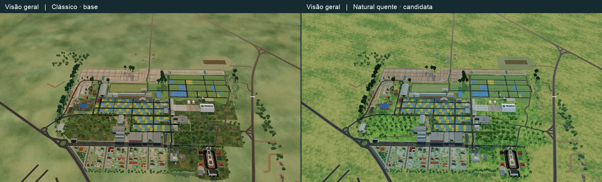
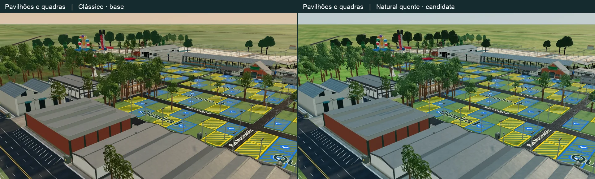

# Mapa Comercial da Fenasoja · Aparência

Abra **Camadas do mapa → Aparência** e alterne entre **Clássico** e **Natural quente**. Na gestão, a primeira visita abre em Natural quente e Qualidade automática. A mesma ficha de lote volta ao fechar Camadas. A preferência vale para as próximas visitas nesse navegador. No celular, Camadas também fica em **Mais controles do mapa**.



| O que observar | Como foi tratado | Custo da escolha |
| --- | --- | --- |
| As manchas do entorno ocupavam o horizonte e exageravam a diferença para o gramado do parque. | Relva com fibras curtas, densidade de pastagem em escala maior e transição apoiada nos limites rurais e de circulação. | Uma textura RGBA de 512 px registra a fibra em 1,60 m e a variação de densidade em 48 m. Na vista aérea o filtro preserva as manchas maiores. |
| O mesmo verde aparecia no gramado aberto, no bosque e junto às quadras A/B. | O gramado dos polígonos internos tem verde mais profundo que a pastagem rural. No bosque da rotatória predomina a relva verde e a serrapilheira ocupa pequenas falhas nas copas densas. A área aberta junto à Árvore Lunar acompanha o registro fotográfico. | Uma máscara preparada fora do navegador cobre o parque. A mistura usa as superfícies que já recebiam o gramado. |
| No estacionamento posterior era difícil distinguir brita e chão compactado. | Os materiais de cada bolsão e dos corredores foram ajustados nos seus próprios polígonos. As linhas claras continuam na posição das vagas. | Os acabamentos compartilham os materiais dos setores. |
| Coberturas claras se perdiam contra o céu bege. No interior, piso e estrutura tinham um acabamento semelhante entre pavilhões. | Céu e preenchimento mais frios separam os volumes. Chapa orientada pela água do telhado, pisos em escala física, estruturas e paredes com as cores de referência dos pavilhões. A circulação interna tem concreto com juntas de 3 m e um contorno contínuo nas bordas reais das ilhas, inclusive nos módulos em L. | Um tile leve de chapa é compartilhado pelos galpões fotografados. O interior usa a planta, os elementos estruturais e os materiais já montados. |
| A sede B12 gerava seus mapas de acabamento na abertura. | O cálculo das nervuras da telha reaproveita as amostras de cada eixo; os mapas resultantes foram comparados byte a byte. O preparo da cena também reduz alocações no recorte de polígonos. | A economia ocorre antes da primeira seleção e atende aos dois perfis. |



- [Comparação em 4K e recortes a 100% do gramado interno e da pastagem](uhd.md)
- [Arquitetura, iluminação e otimização da Casa Fenasoja](arquitetura-e-luz.md)
- [Os 11 interiores visitáveis, em 22 pares de vistas com a mesma câmera](interiores/README.md)
- [14 comparativos visuais, gravações dos percursos e métricas por dispositivo](ensaio.md)
- [Prancha de materiais, registros fotográficos, escala física e custo de memória](materiais.md)
- [Câmeras e estado da cena da candidata](candidate-cameras.json)
- [Tempos individuais de laboratório](medicoes.json)
- [Verificação de abertura, seleção, teclado, toque e suíte de testes](testes.md)

## Onde revisar a implementação

| Parte do mapa | Arquivos de entrada |
| --- | --- |
| Camadas, perfil e qualidade | [Painel Camadas](../../../src/features/commercial-map/components/panels/MapPanels.tsx), [preferências locais](../../../src/features/commercial-map/state/parkAppearance.ts), [estado do mapa](../../../src/features/commercial-map/state/useCommercialMapStore.ts), [orçamento de resolução](../../../src/features/commercial-map/utils/viewport.ts) |
| Pastagem, gramado, bosque e entorno | [Shader do terreno](../../../src/features/commercial-map/components/canvas/interiorGroundMaterial.ts), [entorno territorial](../../../src/features/commercial-map/components/canvas/TerritorialEnvironment.tsx), [árvores](../../../src/features/commercial-map/components/canvas/CommercialTreeLayer.tsx), [máscara cartográfica](../../../scripts/commercial-map-performance/bake-woodland-cover.py) |
| Ruas, estacionamentos e circulação | [Infraestrutura viária](../../../src/features/commercial-map/components/canvas/RoadInfrastructure.tsx), [rede posterior](../../../src/features/commercial-map/components/canvas/RearParkRoadNetwork.tsx), [bolsões de estacionamento](../../../src/features/commercial-map/components/canvas/RearParkingLayer.tsx) |
| Edificações e interiores | [Pavilhões fotográficos](../../../src/features/commercial-map/components/canvas/pavilions/PhotoReferencedPavilion.tsx), [laje, juntas e bordas das ilhas](../../../src/features/commercial-map/components/canvas/pavilions/PavilionInteriorFinishes.tsx), [cena interna](../../../src/features/commercial-map/components/canvas/CommercialPavilionInteriorScene.tsx), [materiais da sede](../../../src/features/commercial-map/components/canvas/headquarters/materials.ts) |
| Luz, tinta comercial e abertura | [Iluminação da cena](../../../src/features/commercial-map/components/canvas/CommercialMapEnvironment.tsx), [cores comerciais no renderer](../../../src/features/commercial-map/components/canvas/commercialStatusInk.ts), [fila e cache das texturas](../../../src/features/commercial-map/components/canvas/warmParkTextures.ts), [aquecimento de shaders](../../../src/features/commercial-map/utils/sceneShaderWarmup.ts) |

## Abrir a prévia navegável

O build a seguir serve a interface de gestão com dados de demonstração do próprio repositório. O perfil pode ser trocado, o lote pode ser tocado e o pavilhão pode ser visitado. A amostra saneada de Expo Rural 2028 e os estados demonstrativos dos outros segmentos são os mesmos usados na galeria. A versão distribuída carrega os mapas de material do próprio aplicativo.

```sh
MAP_QA_REVISION=$(git rev-parse HEAD) MAP_QA_OUT=/tmp/park-gallery npm run build -- --config scripts/external-status-lines/qa.vite.config.ts
node scripts/commercial-map-performance/serve-public-preview.cjs /tmp/park-gallery 4246
```

[Prévia local da interface de gestão](http://127.0.0.1:4246/__dev/commercial-map-interface?exporural2028=1&persistedStage=1&externalLotsQa=1)

## Reproduzir a interação

Com o Chrome e o Playwright disponíveis, execute os comandos abaixo contra a prévia local. A rotina usa o centro cadastral de Q-D-01, exercita os controles de câmera e registra a ficha, posição, alvo e identificadores de câmera e cena. A versão desktop também alterna o perfil pelo teclado.

```sh
PARK_URL=http://127.0.0.1:4246 PARK_OUTPUT=/tmp/park-desktop node scripts/commercial-map-performance/park-appearance-interaction.cjs
PARK_URL=http://127.0.0.1:4246 PARK_MOBILE=1 PARK_OUTPUT=/tmp/park-mobile node scripts/commercial-map-performance/park-appearance-interaction.cjs
```
