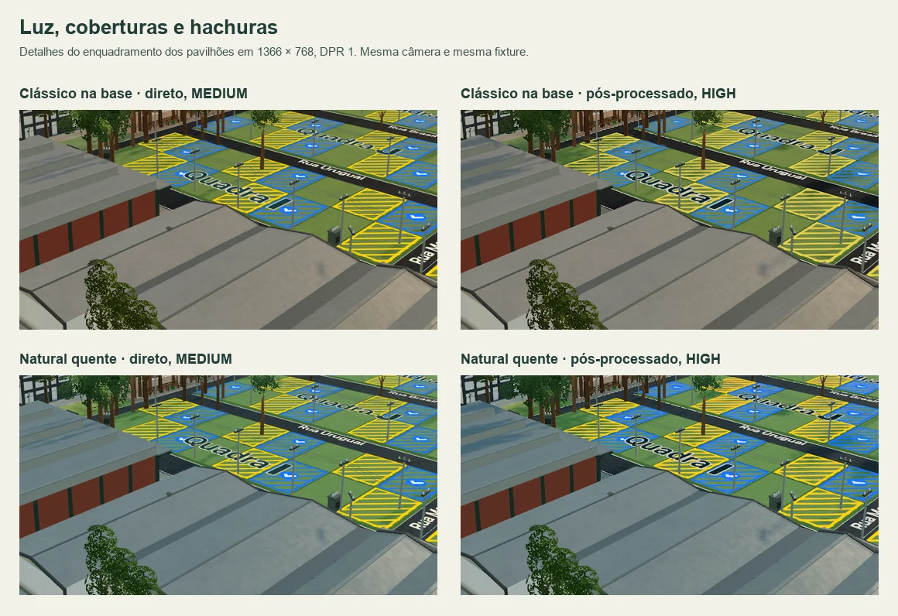
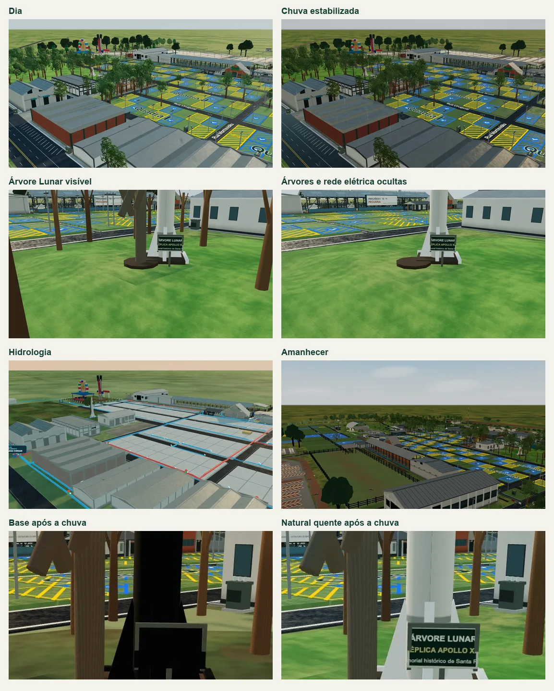

# Luz, arquitetura e circulação

O perfil Natural quente combina sol levemente quente e preenchimento de céu azul-claro. As coberturas recebem luz direcional, enquanto fachadas na sombra recebem luz do céu e do chão. A intensidade do tratamento cresce durante o amanhecer e diminui com a transição para chuva ou noite. O modo hidrológico usa a iluminação própria. A direção do sol, o relógio do amanhecer e o volume coberto pelas sombras seguem a cena existente. O renderer conserva sua exposição. O caminho direto aplica ACES no material. HIGH e ULTRA usam render target HDR e um único efeito ACES ao final.

| Referência | Superfície montada e tratamento |
| --- | --- |
| B1, B3, B4, B5, B6 e B8 | Os lotes de instâncias de `PhotoReferencedPavilion` usam o modelo e a paleta individual. A telha Higgsfield compartilha a coordenada transversal com o bump de zinco existente, em 10 cm por nervura. A orientação segue as águas, inclusive as do galpão floral B8. A crista se destaca pela rugosidade do metal, enquanto as vedações pintadas e os tijolos conservam a pigmentação de referência. |
| B13, Palco Cultural Lactalis, junto às quadras A/B | As duas águas de `LactalisCulturalStage` usam as normais periódicas já cadastradas. A UV superior segue o caimento local em X e dimensiona a onda no eixo longitudinal. Chapas, parede e estrutura diferem em rugosidade. A placa usa seu atlas próprio. |
| Circulação, estacionamento posterior | O asfalto das ruas vem de `RoadInfrastructure` e `RearParkRoadNetwork`. Os passeios recebem concreto. `RearParkingLayer` distingue o saibro compactado e a brita com cor, rugosidade e intensidade das normais, inclusive nas bordas transparentes. As normais já estão presentes no orçamento da camada. Marcas e linhas, inclusive vagas restritas, mantêm a geometria de seleção. |
| Árvore Lunar e Apollo XIV | `LunarTree` mantém a forma da copa, as massas de folhas e as ramificações cadastradas. A madeira cinza-castanha e o verde da copa foram calibrados pelo registro histórico da alameda. O piso da clareira permanece em grama. A réplica, as placas e a base branca são elementos de orientação. [Acervo da Árvore Lunar](../../../public/history/i18-400.webp) |
| Interiores B1, B2, B3, B4, B5, B6, B8 e B10 | A laje e as malhas dos corredores compartilham o concreto Higgsfield com granilha clara. Uma coordenada local contínua estabelece 1,6 m por repetição e aproximadamente 3 m entre juntas. O contorno de cada ilha usa a união geométrica das fileiras cadastradas. Nos módulos recortados, entram as arestas e reentrâncias do polígono real. Um único draw adiciona a junta escura e a faixa de piso mineral na circulação, fora das ilhas. A largura total varia com a escala de apresentação, de 0,035 a 0,075 unidade. As divisões entre módulos mantêm o traçado fino original. Cada parede e perfil usa a paleta do edifício. |
| B9, pavilhões da Pecuária | A serragem nas baias recebe cor palha, enquanto o concreto do corredor e das plataformas mantém a resposta mineral. Aço e cobertura têm reflexos distintos. O preenchimento mantém a leitura dos pilares e do gado. |
| D3, Mirante | A plataforma mineral e a estrutura metálica recebem rugosidades distintas. O preenchimento do céu alcança a parte de baixo da cobertura, com menor emissão própria e luz direcional levemente quente. |
| B12, Casa Fenasoja | O piso de madeira da sede mantém seu desenho e passa a refletir mais luz rasante. As faces em sombra recebem preenchimento. Por fora, a telha cerâmica, os vãos, a letreira e o modelo cadastrado continuam sendo as referências deste prédio. [Ficha e registro da sede](../casa-fenasoja-b12/README.md) |

## Custo do preparo de materiais na Casa Fenasoja

Na medição inicial com CPU limitada apareceu um preparo de 247,3 ms para os materiais B12. A família da cobertura recalculava a mesma série de senoides horizontais e gaussianas verticais no miolo de cada texel. Ela agora calcula cada função por eixo e grava os canais diretamente nos buffers. As sete tabelas ocupam 28 KiB temporários durante o preparo da telha. A textura e o caminho de upload permanecem os mesmos.

No microensaio no Apple M5 (Mac17,3), com Node 24.13.0, dez pares alternaram a ordem da geração das quatro famílias. A mediana passou de **110,3 ms a 30,8 ms** (72% de redução) neste computador. Os doze canais gerados tiveram bytes e SHA-256 idênticos nas duas revisões. Este cronômetro mede a CPU local na geração de dados. A abertura e o movimento no navegador são medidos separadamente no ensaio da rota. [Tempos por rodada, tamanhos e hashes](b12-cpu.json) · [Ensaio da rota](ensaio.md)

```sh
node scripts/commercial-map-performance/park-materials-cpu.cjs c99436b3
```

## Comparação da cor entre níveis

A cena de QA usa a implantação 2028 e a fixture comercial saneada, com a câmera em `[9, 8.8, 31]`, alvo `[-9, 0.8, 12]`, FOV de 38°, Chrome 157.0.8103.79 e 1366 × 768 a DPR 1. A análise começa em PNG, antes de compactar a prancha em WebP. A janela dos lotes vai de (735, 393) a (1100, 538). Para cada revisão, a máscara fixa seleciona os pixels de MEDIUM próximos do azul #1677FF (tolerância de quatro níveis sRGB por canal) e do amarelo #FFD400 (oito níveis). LOW, HIGH e ULTRA reutilizam **as mesmas coordenadas**. Os intervalos antialias entre grama e tinta ficam fora da máscara. SMAA e MSAA podem misturar amostras diferentes nas mesmas bordas.

A leitura da cobertura vem de (620, 605)–(725, 638) e a da fachada sombreada de (145, 420)–(165, 439), usando a mediana dos canais RGB. Cada nível registrou os atributos reais dos quatro estados e o caminho de render efetivamente apresentado. A comparação é local, em desktop, com o ambiente e o inventário registrados na [galeria](ensaio.md).

```sh
PARK_PROFILE=warm-natural PARK_URL=http://127.0.0.1:4244 PARK_OUTPUT=/tmp/park-parity \
node scripts/commercial-map-performance/park-appearance-parity.cjs
```



| Revisão e perfil | Caminho | Vendido, RGB mediano | Em aberto, RGB mediano | Cobertura | Fachada sombreada |
| --- | --- | --- | --- | --- | --- |
| Base c99436b3 | MEDIUM, direto | 22, 119, 255 | 255, 212, 0 | 127, 127, 119 | 132, 135, 123 |
| Base c99436b3 | HIGH, pós | 32, 125, 225 | 230, 209, 73 | 128, 127, 119 | 132 / 134,5 / 123 |
| Natural quente ff8f8360 | MEDIUM, direto | 22, 119, 255 | 255, 212, 0 | 106, 126, 130 | 127, 141, 137 |
| Natural quente ff8f8360 | HIGH, pós | 18, 119, 255 | 255, 214, 0 | 106, 126, 130 | 127, 141, 137 |

Entre MEDIUM e HIGH, o maior desvio entre canais caiu de 30 para 4 no vendido e de 73 para 2 no em aberto. LOW coincidiu com o MEDIUM e ULTRA com o HIGH nas duas tintas. Nos quatro níveis havia 148 disponíveis e 1 bloqueado com atributo de hachura zero, 59 em aberto com atributo um e 69 vendidos com atributo dois. A textura de chapa sRGB do Higgsfield estava vinculada ao material de cobertura nos quatro níveis. A medição inclui a hachura, a moldura e o disco de confirmação visíveis no mesmo recorte. [Resultados por nível e por superfície](paridade-de-cor.json)

## Horário, chuva e visibilidade das árvores

O ensaio local da candidata `32b68d60` percorreu dia, chuva estabilizada, retorno ao tempo seco, ocultação das árvores, hidrologia e amanhecer. Na mesma câmera dos pavilhões, a intensidade da luz solar caiu de 2,2632 no dia para 0,738 na chuva, e a névoa passou de #ADC7CE para #96ADB7. Na hidrologia, a camada de infraestrutura hídrica ficou visível e o sol mediu 2,08. A sequência de amanhecer foi capturada no arco ascendente. Seu progresso passou de 7,22% em Natural quente para 10,66% em Clássico e 11,90% ao voltar para Natural quente. Posição, alvo, sequência e instante inicial foram preservados. Todos os quadros registraram apresentação direta, renderizador pronto e zero perdas de contexto.

Na câmera da Árvore Lunar, ocultar as árvores retirou do render as duas camadas de vegetação, os cinco lotes de instâncias que projetavam sombra, a copa e o tronco do memorial e a rede elétrica. A réplica, canteiro e placa permaneceram visíveis. Na base, dois materiais molhavam repetidamente a mesma tinta compartilhada, até a inscrição e o meio-fio ficarem pretos. Na candidata, o material de arte da Apollo acompanha a tinta do meio-fio. Em duas sequências de chuva e secagem a cor registrada fez #F3F1E9 → #E1DFD8 → #F3F1E9. Os dois recortes finais da prancha usam a mesma câmera depois de desligar a chuva. [Estados, luz, material da réplica e saúde do render](clima-e-arvores.json)



```sh
PARK_URL=http://127.0.0.1:4246 PARK_OUTPUT=/tmp/clima-parque \
node scripts/commercial-map-performance/park-weather.cjs
```
