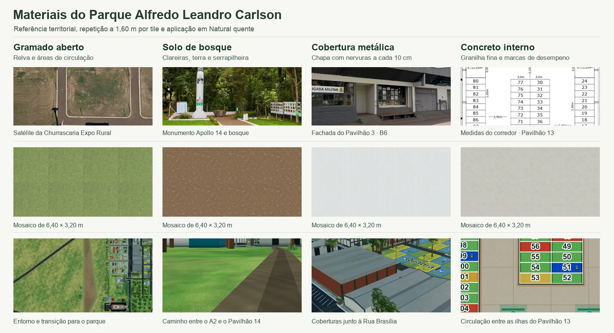
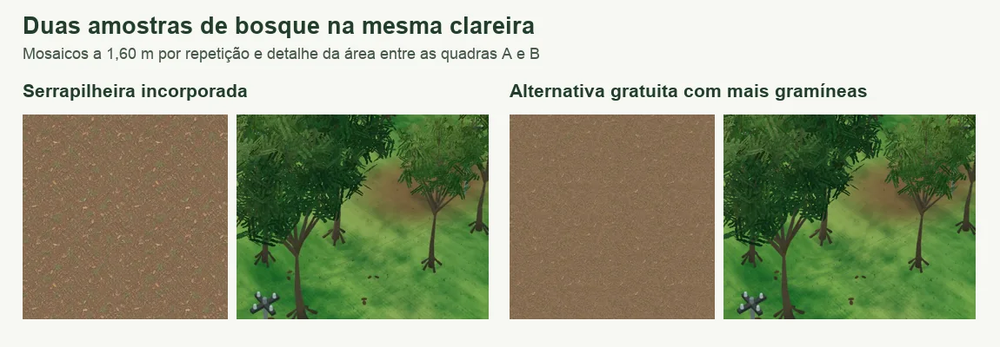

# Materiais do parque

## Registro territorial

A Casa Fenasoja é a B12, na Rua Brasília. O registro da fachada usa os encontros com Uruguai e Argentina e uma barra de 10 m. O modelo conserva telha cerâmica e o GLB de detalhe da revisão 13 com carregamento por aproximação. A B12 fornece escala construída e uma referência fotográfica para a luz. A chapa desta revisão entra nos galpões metálicos. [Reconstrução espacial da sede](../../fenasoja-complex-reconstruction.md) · [Ficha B12 e vistas da fachada](../casa-fenasoja-b12/README.md)

O anexo fotográfico de 30/10 identifica os pavilhões B1, B3, B4, B5 e B6, e as fotos IMG_1765–1767 registram a floricultura B8. As fotos de B3 e B6, localizadas pelos nomes exatos associados aos modelos, orientaram a distinção entre reboco, chapa clara e planos na sombra. O recorte de satélite da churrasqueira mostra trechos gramados com densidades diferentes, junto a pavimento e edificações. O registro de Gate 9 mostra o agrupamento das copas. A fotografia i18, do acervo Santa Rosa Tur reproduzida pelo Jornal Noroeste, mostra o solo mantido na clareira do monumento Apollo 14. A composição da serrapilheira é uma interpretação artística. [Registro dos pavilhões](../../../src/features/commercial-map/data/pavilionArchitecture2026.ts) · [Satélite da churrasqueira](../../refs-churrascaria-satelite.jpeg) · [Satélite do Portão 9](../../refs-soy-gate9/gate9-satellite.jpeg) · [Árvore Lunar e monumento](../../../public/history/i18-800.webp)

| Área identificada no mapa | Superfície que chega à tela |
| --- | --- |
| Horizonte e entorno contínuo | Plano de `CommercialMapEnvironment`, opaco, recebe luz e sombra. A faixa traseira `RearParkEnvironmentLayer` e a frente da arena compartilham o material. No Natural, o shader usa a fase XZ do mundo e duas frequências de baixa intensidade, com comprimentos diferentes por direção, para a densidade do gramado. Nas bordas das duas glebas e dos eixos de estrada registrados aparece uma transição de relva mais seca no mesmo canal. |
| Quadras A/B, área de motor homes, gramado do estacionamento e bosques | As malhas superiores têm diferentes limites de profundidade/alpha. O mesmo shader de solo recebe as coordenadas do mundo. A máscara de cobertura combina o maciço A2–B2, a faixa livre do caminho e as posições e raios do inventário de 275 árvores. A densidade soma influências irregulares sobrepostas. A mesma máscara guarda a terra exposta das clareiras A/B, a relva seca de transição e a cobertura de gramado cuidado nos polígonos positivos de quadras e áreas verdes. A iluminação e a variação de relva mantêm o verde dominante sob copa; os núcleos densos recebem folhas esparsas. A superfície do caminho e a clareira do monumento G preservam seus recortes. |
| Trilha no bosque, taludes, passeio e acessos | A malha de acesso usa um atributo por vértice para separar superfícies. Piso da trilha e concreto conservam material próprio. Aceiros, linhas de vaga, sinalização, caminhos e seleção são desenhados acima do terreno. A ocultação de árvores retira os objetos que projetam sombra e deixa o solo acumulado no terreno. |
| Faixa castanha rural e lavoura demonstrativa | `TerritorialEnvironment` desenha `southern-cropland` com sulcos orientados pelo polígono; `northern-open-parcels` dá suporte à lavoura demonstrativa da Expo Rural. `SoyFieldStaticLayer` acrescenta solo e plantas da demonstração. O registro da lavoura delimita 120 × 36 m em [43, −57,2]–[61, −51,8]. [Registro da lavoura](../../../src/features/commercial-map/data/soyHarvestLayout.ts) |
| Área cercada diante dos galpões | Entidade oficial `PISTA-CAMPEIRA`. `CampeiraTrack` desenha o solo compactado, a grama seca e a cerca. O test-drive tem o perfil de cascalho `TEST-DRIVE`, e os bolsões posteriores têm materiais de solo e brita próprios. |
| Árvores internas e bordas | Os sprays internos mantêm recorte alfa, verso descartado e uma passagem; a camada piloto conserva seu LOD e seu atlas. No perímetro as três geometrias de distância usam o mesmo material opaco. Perfil natural ajusta luminosidade e rugosidade por família e reduz a opacidade da marca de contato legada sob o tronco. |
| Telhados, paredes, lotes | As coberturas B3/B4/B5/B6/B8 usam o mapa de cor com UV na direção da água e o relevo preexistente. As fachadas usam material pintado. Planta oficial, rótulos, emblemas, contornos, hachuras e hit surfaces conservam seus próprios materiais e geometria. |

## Amostras e custo

Todos os originais Higgsfield selecionados foram gerados a 1.024² com GPT Image 2.6. Para cada quadrado de grama e serrapilheira usei 1,60 m de lado (0,24 unidade no registro de 0,15 unidade/m), pouco menos da metade de uma faixa de 3,5 m da avenida. Para o telhado, 16 nervuras no mesmo quadrado correspondem a um passo estimado de 10 cm. O piso interno usa o mesmo comprimento de 1,60 m. A referência de cotas do Pavilhão 13 registra 3,90 m em um corredor, representados por cerca de 2,44 repetições do tile. O acabamento de concreto é uma interpretação para circulação interna. As dimensões são escalas de apresentação. [Cotas de referência do Pavilhão 13](../pavilion-edge-dimensions/reference-p13.png) [Faixas e caminho do bosque](../../../src/features/commercial-map/data/parkAccessSpatialPlan.ts)

| Ativo | Origem e critério de seleção | Aplicação | Bytes do arquivo | VRAM com mipmaps |
| --- | --- | --- | ---: | ---: |
| warm-grass-v2.webp | Higgsfield `5f3cee03-f16f-490d-b359-5c397ce409f4`. A fibra próxima ocupa o RGB. O alpha linear armazena a variação de densidade preparada offline, amostrada a cada 48 m e ajustada nas margens mapeadas | Gramado e entorno, 512² | 151.688 | ~1,33 MiB |
| warm-woodland-v1.webp | Higgsfield `23dbc300-ee19-4a3b-9d43-509f71c6ea77`. Terra com folhas pequenas, fragmentos e gramíneas descontínuas | Chão sob o bosque e copas cadastradas | 22.476 | ~341 KiB |
| warm-metal-v1.webp | Higgsfield `ceabff4f-e31d-4ad6-baf9-aa619b62bc92`. Chapa clara paralela, recorte entre os vales x=53 e x=969 | Coberturas metálicas | 1.272 | ~341 KiB |
| warm-interior-floor-v1.webp | Higgsfield `96d3b9e6-0868-44c1-b72e-36beb178e5b1`. Concreto desempenado, grãos minerais de 2–6 mm, iluminação difusa e variação de cor discreta | Corredores de pavilhão em Natural quente, após entrar no interior | 3.724 | ~341 KiB |
| woodland-cover-v2.png | Máscara calculada a partir de polígonos e inventário do repositório. Canais lineares R de bosque, G de solo exposto, B de relva seca e A de gramado interno cuidado. Inclui clareiras oficiais A/B e margens de campos e estradas, escala 128 × 128 unidades | Mistura de materiais, contorno do caminho | 21.303 | ~341 KiB |

Os quatro recursos externos somam **196.739 bytes**. O piso interno tem **3.724 bytes** de conteúdo. O ensaio de 11 interiores registrou zero requisições desse ativo no exterior, uma requisição após entrar e a mesma textura enviada à GPU nas oito plantas comerciais. O contexto limpo usou interceptação de rede para bloquear origens externas. O Resource Timing informou `transferSize` zero, e os bytes de conteúdo foram medidos nos arquivos distribuídos. [Medição do percurso interno](interiores/candidata.json) O total instalado é **200.463 bytes**, com 512² para a grama e 256² para os demais arquivos. A estimativa de VRAM é RGBA8 descomprimido com cadeia até 1², 2.446.672 bytes para o exterior e 2.796.196 bytes após o piso interno. Os mapas de cor usam sRGB. A máscara carrega como dado linear com clamp em ambas as direções. Os tiles de cor repetem, com mipmaps gerados pelo WebGL, minificação trilinear e anisotropia limitada a quatro amostras e ao limite do dispositivo. O decodificador nativo de WebP/PNG atende aos cinco arquivos. Os números da tabela excluem cabeçalhos HTTP e overhead do driver.

O processamento offline reduziu a resolução com Lanczos, corrigiu a descontinuidade das bordas por decomposição periódica, atenuou a iluminação de baixa frequência e ajustou as médias de cor. A chapa perdeu 90% da variação transversal gravada; seu relevo reage à luz da cena. No arquivo final, o salto absoluto médio na costura mede **11,48 / 5,23 / 1,30 / 2,17** níveis sRGB para grama, bosque, metal e piso. Entre texels vizinhos mede **21,46 / 8,90 / 0,31 / 1,17**. O mosaico mostra quatro por duas repetições. O processador offline reproduz os quatro WebP byte a byte a partir dos PNG originais dos jobs. [Preparo dos albedos](../../../scripts/commercial-map-performance/prepare-park-albedo.py)

Os tiles chegam pela fila de ociosidade do Canvas após `qualifiesCommercialMapReady`, em tarefas separadas da decodificação e do upload. As cores-base dão suporte à interação mesmo se um ativo estiver indisponível. Cada textura mantém seu cache no renderer. Os marcadores `appearance:<tipo>:ready` registram a espera da decodificação nativa e o tempo de submissão CPU de `initTexture`; duração de execução física da GPU requer instrumentação de hardware. A máscara é reproduzível pelo [processador offline](../../../scripts/commercial-map-performance/bake-woodland-cover.py).

## Decodificação e envio dos materiais

Uma passagem pela galeria de preview local em Chrome desktop com DPR 1 e qualidade média produziu os tempos abaixo. A coluna de decode mede a espera pela promessa nativa de imagem. Submissão mede o tempo de CPU de `WebGLRenderer.initTexture`, inclusive a criação dos mipmaps. Os tempos individuais estão sujeitos ao escalonamento do navegador. [Estado e marcadores da captura](candidate-cameras.json)

| Material | Decode (ms) | Submissão de upload (ms) |
| --- | ---: | ---: |
| Gramado | 8,9 | 10,5 |
| Bosque | 2,0 | 2,0 |
| Máscara territorial | 0,7 | 0,7 |
| Chapa | 0,4 | 0,4 |
| Concreto interno | 0,4 | 0,4 |

## Modalidade das gerações

Os quatro materiais incorporados foram enviados ao Higgsfield na modalidade de créditos, inclusive o concreto antes da manifestação explícita de preferência pela modalidade gratuita. O conector não informou o valor consumido. Os pedidos alternativos de pastagem e de bosque utilizaram apenas a modalidade gratuita.

A alternativa gratuita de bosque (`af72dbb5-c775-457b-8097-289551622ddd`) concluiu às 22h37 de 22/11/2026, horário de Brasília, na última consulta após a espera. O teste local substituiu apenas a resposta do arquivo de bosque, aplicou o mesmo preparo, verificou o vínculo da textura com a GPU e repetiu a câmera das quadras A/B. A amostra selecionada distingue os fragmentos de folha da grama. A alternativa tem mais gramíneas e aparece muito próxima do acabamento do gramado existente, mesmo nos trechos de copa densa.

A referência aérea dedicada de pastagem, a 48 × 48 m, entrou na fila gratuita após a conclusão da alternativa de bosque. O job `ba0c2608-2feb-4004-afad-c295f1e72a2b` aguardava processamento às 22h44. A alternativa gratuita de concreto aguarda a liberação dessa única vaga. A versão distribuída usa a grama Higgsfield já selecionada e o campo multiescala de densidade preparado offline.
