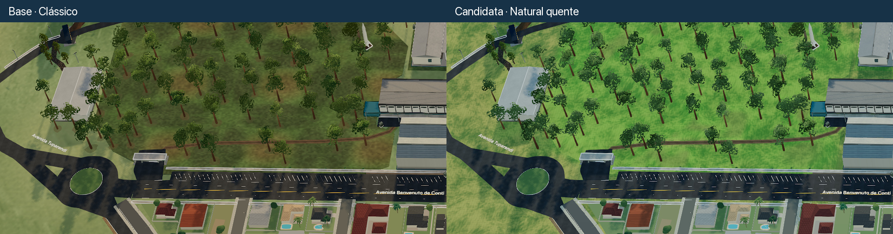
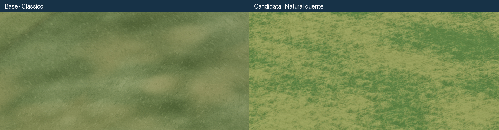

# Gramado e pastagem em 4K

O acesso pela rotatória permite comparar os dois verdes na mesma imagem. Na área arborizada entre a Avenida Tuparendi e os pavilhões, a relva cuidada chega até as margens do caminho. A folhagem seca aparece pontualmente, sob copas densas. Do lado de fora, a pastagem alterna verdes e palha em manchas de diferentes tamanhos. As clareiras da planta e as áreas de lavoura têm seus próprios limites.





Cada metade dos comparativos acima contém 960 × 456 pixels recortados diretamente do frame geral. No GitHub, abra a imagem individual para vê-la a 100%. As capturas completas preservam os 3840 × 2160 pixels do buffer de desenho. O JPEG de documentação usa qualidade 94 e amostragem de cor 4:4:4. Os recortes usam qualidade 96.

Para conferir o verde sem depender da escala da miniatura, medimos também pequenas janelas do PNG original. No gramado entre caminho e avenida, as janelas de 12 × 12 px centradas em (1220, 1606), (1201, 1598), (1350, 1617) e (1340, 1600) têm mediana de verde menos vermelho entre +46 e +56 no Natural quente. Na pastagem externa, as janelas centradas em (700, 200), (365, 451), (900, 192) e (1020, 230) ficam entre +9 e +23. São amostras locais do frame diurno em sRGB de 8 bits.

| Câmera | Base · Clássico | Candidata · Natural quente |
| --- | --- | --- |
| Visão geral da entrada | [Abrir em 4K](uhd/geral-base.jpg) | [Abrir em 4K](uhd/geral-natural.jpg) |
| Vista do lado oposto | [Abrir em 4K](uhd/contracampo-base.jpg) | [Abrir em 4K](uhd/contracampo-natural.jpg) |
| Vista rasante para o horizonte | [Abrir em 4K](uhd/horizonte-base.jpg) | [Abrir em 4K](uhd/horizonte-natural.jpg) |

Usamos a fixture Expo Rural 2028, a mesma câmera, dia com amanhecer completo, tempo seco e Chrome 157.0.8103.79 no Mac M5. Em HIGH, com viewport 3840 × 2160 e DPR de dispositivo 1, a base escolheu inicialmente 3264 × 1836. O ensaio elevou seu buffer a 3840 × 2160 para comparar os acabamentos à mesma resolução efetiva. Na candidata, **Detalhe** atingiu 3840 × 2160 pelo controle do aplicativo. Os seis frames passaram pelo pós-processamento e registraram zero perdas de contexto. A opção Automática continua dimensionando o buffer de acordo com o dispositivo e a interação. [Câmeras, dimensões reais e estado do renderer](uhd/cameras.json)

Para repetir, use as duas prévias de produção descritas no [ensaio](ensaio.md), a mesma versão de Chrome e o mesmo módulo Playwright. O script grava os PNGs e as dimensões originais do buffer antes e depois do ajuste de laboratório.

```sh
PARK_URL=http://127.0.0.1:4243 PARK_PROFILE=classic PARK_OUTPUT=/tmp/base-4k node scripts/commercial-map-performance/park-pasture-uhd.cjs
PARK_URL=http://127.0.0.1:4244 PARK_PROFILE=warm-natural PARK_OUTPUT=/tmp/natural-4k node scripts/commercial-map-performance/park-pasture-uhd.cjs
```
