# Reconstrução arquitetônica — referências e validação local

Data de referência: 30/10/2026. Base sincronizada: `origin/main`, `eb85dedbafbc76b1beeb617e40487c63896c05e2`. Escopo: apresentação física de B1, B3, B4, B5 e B6, continuidade com a ala existente B19 e acesso do Centro Administrativo B11, sem migração ou alteração cadastral.

## Identificação e interpretação das fotografias

As fotografias fornecidas são referências visuais, sem levantamento métrico. As proporções abaixo são razões aproximadas da composição, corrigidas qualitativamente pela perspectiva; não são medidas oficiais. Frente significa a fachada local +Z antes de aplicar a orientação persistida. A implantação, o giro e a projeção das plantas continuam vindos das referências vigentes.

| Pavilhão / ID | Origem e face | Elementos confirmados | Proporções estimadas e ocultações | Decisão e confiança |
|---|---|---|---|---|
| 1 / B1 | `WhatsApp Image 2026-10-30 at 10.39.51 (2).jpeg`; frente e lateral longitudinal esquerda | Placa 01, moldura grafite retangular, panos claros recuados, travessa inclinada, portões cinza de larguras diferentes, janelas altas na lateral, canteiro circular | Faixa superior ocupa cerca de metade da altura visível; pilares e vigas largos; árvore encobre parte direita e placa. Perspectiva não revela águas do telhado | Frente retangular com estrutura volumétrica e painéis recuados, sem toldos individuais. Cobertura baixa atrás da platibanda é interpretação conservadora. Confiança alta na fachada, baixa na cobertura oculta |
| 12 / B3 | `10.39.51.jpeg` e `10.39.50 (4).jpeg`; frente longitudinal | Placa 12, tijolo terra, grandes janelas superiores com montantes claros, pilares verde escuro, faixa ocre, beiral amplo, trecho claro e portão cinza | Janelas ocupam aproximadamente o terço superior do pano; beiral mais profundo que espessura de parede. Troncos/palmeiras encobrem módulos e projeção; telhado não visível de cima | Paginação de tijolo por textura, caixilhos com profundidade e beiral contínuo. Quatro águas em dente de serra preexistentes são mantidas como hipótese histórica do código, sem comprovação fotográfica adicional. Confiança alta em materiais/ritmo; baixa no telhado completo |
| 8 / B4 | `10.39.50 (3).jpeg` e `(2).jpeg`; frente | Placa 08, empena de duas águas, fechamento claro horizontal, janelas/venezianas antigas, dois portões, grande marquise com treliças trianguladas | Marquise cobre a região dos dois portões, projeção visualmente ampla. Perspectiva e poste ocultam extremidades. Pequenos ventiladores pontuais aparecem sobre a cumeeira | Empena simples e marquise unificada; remover monitor longitudinal sem evidência. Fechamento bege/cinza não é classificado como madeira. Confiança alta na frente; média no volume longitudinal |
| 13 / B5 | `10.39.50 (1).jpeg` e `10.39.50.jpeg`; frente e esquina com 8 | Placa com 1/3 empilhados identifica 13, empena moderada, fechamento metálico superior, paredes claras, dois portões, marquise treliçada | Marquise ocupa quase toda a região central; inclinação do frontão moderada. Poste oculta centro e fotografias não mostram fundos | Substituir perfil em uma água por duas águas, metal discreto e portões subdivididos. União 3–13–8 decorre também da informação explícita do usuário. Confiança alta em identificação/frente, média nos encontros não fotografados |
| 3 / B6 | `10.39.49 (1).jpeg` e `10.39.49.jpeg`; dois trechos da frente | Placa 03, frente ampla, testeira metálica contínua com contorno variável, grandes esquadrias, dois portões centrais, rodapé escuro, patamares, rampa e corrimãos, apoios sob plataforma | Esquadrias maiores que portas de serviço; patamar elevado, projeção contínua e pilares marcados. Limites laterais e cobertura principal ficam fora dos enquadramentos | Compor trechos diferentes, sem três portais repetidos. Preservar hipótese das três seções do telhado principal atrás da nova testeira por falta de vista superior. Faixa temporária Brigada Militar não altera uso comercial. Confiança alta na fachada, baixa no telhado posterior |
| Ala da Brigada / B19 | `10.39.49.jpeg` e `(1).jpeg`, junto à frente de P3; continuidade explicitamente confirmada pelo usuário | Panos claros, estrutura grafite, grandes esquadrias, testeira contínua, faixa contextual Brigada Militar | Proporções da ala adaptadas ao footprint vigente; fundos/cobertura atrás da testeira não documentados | Ala física e união com responsável único, mantendo B19 como entidade SECURITY e seleção própria. A faixa não altera os módulos de P3. Confiança alta na fachada/continuidade, baixa no telhado posterior |
| Acesso Centro Administrativo / B11 | `WhatsApp Image 2026-10-30 at 13.24.54 (1).jpeg`; extremidade voltada à Argentina | Cobertura leve inclinada, pilares esbeltos grafite, treliças, testeira clara, caminho de concreto, sebes baixas e gramado | Projeção e largura cabem no recuo existente; vegetação, profundidade e altura são estimadas | Acesso no +X local, que vira −Z no mundo após yaw π/2. B11 mantém implantação e cadastro. Não confundir B11 com o cubo B19 junto ao P3. Confiança média nas proporções |

Os nomes abreviados acima têm o prefixo `WhatsApp Image 2026-10-30 at`. O anexo `WhatsApp Image 2026-10-30 at 10.39.51 (1).jpeg` permanece **não atribuído**: placa e posição não permitem identidade inequívoca. Não foi usado para substituir a fachada de B1 nem incluir outro pavilhão.

As três capturas `Captura de Tela 2026-10-30 às 10.37.*.png` documentam a percepção anterior (paredes semelhantes, toldos pequenos, lacunas do conjunto), sem função de levantamento físico.

## Diagnóstico confirmado na base

- `LANDMARK_PALETTES['commercial-pavilion']` fornecia uma única paleta para toda a família. O mesmo objeto era consultado na criação e no efeito que restaurava as cores; mexer apenas no filho era insuficiente.
- `CommercialPavilion.tsx` montava casca e toldos individuais comuns. `PavilionRoof` escolhia ramos por ID, independentemente de alterar só o perfil no registro.
- Texturas procedurais estavam limitadas a concreto, zinco e piso; não havia superfície de tijolo nem fechamento específico para a fachada fotografada.
- `createCommercialPavilionLayout` aplicava recuo individual às paredes e laje retangular. Os intervalos visuais não significavam, por si, circulação externa autorizada.
- Os dados de acessos distinguem `connectsTo` de `structuralOpening`; a reconstrução não transforma anotações em vãos sem medida.
- B1 tem giro π/2; B3, B4, B5 e B6 têm giro π. B12 e B13 representam sede e palco e permanecem fora do escopo.

## Método reproduzível

O script `scripts/pavilion-architecture/capture.cjs` abre a rota de diagnóstico existente `/__dev/commercial-map-rendering?persistedStage=1`. Ela utiliza o `CommercialMapCanvas` real, `OFFICIAL_REFERENCE_DATA` e a fixture versionada `soyGatePersistedLayout`. Essa evidência verifica apresentação e interações locais; **não substitui uma consulta autorizada dos dados comerciais atuais**. Nenhuma credencial ou link público é gravado nas capturas ou relatórios.

O baseline foi arquivado antes das mudanças em `/tmp/pavilion-architecture-baseline`, servido em 5201. O checkout alterado deve ser servido separadamente. Poses derivam dos mesmos bounds e são aplicadas pelo evento DEV existente `territory-qa`; o relógio visual é estabilizado encerrando a animação inicial no estado diurno. DPR 1 em Chrome headless, sem reduzir resolução por navegação.

```sh
QA_BASE=http://127.0.0.1:5201 QA_OUTPUT=docs/validation/pavilion-architecture-2026/before node scripts/pavilion-architecture/capture.cjs
QA_BASE=http://127.0.0.1:8080 QA_OUTPUT=docs/validation/pavilion-architecture-2026/after node scripts/pavilion-architecture/capture.cjs
QA_MODE=metrics QA_BASE=http://127.0.0.1:5201 QA_OUTPUT=docs/validation/pavilion-architecture-2026/before node scripts/pavilion-architecture/capture.cjs
QA_MODE=metrics QA_BASE=http://127.0.0.1:8080 QA_OUTPUT=docs/validation/pavilion-architecture-2026/after node scripts/pavilion-architecture/capture.cjs
```

Definir `PLAYWRIGHT_MODULE` para o módulo Playwright instalado ou fornecido pelo runtime; o padrão é `playwright`. As capturas usam desktop 1920×1080, notebook 1366×768 e celular 390×844. O modo métricas cria três contextos de navegador independentes; em cada um, a primeira navegação tem cache de navegador frio e a segunda cache quente. O servidor Vite e o cache do sistema operacional já estão aquecidos; não se afirma simular rede móvel, dispositivo modesto ou inicialização fria do processo.

`metrics.json` registra abertura até o marcador de prontidão, recursos transferidos, programas/geometrias/texturas, heap observado e o percurso de câmera de 6 segundos. A coleta existente soma os passes de cor, pós-processamento e sombra no total de chamadas. O script `audit.cjs` complementa com contagem separada por `onBeforeRender` e `onBeforeShadow`, em um único render do mesmo contexto, restaurando imediatamente os callbacks e a política de sombras. O mapa parado usa renderização sob demanda: a métrica de fluidez vem do percurso, não de FPS ocioso.


## Implantação conferida e solução de continuidade

A consulta somente de leitura ao projeto FENASOJA existente em 30/10/2026 está sanitizada em [persisted-footprints.json](persisted-footprints.json). A comparação [persisted-fixture-comparison.json](persisted-fixture-comparison.json) confirma diferença zero entre os limites atuais dos sete footprints e os limites usados nas capturas reproduzíveis. B19/B6 e B11 também têm snapshots próprios em [persisted-brigada-footprints.json](persisted-brigada-footprints.json) e [persisted-administrative-footprint.json](persisted-administrative-footprint.json). Os filhos ativos retornados foram 189/257/114/104/214 para B1/B3/B4/B5/B6; essa leitura não contém compradores, contratos, preços, credenciais ou tokens, e não afirma igualdade de todos os conteúdos comerciais da fixture.

| União | Intervalo entre footprints | Intervalo entre cascas com recuo | Responsável único |
|---|---:|---:|---|
| B4/8 ↔ B5/13 | 0,2400 | 0,3829 | `pavilion-complex:p8-p13` |
| B5/13 ↔ B6/3 | 0,3273 | 0,5171 | `pavilion-complex:p13-p3` |

Os números são **unidades cartográficas da cena**, sem conversão presumida para metros de obra. O recuo individual era 2,5% do menor lado de cada footprint; por isso as lacunas entre paredes eram maiores que as cadastrais. A união fecha só a profundidade comum dos dois envelopes, com paredes frontais/posteriores, piso e arremate de cobertura de um responsável. As faces laterais no contato são omitidas, sem duplicação coplanar. Diferenças de altura permanecem; não se criam passagens de dimensões desconhecidas. `connectsTo` e `structuralOpening:false` continuam intactos.

A camada recebe somente as entidades já autorizadas no escopo e requer a presença de ambos os vizinhos. Não consulta dados adicionais. As peças somem quando um dos vizinhos está em corte e quando o conjunto não está presente no escopo interno/isolado.

As placas físicas são montadas na face externa das respectivas molduras/testeiras, com apoios que tocam a estrutura. A verificação `QA_MODE=signs` captura frente, oblíqua e pedestre dos cinco pavilhões e lança raios ao centro e aos quatro cantos de cada placa contra a geometria do próprio edifício; postes e árvores externos permanecem no lugar. O raycast normal de Mesh/InstancedMesh é habilitado somente durante a consulta e restaurado em `finally`.

A rampa e os patamares de B6 conservam o datum interno e recebem apoio numérico no modo visita; os corrimãos são geometria batched, sem um collider por peça. O canteiro de B1 recebe bordas, conservando a abertura existente e a árvore; o concreto de chegada alcança as soleiras e mantém as aberturas do solo. As três árvores diante de P12 mantêm posição e copa; seus troncos/forquilhas agora alcançam a folhagem existente, com o apoio simplificado do modo visita sincronizado. A revisão visual identificou grama diante dos portões de B1: o concreto do courtyard agora percorre a fachada inteira, usando a mesma largura do patamar existente e os recortes de ruas, superfícies protegidas e canteiro. Uma faixa estreita pertencente ao próprio B1 liga a parede recuada ao limite do footprint na mesma cota de 0,068; ela encosta no concreto externo sem sobrepor seus polígonos, nem cobrir módulos. O modo visita lê o mesmo apoio numérico. Esses limites são uma interpretação conservadora da foto, sem medição oficial ou alteração cadastral. Calçadas, concreto de B3, vias e árvores existentes mantêm suas posições. A árvore pontual do acesso B11 é uma estimativa de apresentação da foto adicional, sem substituir nem reposicionar árvores do cadastro. A projeção de marquise foi limitada ao espaço disponível diante da fachada para não ocupar a faixa da Rua Argentina: é uma acomodação conservadora da implantação, não uma profundidade levantada na fotografia.

## Comparação visual

As imagens têm o mesmo enquadramento, viewport e iluminação estabilizada. As 43 poses externas/corte, incluindo os acessos B19/B11, foram comparadas numericamente em [camera-comparison.json](camera-comparison.json). As cinco cenas internas usam o enquadramento do CameraRig existente. As árvores não foram ocultadas: troncos podem encobrir trechos da arquitetura, como nas referências.

| Vista | Antes | Depois |
|---|---|---|
| Cinco pavilhões / desktop | 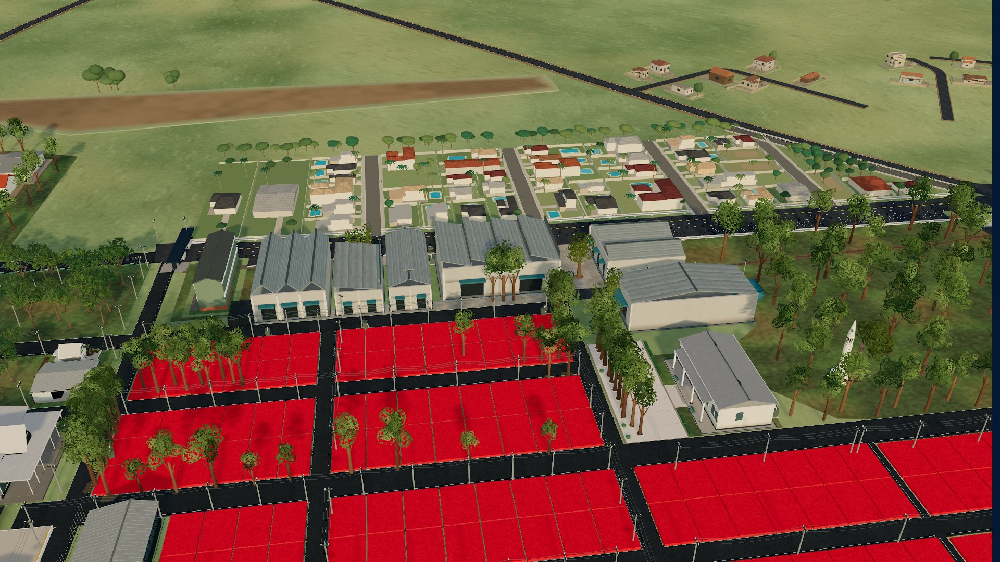 | 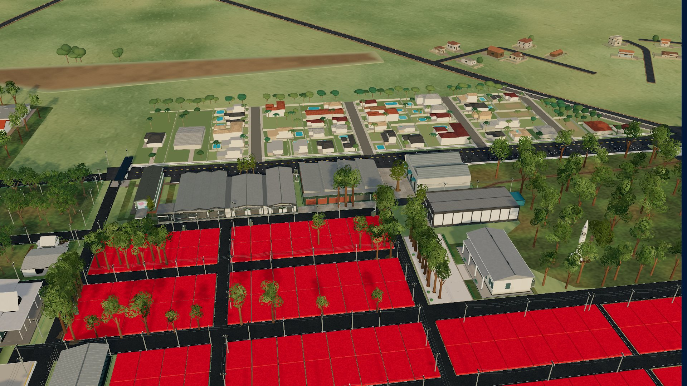 |
| Continuidade 3–13–8 | 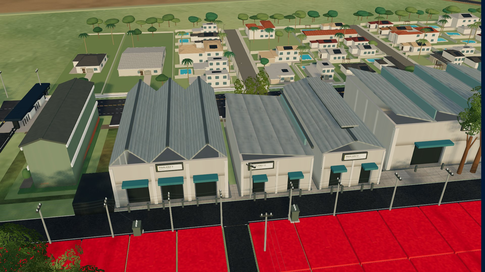 | 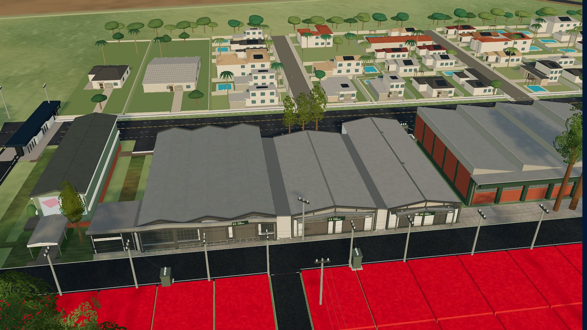 |
| P1, nível próximo do pedestre | 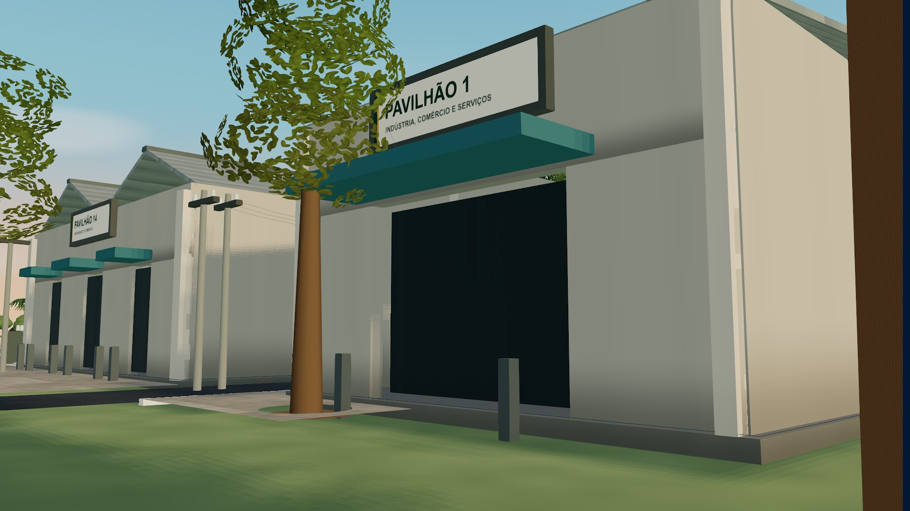 | 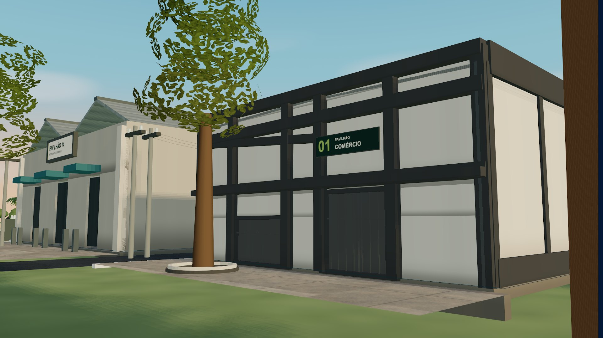 |
| P12, tijolos e esquadrias | 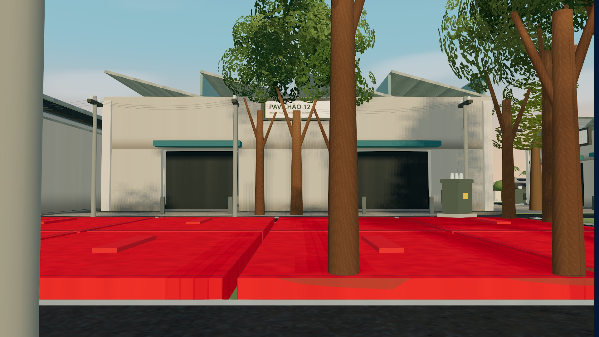 | 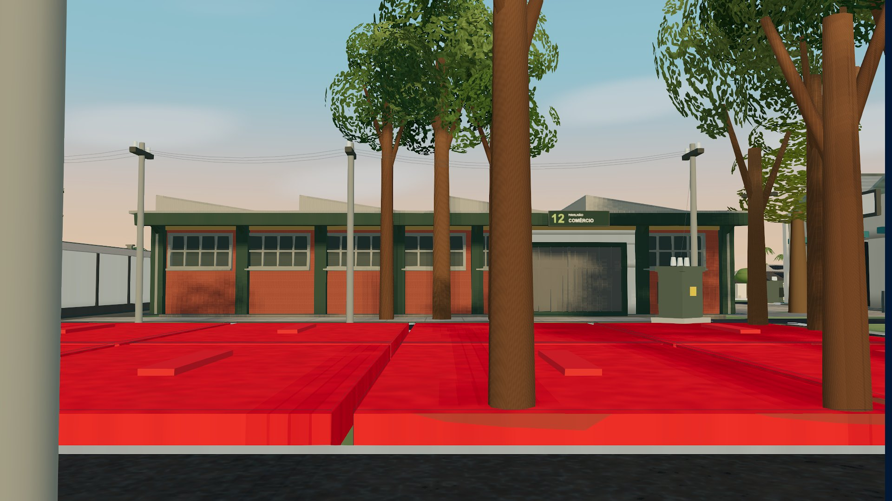 |
| P3, fachada e acesso | 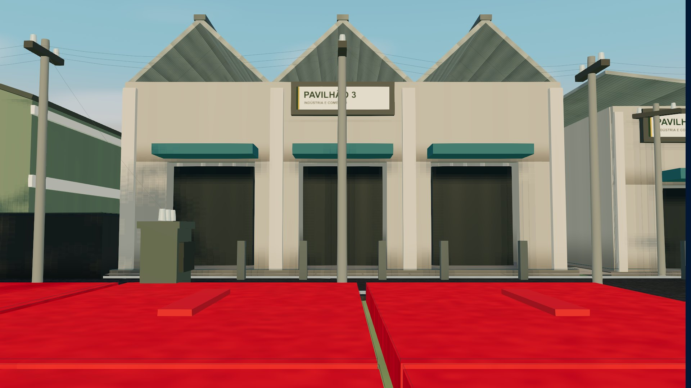 | 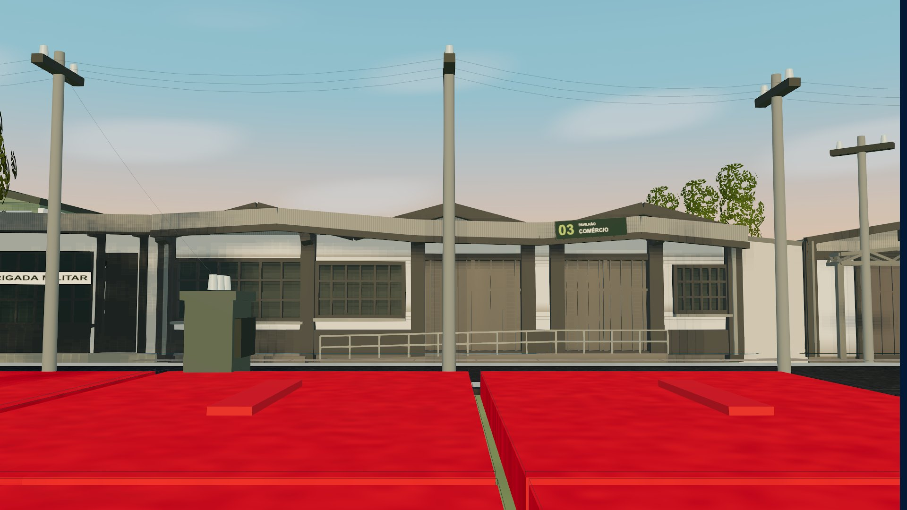 |
| Coberturas | 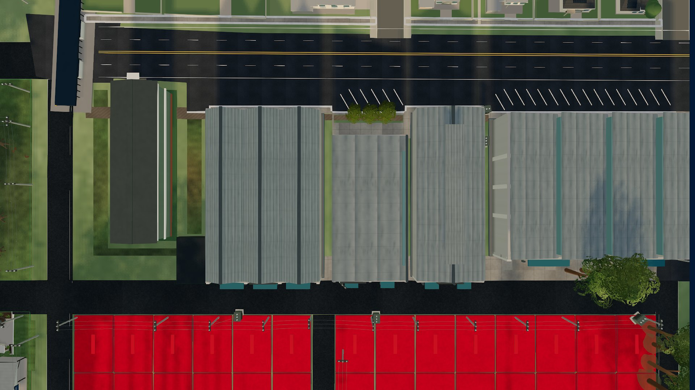 | 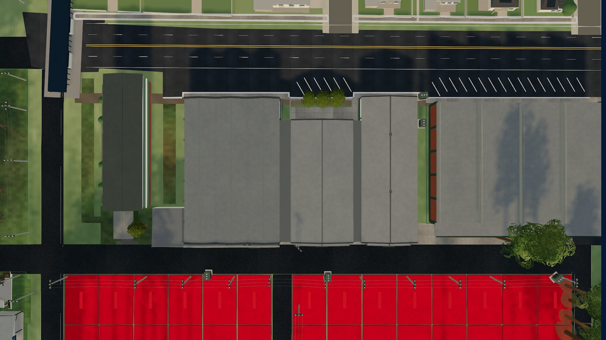 |
| Ala B19, junto ao P3 | 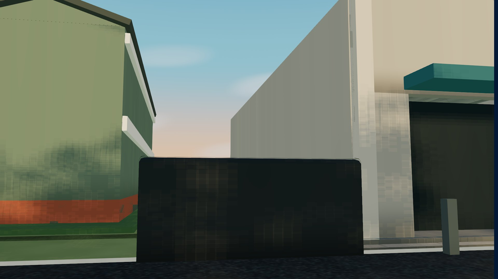 | 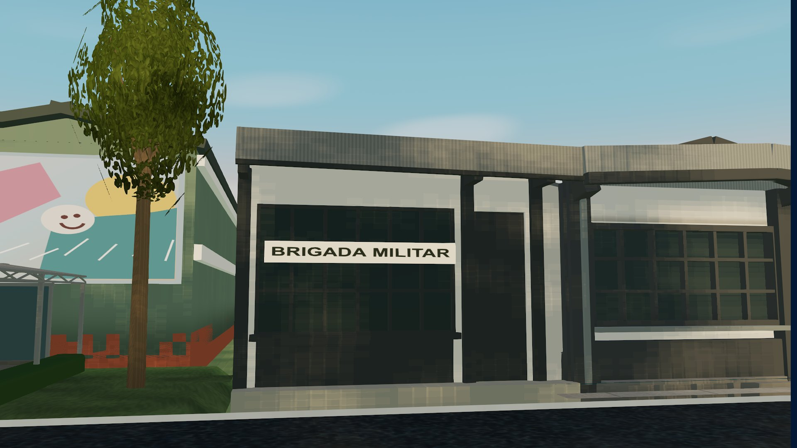 |
| Acesso B11, Centro Administrativo | 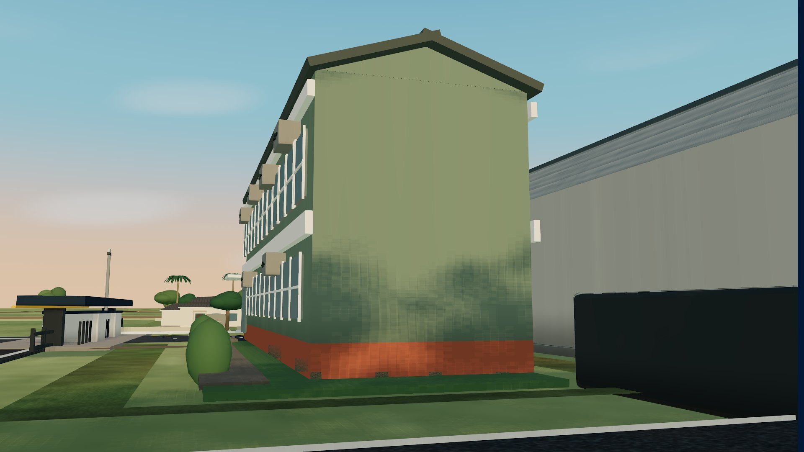 | 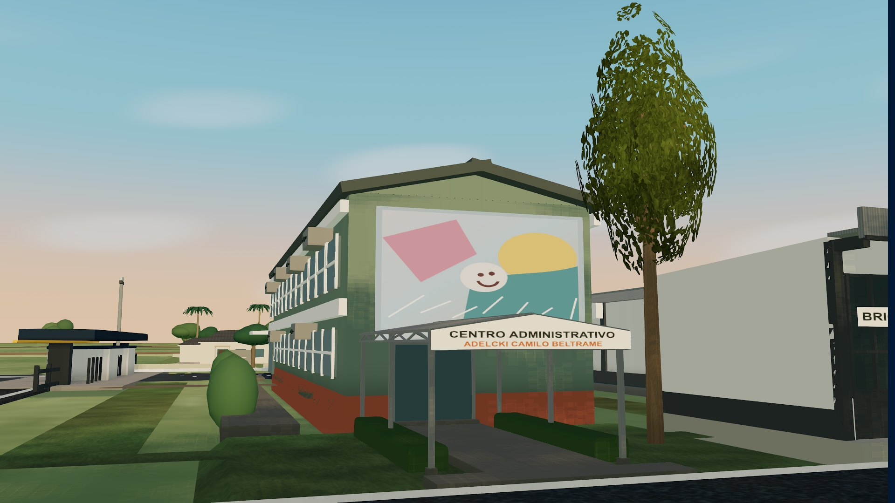 |
| Celular, conjunto | 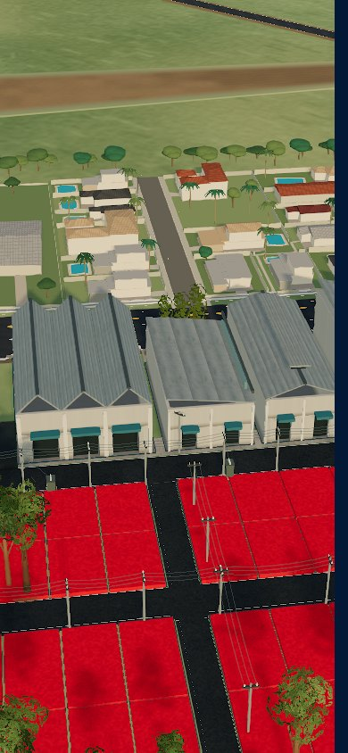 | 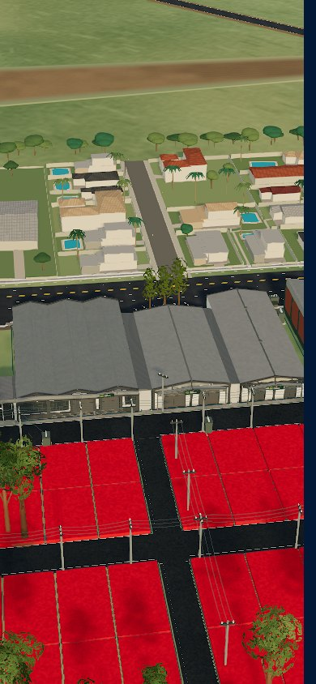 |

Os diretórios before/after contêm também frentes, laterais de P1/P12, marquises, noite, chuva, qualidade reduzida, seleção e interiores dos cinco pavilhões.

Os cenários adicionais podem ser reproduzidos com `QA_MODE=annex` (B19) e `QA_MODE=admin` (B11). Eles produzem três capturas próprias e não alteram as câmeras dos cinco pavilhões. O script `annex-interactions.cjs` verifica por mouse que o corpo e a frente da ala continuam selecionando B19, sem entrar em B6.

## Resultados finais de QA

O resumo agregado está em [performance-summary.json](performance-summary.json), com os dados brutos de [antes](before/metrics.json) e [depois](after/metrics.json). As medições usam Chrome headless, ANGLE Metal/Apple M5, desktop 1920×1080, DPR 1 e três execuções independentes por condição de cache. O cenário inclui os cinco pavilhões, a ala B19 e o acesso B11; Vendas fica desligado e árvores ligadas durante a comparação de desempenho.

| Mediana | Antes | Depois |
|---|---:|---:|
| Prontidão, cache de navegador frio | 3.495 ms | 3.695 ms (+5,72%) |
| Prontidão, cache quente | 3.326 ms | 3.393 ms (+2,01%) |
| Intervalo de frame durante percurso, frio | 16,667 ms | 16,666 ms |
| p95 de frame, frio | 17,2 ms | 17,2 ms |
| p95 de frame, quente | 17,4 ms | 16,8 ms |
| Chamadas observadas no frame do mapa completo | 430 | 459 |
| Geometrias/texturas/programas do renderer | 598 / 138 / 245 | 619 / 141 / 261 |
| Bytes transferidos observados, frio | 34.320.623 | 34.709.733 |
| Bytes transferidos observados, quente | 146.400 | 152.700 |
| Heap JS observado, frio | 179,54 MB | 198,88 MB |
| Heap JS observado, quente | 308,26 MB | 291,89 MB |

A abertura fria aumentou 200 ms e ultrapassou ligeiramente a referência inicial de cerca de 5%. A investigação dos marcos registrados encontrou aumentos medianos na montagem crítica (+27,4 ms), compilação (+50,3 ms), upload de texturas (+42,1 ms) e preparação anterior à cena (+29,8 ms). São fases agregadas, sem atribuição exclusiva por edifício. O custo do escopo final fica explícito para revisão; a navegação permaneceu estável e o DPR não foi reduzido para compensá-lo. A condição quente teve aumento de 67 ms.

O buffer de Resource Timing foi ampliado para 5.000 entradas antes das navegações; o baseline registrou 591 recursos, evitando a truncagem padrão em 250. Os bytes representam o servidor Vite de desenvolvimento, incluindo módulos não minificados e headers de cache, e não o tamanho de uma publicação de produção. Os contextos de navegador eram novos no cache frio; servidor e sistema operacional já estavam aquecidos. O heap é uma observação sujeita a GC, não uma leitura de VRAM nem uma atribuição exclusiva aos modelos. Camadas opcionais diferidas explicam variações nas contagens globais entre execuções; a auditoria seguinte isola os proprietários arquitetônicos.

### Orçamento de desenho e recursos

A [auditoria anterior](before/draw-audit.json) e a [final](after/draw-audit.json) usam o mesmo enquadramento e um único render no contexto existente, com atualização de sombras forçada. Os callbacks de cor e sombra são contados separadamente e restaurados após a coleta.

| Proprietários auditados | Cor antes | Cor depois | Variação |
|---|---:|---:|---:|
| Cinco pavilhões, juntas 3–13–8 e borda do canteiro P1 | 48 | 63 | +15 |
| B19, incluindo sua união com P3 | 1 | 7 | +6 |
| B11, incluindo acesso e árvore | 12 | 21 | +9 |
| Total dos sete escopos | 61 | 91 | +30 |
| Passes de sombra dos sete escopos | 42 | 42 | 0 |

O acréscimo dos cinco exteriores ficou abaixo da meta inicial de aproximadamente 50 chamadas de cor. Na aproximação de P12, as chamadas de cor dos cinco pavilhões caíram de 50 para 45; os passes de sombra do conjunto auditado caíram de 58 para 42 ([antes](before/draw-audit-B3.json), [depois](after/draw-audit-B3.json)). Peças repetidas são instanciadas ou mescladas por material; não há um objeto de cena por tijolo, telha ou diagonal.

Nos sete escopos, a auditoria encontrou 33→55 geometrias, 46→80 materiais e 10→13 texturas. Os buffers de geometria/instâncias somam 44.462→345.664 bytes. A estimativa dos mapas em RGBA com mipmaps é 3,50→6,90 MB; essa conta não inclui buffers de render, sombras ou memória privada do driver. As novas superfícies e placas são procedurais e pequenas, sem texturas 4K individuais.

### Estabilidade, seleção e modos

O [lifecycle](after/lifecycle.json) realizou sete rodadas pelos cinco pavilhões, totalizando 35 entradas/retornos. Todas as sete amostras mantiveram **631 geometrias, 141 texturas e 286 programas**, sem crescimento contínuo. A contagem maior que a abertura inicial inclui os interiores aquecidos. O fechamento de módulos conservou a cena interna.

As provas de interação usam o renderer e os componentes de ficha existentes, com dados de referência locais e sem escritas no backend:

- [Cinco cliques reais em módulos e fechamento da ficha](after/interactions.json), pelo [script de interação](../../../scripts/pavilion-architecture/interactions.cjs): cada pavilhão conserva seu `interiorEntityId` ao fechar o módulo.
- [Dois cliques na ala B19](after/annex-interactions.json), pelo [script B19](../../../scripts/pavilion-architecture/annex-interactions.cjs): corpo e frente selecionam B19, sem entrar em B6.
- [Cliques no letreiro e cobertura externos de B11](after/admin-interactions.json), pelo [script B11](../../../scripts/pavilion-architecture/admin-interactions.cjs): selecionam B11; arrasto de 28×12 px não seleciona. O envelope invisível de picking não acrescenta desenho à arquitetura.
- [Placas dos cinco pavilhões](sign-review/visual.json), [B19](after/visual-annex.json) e [B11](after/visual-admin.json): 21 poses e 105 raios ao centro/cantos, sem oclusão pela própria estrutura. Árvores e postes externos permanecem no lugar; no frontão B11, os pontos cobrem a faixa retangular do letreiro.
- [Gates de Vendas e árvores](after/visibility-gates.json), pelo [script de estados](../../../scripts/pavilion-architecture/gates.cjs): arquitetura e as três uniões permanecem visíveis em Vendas; a árvore B11 some em Vendas ou com árvores desligadas, e reaparece ao restaurar o modo. Seus recursos permanecem montados; a política pública de vegetação é preservada. As correções de gates não alteram o cenário padrão usado nos benchmarks.

Há 48 capturas padrão por versão (42 dos cinco pavilhões e seis de B19/B11), além das provas de placas, interações e modos. As 43 poses externas/corte coincidem exatamente; as cinco internas usam o CameraRig existente. A [verificação de código](validation-results.md) e a [comparação da suíte](test-summary.json) registram typecheck/build e distinguem as falhas antigas dos testes adicionados.

Para reproduzir as provas adicionais, execute os scripts acima com `QA_BASE`, `QA_OUTPUT` e `PLAYWRIGHT_MODULE` configurados como no método. `QA_MODE=signs`, `QA_MODE=lifecycle`, `QA_MODE=annex` e `QA_MODE=admin` usam o [capturador](../../../scripts/pavilion-architecture/capture.cjs); a auditoria usa [audit.cjs](../../../scripts/pavilion-architecture/audit.cjs), e [report.cjs](../../../scripts/pavilion-architecture/report.cjs) agrega os JSON já salvos.

## Limitações e entrega

As alturas, os detalhes encobertos, as águas não fotografadas e a seção exata das passagens não constituem levantamento oficial. Soluções conservadoras estão registradas nos perfis e neste documento. A aprovação visual não implica homologação dimensional ou de acessibilidade da edificação real. Os testes de viewport de notebook/celular usam a mesma máquina Apple M5; não comprovam desempenho em hardware modesto. A medição de desenvolvimento também não inclui latência de uma consulta comercial real nem uma publicação de produção.

Implementação local, PR, eventual migração e publicação são estados separados. Este trabalho não altera a produção automaticamente.
