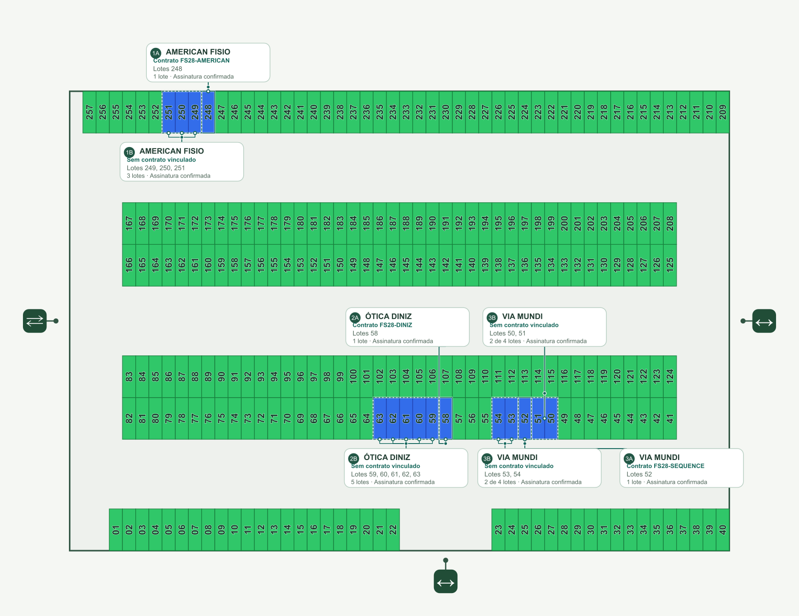
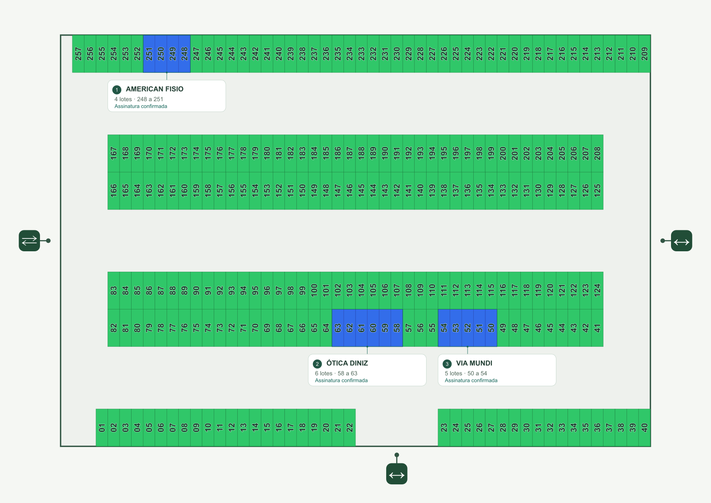
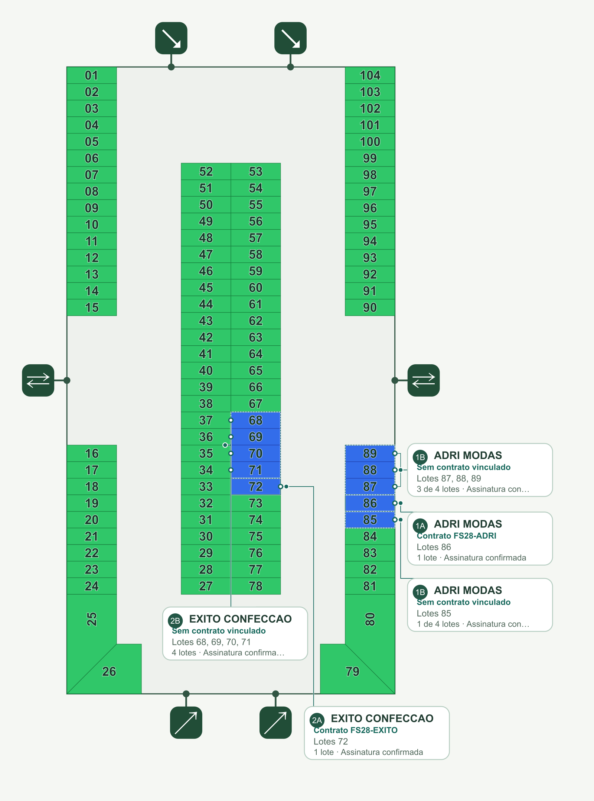
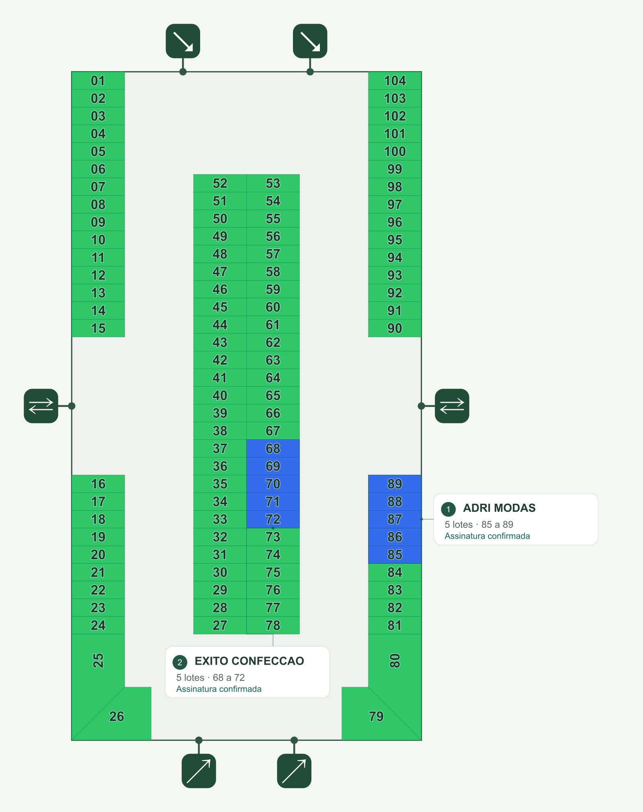

# Agrupamento empresarial canônico — FenaSoja 2028

Implementação de 20/10/2026, base `39f1b825457b476eb61808a95f93b1dc299736a1`. A prévia isolada está em `/scripts/dashboard/occupancy-qa.html`. Seus registros comerciais são fictícios, sobre polígonos oficiais dos fixtures. Nenhuma venda, assinatura, preço, geometria ou documento de produção foi alterado.

## Causas comprovadas

1. **Contrato confundido com empresa.** `buildOccupancyVisualScopes()` dividia uma empresa entre cada contrato e o saldo do pedido sem documento. No caso real da Ótica Diniz, um contrato tinha abrangência explícita somente sobre 58; o mesmo pedido/expositor continha também 59–63. Isso gerava os cards 8A e 8B sem que houvesse duas empresas ou duas vendas.
2. **Componente geométrico confundido com empresa.** `buildPavilionAnnotationLayout()` percorria cada polígono da união e criava outra anotação completa. Os saldos de American Fisio e Adri Modas tinham regiões separadas, gerando mais um clone do card. A separação contratual retirava uma célula intermediária do perímetro, agravando a desconexão.
3. **Seleção parcial.** `companyEntityIds` usava `selectedScope.items` no lugar de `selected.items`. Escolher o contrato atenuava os demais lotes da mesma empresa. Os filtros de status também truncavam `group.items`, produzindo resumos parciais.
4. **Peso gráfico multiplicado.** Havia halo branco e traço colorido para cada contorno e conexão, além de ramificações/nós para cada célula e bordas cadastrais selecionadas de 3,5 px.
5. **Atualização entre sessões incompleta.** `commercial_map_revision` fazia `JOIN commercial_lots ON c.lot_id`; contratos `ORDER_ITEMS` têm `lot_id` nulo. Sua anexação, alteração ou cancelamento por outra sessão não mudava a assinatura; alterações de `lot_contract_lots` também não eram observadas. O teste PostgreSQL reproduz a revisão antiga inalterada depois de anexar um documento de pedido e comprova a correção.

## Conferência autenticada somente em leitura

A sessão Chrome Leo permitiu conferir as chaves `data-exhibitor-group`, `data-contract-scope` e o painel comercial da versão publicada, antes de alterar qualquer registro. Os IDs reais foram comparados e seus hashes foram registrados em [authenticated-observations.json](authenticated-observations.json); credenciais, contatos, arquivos privados e IDs de produção não foram publicados.

| Empresa | Ocupação encontrada | Documento explícito encontrado | Fragmentação anterior |
| --- | --- | --- | --- |
| OTICA DINIZ | P12, 58–63, seis lotes no mesmo expositor/pedido | Um documento ligado a 58 | Dois cards |
| AMERICAN FISIO | P12, **247–251**, cinco lotes no mesmo expositor/pedido | Um documento ligado a 248 | Três cards; o saldo 247 era outra região |
| ADRI MODAS | P13, 85–89, cinco lotes no mesmo expositor/pedido | Um documento ligado a 86 | Três cards; o saldo 85 era outra região |
| VIA MUNDI | P13, **49–56**, oito lotes no mesmo expositor/pedido | Um documento ligado a 54 | Dois cards; o resumo ainda abreviava a sequência |

Os testes reproduzem tanto os subconjuntos solicitados (248–251 e 50–54) quanto as ocupações adicionais efetivamente observadas. Eles não excluem 247, 49, 55 ou 56 para fazer o resultado coincidir artificialmente com o enunciado.

## Modelo e interação

- A fonte continua sendo a RPC autorizada `commercial_pavilion_occupancy`; o seletor puro resolve expositor → pedidos/vendas → documentos → itens. Sem `exhibitorId`, conserva a chave do pedido/venda e informa identidade não verificada. Homônimos não se unem.
- Lotes, contratos e vínculos repetidos são deduplicados por IDs persistidos, em ordem determinística. Vendas conflitantes ficam em conferência. Mais de um documento explícito não torna uma empresa inválida. Um documento atribuído a pedidos distintos é deduplicado no escopo de inspeção e sinalizado como conflito de abrangência, sem escolher um pedido artificialmente.
- Mudanças de nome de um expositor identificado preservam a chave e os estados assinados dos itens; usa-se o nome persistido mais recente e a divergência histórica fica explícita. Um nome não cria nem transfere identidade.
- Há **uma anotação principal por empresa**, com todos os lotes. A união dos polígonos produz um ou vários contornos físicos subordinados. Não há inferência comercial por proximidade ou sequência numérica.
- Contornos de 1 px (1,6 px selecionados), líderes de 0,85–1,1 px, sem halo branco nem ramificação por célula. Uma ligação por componente chega à borda externa. Rotas evitam retângulos ocupados, etiquetas, acessos e cruzamentos; linhas distantes são substituídas por pequenos marcadores compartilhando a identidade.
- A seleção empresarial identifica a ocupação inteira. A seleção contratual mantém todos os seus lotes e aplica traço secundário ao subconjunto persistido. O painel conserva cada número/ID de documento e sua abrangência. Clique em lote resolve a empresa inteira e abre seus detalhes.
- O filtro comercial encontra empresas com lotes naquela situação, sem cortar a ocupação empresarial. Seleções inválidas são limpas após remoção de contrato, perda de acesso ou troca de pavilhão.
- A densidade mantém até oito cards simultâneos; os demais expositores continuam na lista, com contornos e marcadores quando houver espaço. Escolher um expositor promove sua etiqueta única. Não são oito empresas no modelo: é um orçamento visual, preservado para plantas densas.
- A projeção cadastral existente e o cache da união são independentes de hover e seleção contratual; layouts e rotas são reutilizados. A cena 3D não foi alterada.

## Sincronização e migração mínima

`usePavilionOccupancy` conserva uma consulta consolidada, validação contra o inventário e invalidação pelo prefixo existente `commercial-sale-orders`. Os testes cobrem anexação/remoção de documento sem mudança de inventário, coerência durante atualização e perda de permissão.

A nova migração `20261020110000_commercial_revision_order_contracts.sql` (espelhada em Drizzle 0024) altera **somente a função de assinatura de leitura**. Acrescenta contratos do pedido por projeto e a assinatura exata de seus vínculos de lotes; preserva todos os outros componentes da revisão e as permissões. Não cria grupos persistentes, tabelas, políticas, gatilhos ou novos temporizadores. Não foi aplicada em produção nesta execução. Deve ser aplicada pelo fluxo normal de migrações para que mudanças documentais entre sessões sejam detectadas no ciclo já existente de revisão (60 s com a página visível).

## Evidências visuais

Os PNGs abaixo são **renderizações dos SVGs reais montados pelos componentes React em jsdom**, usando os mesmos dados antes/depois. Não são screenshots de navegador nem validam sozinhos layout CSS, responsividade ou enquadramento em tela cheia. O script confere também a igualdade exata dos caminhos, IDs, status e preenchimentos dos 257/104 lotes.

| Pavilhão | Antes | Depois |
| --- | --- | --- |
| 12 |  |  |
| 13 |  |  |

- [Ótica Diniz: seis lotes; um contrato em inspeção secundária](pavilion-12-otica-diniz-contract.png).
- [Adri Modas: cinco lotes; uma identificação principal](pavilion-13-adri-modas-contract.png).
- [Relatório SVG](svg-report.json): P12 7 → 3 cards; P13 5 → 2 cards, sem alteração cadastral ou de preenchimentos.
- [PDF vetorial P12](pavilion-12-reported.pdf) e [PDF vetorial P13](pavilion-13-reported.pdf), com referências jurídicas individuais na página seguinte. [Relatório PDF](pdf-report.json) verifica números, documentos, preenchimentos, posições e ausência de imagens raster dentro dos documentos.
- [Snapshot P12](pavilion-12-canonical.json) e [snapshot P13](pavilion-13-canonical.json): relações comerciais sintéticas exatas usadas nas exportações.

## Testes e resultados

- **45 testes focados aprovados**: `pavilionOccupancy`, `pavilionOccupancyInteraction`, `pavilionPdf`, `usePavilionOccupancy`, `commercialPavilionGroupingMigration`. Conferem os conjuntos exatos, documentos distintos, homônimos, desconexões, estados mistos, nomes atualizados, novos pedidos, transferência, retirada/cancelamento, documento removido, filtros e seleção.
- Tela cheia: testes React comprovam um único SVG, persistência de empresa/subconjunto contratual e zoom 150%, fechamento acessível e restauração de foco. Validação visual final em navegador continua pendente (ver limite abaixo).
- PostgreSQL WASM: corpos SQL reais de checkout, confirmação, cancelamento e consultas, com autenticação/esquema/preços sintéticos. Um segundo pedido recompõe uma empresa com quatro IDs exatos e dois documentos; cancelamento retira apenas o item pendente e não apaga o histórico; permissões, projetos e contratos conflitantes são verificados. [Relatório SQL](database-report.json).
- Desempenho: 257 lotes/68 grupos; uma união por grupo; 50 consultas de layout já calculado sem repetir união ou roteamento. O caso medido passa os limites de 2 s para composição inicial e 100 ms para 50 reaproveitamentos. Não é benchmark de produção nem substitui avaliação de gestos no navegador.
- `typecheck`, build de produção e ESLint dos arquivos alterados passaram; avisos de bundle grande e Browserslist são preexistentes.
- Suíte completa: **3.771 aprovados e 89 falhas** na execução final da implementação; a base intacta apresentou **3.747 aprovados e as mesmas 89 falhas**, com os mesmos nomes, sem nova falha. Os 45 testes focados também estão aprovados e incluídos nessa execução final. [Comparação completa](regression-report.json).

## Limites e condição de revisão

A inspeção autenticada dos vínculos reais foi concluída em leitura. A alteração ainda não foi implantada, e as RPCs de escrita foram exercitadas exclusivamente no PostgreSQL isolado.

Após a conferência autenticada e as primeiras capturas, o acesso de automação retornou `Local browser use is disabled in Work settings`, inclusive após nova tentativa autorizada pelo usuário. Assim, **as capturas finais depois em navegador, o fluxo visual mobile e a medição de responsividade em navegador não foram concluídos**. Renderizações SVG e PDF são identificadas como tal; não substituem essa etapa. O relatório de design não declara aprovação final. A PR deve permanecer em rascunho até essa conferência.

## Arquivos principais alterados

- `pavilionOccupancy.ts`: identidade, deduplicação, escopos de inspeção e seleção pura.
- `pavilionAnnotationLayout.ts`: anotação por empresa, múltiplos contornos, rotas e cache.
- `PavilionAnnotations.tsx` / `pavilion-occupancy.css`: card único, tipografia e traços leves.
- `CommercialDashboardPavilion.tsx` / `CommercialMiniMap.tsx`: seleção completa/secundária, filtros e estados obsoletos.
- `pavilionPdf.ts`: mesmo modelo empresarial e abrangência documental individual.
- Migração Supabase/Drizzle da revisão de contratos; testes, fixtures e scripts de comprovação.

`commercialDashboardGeometry.ts`, `usePavilionOccupancy.ts`, a RPC de ocupação, a cena 3D e as regras financeiras/comerciais foram inspecionados e preservados. A projeção existente é reutilizada.

## Reprodução

Com as dependências existentes: `npm run typecheck`, `npm run build`, `npm test`. Foco: `npx vitest run src/test/pavilionOccupancy.test.ts src/test/pavilionOccupancyInteraction.test.tsx src/test/pavilionPdf.test.ts src/test/usePavilionOccupancy.test.tsx src/test/commercialPavilionGroupingMigration.test.ts`.

- `PAVILION_PDF_EVIDENCE=1 npx vitest run src/test/pavilionPdf.test.ts -t 'same canonical'` gera os dois snapshots/PDFs principais.
- `PGLITE_MODULE=/caminho/para/@electric-sql/pglite/dist/index.js node scripts/dashboard/occupancy-db-qa.mjs` executa a prova SQL (dependência de QA externa; não altera o lockfile).
- `PAVILION_SVG_EVIDENCE=1 npx vitest run src/test/pavilionOccupancyInteraction.test.tsx -t 'selects the exact complete'` salva o SVG real. Para comparar a base, usar checkout/arquivo de `39f1b825` com o fixture e o emissor de evidências atuais, salvando em `baseline-svg/`; os testes de seleção novos falham na base, como esperado. `SHARP_MODULE=/caminho/para/sharp/dist/index.mjs node scripts/dashboard/occupancy-svg-qa.mjs` compara caminhos e renderiza antes/depois.
- `python scripts/dashboard/occupancy-grouping-pdf-qa.py` verifica e renderiza os PDFs com `pypdf` e `pypdfium2`.
