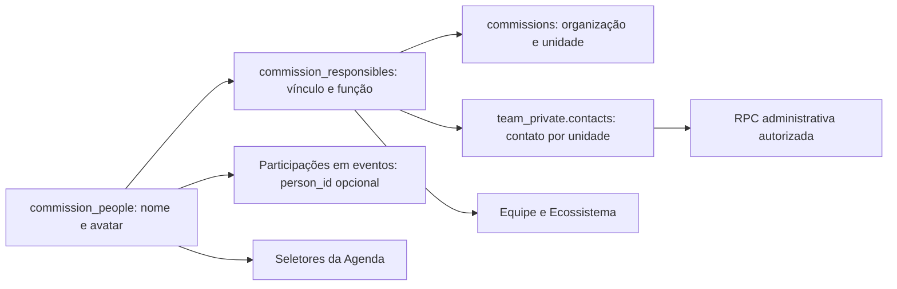

# Cadastro institucional de voluntários

O menu **Equipe** cadastra uma pessoa uma vez e compartilha seu nome/avatar com a equipe, o Ecossistema autenticado e os seletores da Agenda Fenasoja. A pessoa não precisa de conta. Contatos são carregados separadamente, somente após autorização do servidor.

## Ambiente, cobertura e entrega

- Repositório: `leomateus620-pixel/expo-logistics-hub`; auditoria inicial no commit `19d54148`.
- Lovable: projeto `756eeb64-0d44-4171-b445-f8a60f0492c0` (Fenasoja Log), conector da conta Fenasoja.
- Supabase: `btfaumhroqtqzxomqorx`; organização `985888b8-155f-4bbe-b6b9-6bef2893d99b`.
- **Preview e produção compartilham esse banco.** Nenhum outro projeto foi usado como substituto. O frontend é entregue por PR; não foi publicado nem mesclado automaticamente.
- [Matriz de cobertura completa](COVERAGE.md): 38 unidades ativas auditadas, das quais 37 são comissões/assessorias. CCPF continua conselho. Fotografia inativa e Limpeza aposentada não foram reativadas.
- [Aplicação Lovable e hashes das fontes](evidence/lovable-application.json), [mapa dos IDs preservados](evidence/identity-map.json), [autorização no banco conectado](evidence/live-authorization.json).

## Auditoria e decisões de experiência

Aplicado o fluxo **Product Design / audit**, com captura da tela anterior e revisão do resultado renderizado. A lista anterior do workspace separava os integrantes, mas não oferecia cadastro. Logística tinha operação própria; os outros módulos existentes apresentavam cadastros operacionais, placeholders ou navegação de mapa. Esses cadastros não foram tratados como equipe de apoio.

O layout usa os componentes e tokens existentes: conteúdo limitado a 1120 px, responsáveis separados dos voluntários, cards com avatar e função, busca por nome, paginação progressiva de 24 integrantes e contato em seção administrativa discreta. Não há métricas adicionais nem seleção de papel privilegiado.

O modal contém foto, nome e e-mail, com unidade bloqueada pelo contexto e validada novamente no servidor. Tem validação junto ao campo, foco no erro, confirmação de descarte, bloqueio de envio repetido, manutenção dos dados após erro e **Salvar e adicionar outro**. A área rolável e o rodapé acompanham `visualViewport` para manter ações acessíveis quando a área útil diminui.

Evidências visuais, todas com dados sintéticos e componentes reais:

| Estado | Evidência |
|---|---|
| Antes | [Equipe anterior](evidence/01-team-before.jpg) |
| Página e formulário desktop | [Equipe](evidence/02-team-desktop.jpg), [modal](evidence/03-form-desktop.jpg) |
| Mobile 390 × 844 | [Formulário](evidence/04-form-mobile.jpg), [erros](evidence/05-mobile-errors.jpg) |
| Área útil reduzida 390 × 440 | [Cabeçalho, conteúdo rolável e ações](evidence/06-mobile-reduced-viewport.jpg) |
| Foto e cadastro confirmado | [Recorte](evidence/07-photo-crop-mobile.jpg), [integrante salvo](evidence/08-saved-mobile.jpg) |
| Falha recuperável | [Dados preservados](evidence/09-network-error.jpg) |
| Fluxo autenticado no backend conectado | [Equipe após recarregar](evidence/10-live-team.jpg), [agenda interna](evidence/11-live-unit-agenda.jpg), [seletor da Agenda Fenasoja](evidence/12-live-agenda-selector.jpg), [Ecossistema](evidence/13-live-ecosystem.jpg) |

A revisão usou Chrome com viewport desktop/mobile e seletor nativo de arquivo. O teclado foi **simulado por redução da área útil**, não testado em aparelho físico. Câmera física, leitores de tela e Safari/iOS real permanecem verificações de dispositivo; não são apresentados como executados.

As imagens 10–13 registram um cadastro real pelo frontend local no backend conectado, com organização/conta sintéticas isoladas. A pessoa sem conta apareceu com o mesmo avatar nas quatro telas. A revisão detectou e corrigiu o rótulo legado do Ecossistema que tratava todos os integrantes como responsáveis: agora o detalhe separa liderança e apoio, o nó destaca a liderança quando existente e informa a quantidade de voluntários. Sem liderança, o título permanece o da unidade. Nenhum formulário de evento foi enviado e nenhum convite foi disparado. Ao abrir a Agenda, o mecanismo preexistente de seed criou automaticamente 27 eventos padrão na organização sintética; esses registros também foram removidos na limpeza, sem alterar a organização real.

## Rotas e integrações

- `/equipes`: diretório das comissões e assessorias ativas **do banco**, incluindo unidades fora dos cards institucionais. Admins também encontram solicitações de acesso e reconciliação.
- `/comissoes/:moduleSlug/equipe`: rota exata antes das rotas genéricas de módulo; não passa pelo redirecionamento para o mapa. Aliases resolvem para o mesmo ID persistido.
- `/comissoes/logistica/equipe`: aba Voluntários e aba **Escalas e operação**, mantendo o `TeamPage` existente e seu controle de acesso.
- Exporural, ICS, Automóvel, módulos com placeholders e assessorias usam a mesma gestão de voluntários. O workspace mantém seus menus de Agenda, Documentos e Tarefas.
- `/cronograma-eventos` é o menu atual **Agenda Fenasoja**, confirmado pelas rotas/navegação; `FenasojaEventsPage` é uma tela distinta.
- O seletor relacional compartilhado atende criação/edição desktop e mobile. O primeiro integrante pode ser responsável e os demais convidados. A agenda interna recebe os mesmos IDs via `event-draft`/`cronograma_unit_agenda`.
- Convidados textuais antigos e a lista textual operacional de subeventos continuam preservados. Não há associação automática por nome. Novas escolhas no seletor institucional usam `person_id`.

Arquivos centrais: `src/features/volunteers/*`, `CommissionVolunteerTeamPage`, `TeamsDirectoryPage`, `useOrgCommissions`, `useCommissionPeople`, `InstitutionalPeopleProvider`, adapters das agendas, `useCronogramaRelationOptions`, `PersonAvatar`, resolver do Ecossistema, `CommissionLayout`, `App`, `src/styles/volunteer-team.css` e tipos Supabase.

## Identidade, escopos e compatibilidade



`commission_responsibles.id` não mudou. As 64 ligações legadas resultaram em 60 identidades: somente vínculos já confirmados com o **mesmo `user_id` e organização** foram consolidados. Homônimos sem conta permanecem pessoas diferentes. [identity-map.json](evidence/identity-map.json) registra cada correspondência.

O nome canônico vive em `commission_people`; a coluna antiga é espelhada para leitores compatíveis. Inserções legadas feitas por backend confiável recebem uma identidade pelo trigger de compatibilidade. Escritas diretas do navegador e a RPC de reseed institucional irrestrita foram revogadas. O antigo `sync_official_units_2028` não deve voltar a ser chamado: seu índice por nome foi substituído por vínculo pessoa/unidade.

Eventos/subeventos ganharam FK composta `(person_id, org_id)` opcional. IDs de participações e snapshots antigos foram preservados; backfill de eventos só usa `user_id` previamente verificado. Selecionar uma pessoa nova não escreve `org_member_user_id` e **não concede acesso a evento privado**. A inativação altera somente o vínculo; participações históricas e outras unidades permanecem.

A identidade institucional segue o escopo de organização já existente; não foi inventada coluna de edição numa tabela que não a tinha. Eventos conservam `source_year`, origem e filtros de ciclo existentes; logística conserva seu ciclo operacional. Nenhum evento 2026/2028 foi movido, clonado ou recategorizado.

## Privacidade e autorização

| Perfil | Nome/avatar | Cadastro/edição/inativação | Contato do fluxo |
|---|---|---|---|
| Admin ativo da organização | Escopo institucional da organização | Unidades ativas da organização | Sim, nesse escopo |
| Principal/corresponsável/copresidente formal ativo | Escopo institucional permitido | Somente unidade atribuída | Somente daquela unidade |
| Voluntário, usuário comum ou responsável de outra unidade | Conforme acesso institucional | Não naquela unidade | Não |
| Visitante | Somente projeção pública preexistente | Não | Não |

- `team_manageable_commission_ids` valida `auth.uid()`, associação ativa à organização e atribuição ativa; módulo, slug, foto, nome, e-mail digitado e `created_by` não autorizam.
- O schema `team_private` não é exposto pela API, não concede `USAGE`/leitura aos papéis do navegador e usa RLS sem políticas públicas. Não há e-mail em `commission_people`, joins do diretório, JSON das agendas, Ecossistema, canais realtime ou logs de auditoria.
- Funções `SECURITY DEFINER` têm `search_path=''`, autorização explícita e execução mínima. Commit/limpeza de avatar são exclusivos do serviço; a edge function confirma a sessão em `auth.getUser()` antes de agir.
- RLS de leitura usa conjuntos calculados, seguindo a regra do repositório. FK por organização, unicidade pessoa/unidade, email normalizado por unidade e índices impedem vínculos inconsistentes.
- Consultas privadas usam `meta.persist=false`, `gcTime=0`, chaves por organização/usuário/unidade, descarte ao sair/trocar escopo e falha fechada. A perda de atribuição apaga contato e fecha a edição. O service worker já ignora Supabase; o fluxo não envia contato a analytics.
- Alterações públicas usam realtime em `commission_people`/`commission_responsibles`. Contatos privados não são publicados. Invalidação das keys reais e refetch de 30 s/foco cobrem sessões sem realtime e alterações privadas autorizadas.
- Diretório lê páginas de 1000 por tabela e assina miniaturas em lotes de 100, sem chamada por integrante. URLs temporárias não são persistidas; listas permanecem utilizáveis se o storage falhar.

## Duplicidades, concorrência e acesso

Pessoa, contato e vínculo são salvos em transação. UUID de envio + hash do payload + advisory lock impedem duplicação em retry/clique concorrente; versão otimista rejeita edição desatualizada. Normalização usa apenas `lower(trim(email))`, sem remover pontos ou `+tags`.

Duplicidade na unidade orienta edição do registro existente. Correspondências externas retornam mensagem genérica e uma solicitação privada à administração, sem entregar nome, ID ou contato da outra unidade. O admin confirma explicitamente a pessoa ou declara identidades distintas. Uma pessoa em várias equipes tem nome/foto globais editáveis somente pelo admin; responsáveis locais alteram apenas o contato de sua unidade. Inativados podem ser reconciliados/reativados administrativamente.

**Convidar para acessar** é uma solicitação rastreável, separada do cadastro e do convite ao evento. O provisionamento já existente é reservado à administração; essa governança foi mantida. A fila administrativa tem estados solicitado/em atendimento/concluído/não aprovado, controle de versão e reenvio limitado a 24 h. Nenhuma RPC deste fluxo cria conta, muda senha, altera e-mail de autenticação ou concede perfil. Marcar a solicitação concluída registra atendimento; não constitui, por si só, provisionamento. Vincular conta existente exige o fluxo administrativo de confirmação de identidade, nunca comparação automática com o contato digitado.

## Fotos e compensação

Galeria/arquivo e `capture=user` quando suportado; prévia imediata, círculo sobre recorte quadrado, arraste e controles de posição/zoom acessíveis por teclado. O navegador orienta a prévia; o servidor repete a correção EXIF antes de recortar. HEIC/HEIF recebe instrução de conversão explícita.

`team-avatar` valida bytes reais de JPEG/PNG/WebP, até 8 MB, 12 MP, 6000 px por lado e mínimo 64 px. Bloqueia containers animados, limita memória/tempo/perfis do decoder, remove metadados e gera WebP 256 × 256. Não há base64 no banco nem original persistido. O recorte enviado é `{x,y,size}` em pixels após orientação.

Bucket `team-avatars` privado; somente miniaturas atuais recebem URLs temporárias para membros autorizados da organização. Chave `org/unidade/pessoa/request.webp`, sem nome/e-mail/nome original; cada alteração muda a versão/cache. Prioridade: foto persistida, retrato legado apenas para identidade migrada, iniciais. Remover foto desativa também o fallback legado daquela identidade.

Cadastro, upload e solicitação de acesso são operações separadas. A foto antiga só é removida depois do novo commit. Falha externa mantém a pessoa e permite retry com o mesmo identificador. Reserva de objeto órfão é coletada após 24 h, em lotes de até 30 nas próximas operações; não existe job periódico adicional. Se não houver novas operações, a limpeza aguarda a próxima chamada. Falha de limpeza não transforma um cadastro confirmado em erro.

## Migrações e Soja Store

Aplicadas via **Lovable `query_database`**, mecanismo efetivamente disponível, em transação única com advisory lock, timeout curto de locks, pré-condição de organização e asserts de preservação. SQL exato e SHA-256 constam em `supabase_migrations.schema_migrations`; replay com fonte diferente é recusado. Não foram editadas migrações antigas nem criado histórico Drizzle concorrente para estas versões.

1. `20261106090000_commission_volunteers.sql`: identidade, vínculo, contatos privados, autorização, transações, fila de acesso e storage.
2. `20261106091000_commission_people_agenda.sql`: referências relacionais da Agenda, validação e projeções públicas.
3. `20261106092000_team_reconciliation_cleanup.sql`: reconciliação administrativa, compensação, compatibilidade e realtime.
4. `20261106103000_team_conflict_response.sql`: resposta HTTP 409 para conflitos de versão. O teste hospedado detectou que `40001` provocava retries até timeout; o código foi substituído por `PT409`, conforme a [orientação oficial do Supabase](https://supabase.com/kb/troubleshooting/high-cpu-and-infinite-transaction-retries-when-using-custom-error-codes-in-rpc-functions). As três fontes anteriores permaneceram intactas.

Os triggers de aplicação são suspensos **somente durante o backfill**, na mesma transação, com restauração de cada modo original; FKs continuam ativas. Isso evita alterar timestamps ou enfileirar sincronizações/avisos por simples migração de identidade. Nove tabelas legadas tiveram contagem e checksum de todos os campos antigos idênticos, incluindo 329 eventos e 570 participações. Tipos do banco foram atualizados no repositório.

Soja Store: **9 integrantes, 8 de apoio, 7 sem conta**, 9 identidades preservadas. Os 8 retratos legados continuam em `personPhotos.ts`; nenhum arquivo foi substituído no backfill. Os 4 eventos associados e seus vínculos/históricos não mudaram. O botão Adicionar voluntário não depende de equipe vazia. Contatos ausentes continuam vazios e os registros legados podem ser complementados.

Rollback operacional: antes de receber novos cadastros, é possível reverter o frontend mantendo o schema aditivo. Depois de novas pessoas/eventos, não remover tabelas/IDs nem reintroduzir o índice por nome. Suspender ações de escrita e fazer correção incremental; não usar rollback destrutivo. As definições anteriores das projeções estão em [agenda-definitions-before.json](evidence/agenda-definitions-before.json).

## Reprodução dos checks

```sh
npm install
npm run typecheck
npm run build
npm test
npx vitest run src/features/volunteers src/features/alvorada/organizational

# PostgreSQL descartável, sem credenciais de produção:
npm install --prefix /tmp/fenasoja-tooling embedded-postgres
TEAM_PG_MODULE=/tmp/fenasoja-tooling/node_modules/embedded-postgres/dist/index.js node scripts/volunteers/database-qa.mjs

# Decoder real e tipos da edge function (Deno):
deno test --allow-read supabase/functions/team-avatar/image_test.ts
deno check supabase/functions/team-avatar/index.ts

# Revisão visual isolada, sem acesso ao backend:
npx vite --config scripts/volunteers/review.vite.config.ts
```

O fixture PostgreSQL representa as dependências legadas necessárias; não é um dump de produção. A evidência conectada complementa esses testes com RLS/privilégios reais. `live-authorization.sql` é específico do ambiente auditado e termina em `ROLLBACK`; não é uma migração. `migration-envelope.mjs` apenas produz o envelope para o conector, sem abrir conexão alternativa.

Resultados finais, limites e evidências de processamento hospedado: [TESTING.md](TESTING.md).
