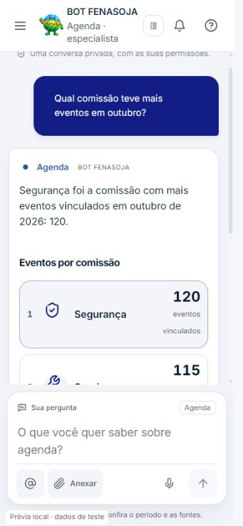
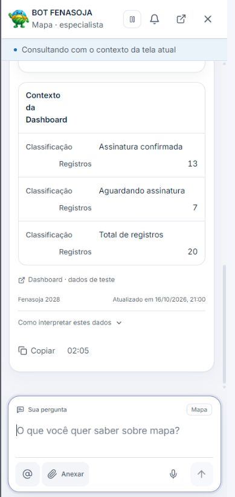

# Validação da correção do BOT FENASOJA

Data:17/10/2026. Ambiente Windows, worktree isolado da main1c18ea00; execução local, sem alterações em produção. Skill Product Design aplicada na leitura dos anexos, inspeção da interface existente e refinamento dos padrões já adotados. Não foi criada nova identidade visual.

## Verificações automatizadas finais

-366 testes pertinentes aprovados, zero falhas: `scoped-tests.json`. Cobrem frontend/hook/SSE, identidades/contratos, período após erro, roteamento explícito, catálogo, registro Edge, autorização, ações e rotinas existentes.
-44 verificações PostgreSQL WASM aprovadas: Agenda19, filtros/agregações15, persistência10. Executam migrations reais contra fixtures sintéticas; a fixture de eventos não contém `responsible_user_id` e reproduz42703 antes da corretiva.
-`npm run typecheck`: aprovado (`typecheck.log`). Os erros encontrados nas fixtures novas e no tipo de esclarecimento foram corrigidos antes dessa execução final.
-`npm run build`: aprovado (`build.log`), com avisos existentes de tamanho de chunks/Browserslist. O build reescreve automaticamente o bundle MCP pelo plugin; esse efeito colateral foi restaurado e não faz parte da alteração.
-`deno check --config supabase/functions/workers-orchestrator/deno.json supabase/functions/workers-orchestrator/index.ts`: aprovado (`deno-check.log`).
-Lint pertinente: zero erros; sete avisos de Fast Refresh (`lint.log`).
-Registro Edge sincronizado por gerador, SHA256 `eec471a1babbd01dfbfce9a3cc74c2c8edfd10df902aaaa0c5383e07f329b55b`. Catálogo mantém50 referências Mapa e100 Agenda; documentação exportada atualizada.
-`git diff --check`: aprovado.

Os366 testes incluem regressão de deadline com RPC que nunca termina:55s encerram a tentativa, dados tardios não são persistidos/emitidos e limpeza tem seu próprio limite3s. Também distinguem erro de conexão de autenticação, credencial inválida e limitação temporária.

A suíte global fora do escopo não foi executada novamente; não há alegação de aprovação de todo o repositório nem atribuição automática de falhas globais à baseline.

## Revisão visual e interações

As capturas contêm somente dados sintéticos identificados. O navegador integrado apresentou indisponibilidade inicial, tendo sido usado Chrome como fallback; a validação final foi retomada no navegador integrado. Capturas em estados de erro de navegação ou recarregamento não foram aceitas como resultado. Os recortes medidos abaixo são valores CSS observados, não nomes de dispositivos.

| Passo | Fluxo | Estado observado / evidência |
| --- | --- | --- |
|1|Chat desktop e identidade atual|Visual preservado, com mascote/cabeçalho/compositor existentes. Baseline em01/02; são referências de sessão, com escala diferente das capturas finais, sem comparação pixel a pixel.|
|2|Ranking de pessoas|Nome/contagem/posição e fallback por iniciais, homônimos separados; [03-desktop-ranking.jpg](captures/03-desktop-ranking.jpg). A captura enquadra o início da lista, não o conjunto inteiro.|
|3|Ranking de comissões|Consulta específica e símbolos oficiais; [04-desktop-commissions.jpg](captures/04-desktop-commissions.jpg) e [05-mobile-commissions.jpg](captures/05-mobile-commissions.jpg). Recorte mobile observado342×740.|
|4|Falha técnica|Uma mensagem por tentativa, sem spinner residual nem repetição de RPC inválida; [06-mobile-query-error.jpg](captures/06-mobile-query-error.jpg).|
|5|Nova tentativa de conexão|Botão explícito cria novo requestId, rótulo “Nova tentativa”, pergunta antes da resposta e remove possibilidade da tentativa anterior após sucesso. Verificado na interface e nos testes do hook.|
|6|Menu lateral|Documento329px no viewport342px; painel264px, scrollWidth264px, sem overflow horizontal; body contido, `pan-y pinch-zoom`; fechar restaura foco no botão de navegação. [07-mobile-navigation.jpg](captures/07-mobile-navigation.jpg). Rolagem vertical permanece disponível.|
|7|Orientação horizontal|Recorte845×389, compositor visível e campo computado16px; [08-landscape.jpg](captures/08-landscape.jpg).|
|8|Copiloto nominal|Fabiano Souza consultado como identidade nominal, avatar/fallback e12 eventos sintéticos; [09-mobile-copilot-person.jpg](captures/09-mobile-copilot-person.jpg). Recorte medido389×845.|
|9|Foco após conversa longa|Reprodução local revelou workspace scrollTop281,58px e cabeçalho cortado, mesmo com visualViewport top0/scale1. [10-mobile-copilot-focus-before-fix.jpg](captures/10-mobile-copilot-focus-before-fix.jpg).|
|10|Foco corrigido|Contêineres externos usam `overflow:clip`, mensagens mantêm rolagem. Após repetir a conversa e focar, sheet/workspace/main scrollTop0, cabeçalho top0 e compositor até844,74px, sem branco residual. [11-mobile-copilot-focus-fixed.jpg](captures/11-mobile-copilot-focus-fixed.jpg), medições em[focus-geometry.json](captures/focus-geometry.json).|

O campo calculou16CSSpx e a escala permaneceu1 nos recortes observados. A política de ampliação manual não foi bloqueada. Os testes de viewport simulam abertura/fechamento, offsetTop e escala2 para ambos os proprietários; comprovam cálculo e limpeza de listeners, não teclado virtual real.

## Banco integrado e dados oficiais

[Preflight remoto](../live-readonly-preflight.json) confirmou a coluna ausente e relações oficiais, além de endpoint Edge ativo. Foram usados somente requests de leitura/projeções de zero linhas e sondagens sem dados comerciais. Não se obteve credencial de gestão para ler todas as definições/ACLs, histórico efetivo de migrations ou código/hash do Edge publicado. Esses itens permanecem pendentes antes da implantação.

A equivalência da Agenda foi testada com seleção direta dos mesmos vínculos/recorte na fixture. A equivalência comercial foi testada chamando a mesma API da Dashboard com seus filtros:124 registros/60PENDING/64SIGNED na fixture de referência; resposta destaca64 assinados. As capturas visuais usam outra massa explícita20/7/13 para evitar confundir aparência com homologação de dados reais. Nenhum desses números foi fixado no código de produção.

## Pendências efetivas

1. Operador com acesso ao schema/gestão comparar definições, grants e versão Edge publicados antes de aplicar somente050000/060000.
2. Aplicar corretivas e publicar backend/frontend compatíveis em janela autorizada; nada foi aplicado/publicado nesta sessão.
3. Homologação autenticada simultânea no BOT e Agenda/Dashboard, mesma organização/projeto/período/classificação. Revalidar124/60/64 ou comparar a mesma fonte se os dados tiverem mudado.
4. Safari/iPhone físico: teclado aberto/fechado, barra inferior, rotação, foco/zoom manual, swipe lateral, anexos e conversa longa. Não há aparelho físico conectado. Os anexos fornecidos pelo usuário são evidência do sintoma anterior, não prova de correção no aparelho.
5. Anexos e troca de especialista tiveram regressão automatizada; o cenário físico com teclado+anexo ainda precisa ser homologado. Não foi declarada acessibilidade integral por capturas.

Limitações de filtros e fontes sem suporte são explícitas em[README.md](README.md); não se substitui a métrica solicitada por outra.
